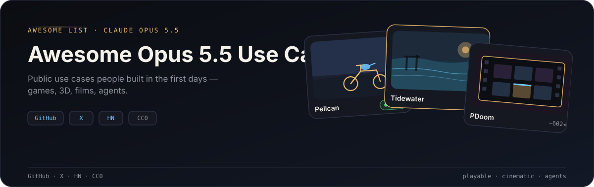

  

  
  
  

A curated gallery of **public Claude Opus 5.5 use cases** — playable games, interactive 3D, films, and agents — collected from GitHub, X, and Hacker News, including a dedicated [Videos (from X)](#videos-from-x) section credited to each creator.

*Claude Opus 5.5 公开用例精选：游戏、3D、影像与 Agent 作品合集。*

**Claude Opus 5.5** launched on **2026-09-22** as the first model in Anthropic’s Claude 5.5 family. Within days, builders shipped playable Three.js games, cinematic browser films, multi-agent harnesses, and same-prompt A/B benches. This list tracks the most interesting public use cases.

---

## Featured

Start here — strongest public use cases with live links where available.

- **[Pelican on a Bike](https://github.com/riba2534/claude-opus-5-5-demo)** — Viral Three.js pelican-on-a-bike game (~764★). **[▶ Live demo](https://claude-opus-5-5.riba2534.cn/)** · [HN](https://news.ycombinator.com/item?id=49812241)
- **[Rain on Glass](https://rain-on-glass-production.up.railway.app)** — Interactive foggy-window rain scene. **[▶ Live](https://rain-on-glass-production.up.railway.app)** · [X post](https://x.com/HixonStudio/status/2102511610518774178)
- **[Turbo Kart Rally](https://github.com/bridge-mind/turbo-kart-rally)** — Mario Kart–style arcade racer in Three.js with fully procedural assets
- **[Tidewater](https://github.com/dgreenheck/tidewater)** — Atmospheric coastal town scene built end-to-end with Opus 5.5 (~275★)
- **[PDoomVideo](https://github.com/JohnHeibel/PDoomVideo)** — Source for the *I’m Upping My P(doom)* music video (~602★)

---

## Contents

- [Featured](#featured)
- [Official / launch](#official--launch)
- [Interactive 3D & Games](#interactive-3d--games)
- [Creative coding / films / animation](#creative-coding--films--animation)
- [Agent / engineering demos](#agent--engineering-demos)
- [Collections & prompt lists](#collections--prompt-lists)
- [Benchmarks & analysis](#benchmarks--analysis)
- [Videos (from X)](#videos-from-x)
- [Notable X / HN showcases](#notable-x--hn-showcases)
- [Contributing](#contributing)
- [License](#license)

---

## Official / launch

- [Claude Opus 5.5 — Anthropic](https://www.anthropic.com/claude-opus-5-5) — Official product page for the first Claude 5.5-family model (launched 2026-09-22). [HN discussion](https://news.ycombinator.com/item?id=49803863)
- [Getting the most out of Opus 5.5](https://claude.dev/blog/getting-the-most-out-of-opus-5-5/) — Official tips on how to prompt and operate the model effectively

---

## Interactive 3D & Games

Playable scenes and games built with Opus 5.5 — live links included when publicly hosted.

- [Pelican on a Bike](https://github.com/riba2534/claude-opus-5-5-demo) — Viral Three.js pelican-on-a-bike game (~764★). **[Live demo](https://claude-opus-5-5.riba2534.cn/)** · [HN: Claude Opus 5.5 – Pelican Game](https://news.ycombinator.com/item?id=49812241)
- [Tidewater](https://github.com/dgreenheck/tidewater) — Atmospheric coastal town scene built end-to-end with Opus 5.5 (~275★)
- [Turbo Kart Rally](https://github.com/bridge-mind/turbo-kart-rally) — Mario Kart–style arcade racer in Three.js with fully procedural assets (BridgeMind / X buzz via `@0x0SojalSec`)
- [OpusSkate](https://github.com/OminousIndustries/OpusSkate) — Native C++ skateboarding game authored by Opus 5.5
- [Dead Signal (zombies FPS)](https://github.com/bridge-mind/claude-opus-5.5-zombies-game) — Browser extraction-survival zombie shooter built with Three.js and TypeScript
- [Nova Lancer](https://github.com/tanuu5/nova-lancer) — Star Fox–inspired 3D rail shooter with procedural terrain, models, music, and SFX
- [Nagi Home](https://github.com/tanuu5/nagi-home) — Cozy crab-home life simulation (カニのナギ) created with Claude Opus 5.5
- [Sprout Quest](https://github.com/aibengineering/sprout-quest) — Cute mobile adventure with arena battles, crafting, village building, and Blender-rendered 3D art
- [Tatertots Flight Sim](https://github.com/JaredTate/tatertotsflightsim) — Early Opus 5.5 flight-simulator test build
- [Qingming Bianjing A/B](https://github.com/SilentFleetKK/qingming-bianjing) — Realtime 3D *Qingming Shanghe Tu* city: same prompt, Opus 5.5 vs GPT-6 Sol
- [Clearwater](https://github.com/Aureliengmz/clearwater) — Single-file WebGL2 photoreal shallow water with FFT waves, interactive ripples, and caustics, co-authored with Opus 5.5 (~375★). **[Live demo](https://aureliengmz.github.io/clearwater/)**
- [Sakura river-valley boat (Meng To)](https://x.com/MengTo/status/2102760783344189761) — Playable Three.js riverboat ride through a feudal Japanese mountain valley with painterly water and weather. **[Live demo](https://valley.mengto.here.now)**
- [Foldline](https://x.com/chetanankola/status/2103001194696458512) — Watercolor-and-ink Three.js road that folds up walls and into sheet music you steer through to play each street's melody (`@chetanankola`)
- [Slide Rush](https://github.com/KJLKurt/waterslide-game-opus-5.5) — Mobile-first Three.js waterslide racer against 12 AI rivals, built at extra-high effort. **[Live demo](https://kjlkurt.github.io/waterslide-game-opus-5.5/)**
- [Fishslop](https://github.com/vasu-devs/FishSlop_Opus5.5) — Underwater reef-keeping Three.js game with a bathyscaphe, procedural fish, sonar, and an upgrade economy. **[Live demo](https://vasu-devs.github.io/FishSlop_Opus5.5/)**
- [Long Wind — browser wuxia](https://github.com/jbang2004/long-wind) — A three-chapter third-person wuxia action game in three.js, with parries, bosses, and synthesized audio, whose author says every line was written by Claude Opus 5.5 over about a day. **[Live demo](https://jbang2004.github.io/long-wind/)**
- [The Tithe](https://github.com/miguelsolorio/the-tithe) — A first-person horror game in three.js about descending a flooded cult house, with procedural models and sound, that the repository describes as built with Claude Opus 5.5 (1★). **[Live demo](https://miguelsolorio.github.io/the-tithe/)**
- [Vibe Games Arcade](https://github.com/icebear0828/vibe-games) — Four browser games — a lane-fighting sim, a voxel sandbox, a lawn-defense game, and a deckbuilding roguelike — that the README says were each one-shot from a single sentence with Claude Opus 5.5 (1★). **[Live demo](https://icebear0828.github.io/vibe-games/)**
- [Oxygen Not Included Web](https://github.com/yhyang201/oni-web) — A single-file browser colony sim with gas diffusion, digging, and duplicant jobs, that the README says Claude Opus 5.5 rebuilt in the spirit of Oxygen Not Included. **[Live demo](https://yhyang201.github.io/oni-web/)**
- [Pokémon Claude Red](https://github.com/levy-street/pokemon-claude-red) — Claude Opus 5.5 rebuilt the Kanto story of Pokémon Red as a browser game in which every sprite, tile, battle effect and song is drawn or synthesized in code, with no image files (3★). **[Live demo](https://claudered.dev)**
- [Ombres](https://github.com/briossant/ombres) — A local browser party game where players steer giant birds from their phones and paint a Moebius-style desert with their shadows as the sun sets; the README says Claude Opus 5.5 designed and built it from a single brief, with no human-written code (1★). **[Live demo](https://ombres.deploy.breizhware.com/)**
- [Claude Opus 5.5, four overnight builds](https://github.com/Nipale-ai/opus-5-5-overnight-builds) — Four unattended overnight runs of Claude Opus 5.5 in headless Claude Code — a freeride ski game, a voxel diorama, a city block across five decades and a pirate-ship scene — published with every brief and live pages (1★). **[Live demo](https://nipale-ai.github.io/opus-5-5-overnight-builds/)**
- [Universe simulator in the browser](https://x.com/yahiaesalem/status/2104571690638299521) — A free browser universe simulator built with three.js and WebAssembly using Claude Opus 5.5 in two to three days, with real gravity, general-relativity effects, NASA data and a fall-into-a-black-hole mode. **[Live demo](https://universe.yahia.codes/)**
- [Knosp Sellar Atlas](https://x.com/poyraz_dr/status/2104574432467648766) — A free interactive 3D lesson on the Knosp classification of pituitary adenomas, showing the sella, cavernous sinus, carotid siphon and cranial nerves III–VI on a coronal section from grade 0 to 4, credited to Claude Opus 5.5 by its author. **[Live demo](https://opisthion06.github.io/knosp-sellar-atlas/)**
- [Soccar](https://x.com/BlendiByl/status/2104800823620632641) — A browser car-soccer game with boost, aerials and arena physics, which @BlendiByl says Claude Opus 5.5 built as an unofficial Rocket League-style fan project. **[Live demo](https://soccar-one.vercel.app/)**
- [Marble Madness remaster](https://x.com/agent_republic/status/2104695709572190529) — A one-shot Claude Opus 5.5 rewrite of Marble Madness as a single HTML file: six floating Three.js courses, marble physics, Web Audio and local two-player racing. **[Live demo](https://big-apple.tv/marble-madness/)**
- [Globe Prix](https://news.ycombinator.com/item?id=49908608) — A racing game whose circuits follow the outlines of countries, which the author says Claude Opus 5.5 built from an idea he had held onto for a while. **[Live demo](https://globeprix.chyuang.com/)**
- [Spider-Verse fan game](https://x.com/KalraIshaan11/status/2105065901972173054) — A comic-book Spider-Man fan game in the browser, built with Claude Opus 5.5, with a trailer the author also credits to Opus 5.5. **[Live demo](https://spiderman-spiderverse.vercel.app/)**
- [AI data centre you can take apart](https://x.com/konstantinsaifo/status/2104895018683044262) — An interactive browser model of an AI data centre, built with Claude Opus 5.5, where you follow the power and cooling water, open a rack and pull a GPU tray apart. **[Live demo](https://airsup.ai/lab/ai-data-center)**
- [Fang the Fox for Game Boy Color](https://tinybitadventures.com/games/fang-the-fox-gbc/) — A Game Boy Color port of Fang the Fox, written in C by Claude Opus 5.5 in a day by an author who says he had never written C, playable in the browser or as a ROM. **[Live demo](https://tinybitadventures.com/play/fang-the-fox-gbc/)**
- [Last Courier](https://github.com/tanuu5/last-courier) — A browser 3D delivery game inspired by Death Stranding, with cargo balance and corrosive rain, which the README says Claude Opus 5.5 built at extra-high effort (0★). **[Live demo](https://tanuu5.github.io/last-courier/)**
- [GRAVEWAKE](https://github.com/LioraLabs/gravewake) — A dark-fantasy twin-stick shooter that Liora Labs says Claude Opus 5.5 vibecoded, with waves, boons and a midnight clearing kept in readable data files (3★). **[Live demo](https://shiny-guru.itch.io/gravewake)**
- [Core Business](https://github.com/Leichtbier/core-business) — A non-commercial 2.5D three.js remake of the Flash game Motherload, whose README says Claude Opus 5.5 wrote the code, tests, textures and Blender models (1★). **[Live demo](https://leichtbier.github.io/core-business/)**
- [NEON BAY](https://github.com/L1vsun/NEONBAY) — A browser open-world coastal city with simulation-grade car physics, which the README says Claude Opus 5.5 wrote in Claude Code (0★). **[Live demo](https://l1vsun.github.io/NEONBAY/)**
- [Glory](https://github.com/athemeroy/glory) — An unofficial browser first-person action game based on the novel The King's Avatar, which the README says Claude Opus 5.5 built in about fifteen hours, with training, arena and co-op modes (0★). **[Live demo](https://glory-game.vercel.app/play/)**
- [GalaxyQuest](https://github.com/bigmak94/GalaxyQuest) — A native Meta Quest 3 VR port of Super Mario Galaxy on the Petari decompilation, which the README says Claude Opus 5.5 wrote in full, and which needs the player's own game files (1★).
- [Realms of Eldermyr in 3D](https://news.ycombinator.com/item?id=49923156) — A browser 3D action game which the author says Claude Opus 5.5 one-shot, beside the 2D multiplayer MMO he had already built by hand. **[Play](https://3d.eldermyr.com)**
- [Knesset Kombat 26](https://github.com/yarinbnyamin/knesset-kombat-26) — A browser Mortal Kombat-style satire in Three.js, which the README says Claude Opus 5.5 one-shot in about fifty minutes from an Instagram gameplay reel (0★). **[Play](https://yarinbnyamin.github.io/knesset-kombat-26/)**
- [Cosmic Breach](https://github.com/CalmDownNova/cosmic-breach) — A four-layer NeoForge action-RPG dimension, which the README says Claude Opus 5.5 built in Claude Code (3★). **[Release](https://github.com/CalmDownNova/cosmic-breach/releases/latest)**
- [Kigumi timber diagrams](https://x.com/yoshifujidesign/status/2105746986339283305) — @yoshifujidesign — Five Japanese buildings assembled as interactive timber diagrams in Three.js and Canvas 2D, which the post says Claude Opus 5.5 built entirely in code. **[Open](https://re-presentation.jp/tool/KigumiArchitecture.html)**
- [OpusCraft](https://github.com/Oppenheimerism/OpusCraft) — A browser survival sandbox made to play like Minecraft Java Edition 1.21, which the README says Claude Opus 5.5 wrote in Claude Code (1★). **[Play](https://opuscraft.pages.dev)**
- [Claude Code Games](https://github.com/opivankristovi/Claude_Code_Games) — Three self-contained three.js browser games, a space shooter, a desert podrace and a dog-life sim, which the README says were built with Claude Code using Opus 5.5 (0★). **[Play](https://opivankristovi.github.io/Claude_Code_Games/)**
- [Garry's Redemption](https://github.com/codeByAlexff/garrys-redemption) — A story-mode passthrough mod that plays Red Dead Redemption 2 with Garry's Mod movement, weapons and tools, which the README says Claude Opus 5.5 built and tested in the running games (1★).
- [Montanha: Zero Day](https://github.com/tiagovilasboas/montanha-zero-day) — A mobile-first Canvas PWA platformer set in a cyberpunk Neo-Sampa, which the README says was developed with Claude Opus 5.5 (Cowork) (0★). **[Live demo](https://tiagovilasboas.github.io/montanha-zero-day/)**
- [Snakeboard](https://github.com/thebuggeddev/snakeboard) — A 3D snakes-and-ladders game where the snakes move, which the repository description and @thebuggeddev credit to Claude Opus 5.5 (0★). **[Live demo](https://snakeboard.wasmer.app/)**
- [Slopstroid Opus](https://github.com/switchfire6/Slopstroid-Opus) — A single-file Three.js asteroid-impact simulator, which the README says Claude Opus 5.5 built at High effort (0★).
- [Mini Warehouse](https://github.com/hlwsby/mini-warehouse) — A browser Three.js warehouse simulation with trucks, docks and forklifts, which the GitHub description credits to Claude Opus 5.5 (0★). **[Live demo](https://hlwsby.github.io/mini-warehouse/)**
- [Snowline Rivals](https://x.com/Alex_Vainshtein/status/2107109322937303511) — A free browser 3D snowboard racer with alpine courses and rival ghosts, which @Alex_Vainshtein says was built with GPT-6 Astra and Claude Opus 5.5. **[Live demo](https://snowline.freesoul.games/)**
- [Poké Wars](https://github.com/gavilanbe/poke-wars) — A fan-made, Advance Wars-style turn-based tactics game with Pokémon, an eight-mission story mode and eight commanders, which the README says was made with Claude Opus 5.5 (0★). **[Play](https://gavilanbe.github.io/poke-wars/)**
- [Srak l Zit](https://github.com/gavilanbe/srak-l-zit-2) — A 3D stealth game with a pixel-art look in which a Moroccan cockroach steals a household's oil night after night, with four settings, cutscenes, a synthesised Arab orchestra and mobile/PWA support, which the README says was made with Claude Opus 5.5 (0★). **[Play](https://gavilanbe.github.io/srak-l-zit-2/)**
- [Invisible Cities, an atlas](https://github.com/stared/invisible-cities-opus-5.5) — A three.js atlas of all 55 cities in Italo Calvino's Invisible Cities as animated dioramas on the Khan's chessboard, which Piotr Migdał's write-up says Claude Opus 5.5 one-shot in Claude Code in 1 hour 25 minutes with six parallel subagents for about $74 in API tokens (0★). **[Live demo](http://p.migdal.pl/invisible-cities-opus-5.5/)** · [Write-up](https://quesma.com/blog/invisible-cities-one-shot/) · [HN](https://news.ycombinator.com/item?id=49991903)
- [Three.js multiplayer FPS](https://github.com/chrisbuczek/threejs-multiplayer-fps) — A browser multiplayer first-person shooter in three.js and TypeScript with an authoritative Node.js server, team and free-for-all deathmatch, rooms and lag compensation, which the GitHub description says the author created with Opus 5.5 (0★). **[Live demo](https://threejs-multiplayer-fps.vercel.app)**
- [Bomb Jack Go](https://github.com/teedjay/go-bombjack) — A Bomb Jack–style arcade platformer in Go and Ebitengine with six levels, homing missiles, graphics drawn in code and SID-style music, which the repository description says was made with Claude Opus 5.5 and Sonnet 5.5 (0★).
- [Butch Graves 3D](https://github.com/WollyMonjac/ButchGraves3D) — A Duke Nukem 3D–style Halloween shooter for J2ME phones with a Pumpkin King boss and Doom-style screen melt, which the repository description says was made with Opus 5.5 (9★).
- [IRONLINE](https://github.com/cktang88/3d-fps) — A tactical browser first-person shooter in three.js with Rapier physics, bots, a gunsmith and eleven weapons, which the repository description says was built by Claude Opus 5.5 (0★).
- [Saigon Rush Hour](https://github.com/0xabys/saigon-rush-hour) — An isometric 3D traffic simulator of District 1 in Ho Chi Minh City, in Three.js, where motorbikes follow a social force model and cars the Intelligent Driver Model, which the repository description says was built with Claude Opus 5.5 (0★). **[Live demo](https://0xabys.github.io/saigon-rush-hour/)**
- [AbyssScavenger](https://github.com/Foremanytz/AbyssScavenger) — A rogue-like game in Traditional Chinese only, which the repository description says Claude Opus 5.5 made (0★).
- [Glyphfall](https://github.com/dimitriskaramalikis/glyphfall) — A typing shooter game inspired by ZType, which the repository description says Claude Opus 5.5 created (0★).
- [Bay Ride](https://x.com/prasenx/status/2108282068308517050) — A seaside 3D boat game with sea and time-of-day controls, playable inside an X card, which @prasenx says Claude Opus 5.5 built. **[Live demo](https://starknightt.github.io/bay-ride/card/?v=3)**
- [Plane Sailing](https://x.com/paalsoberg/status/2108308525604626571) — A free paper-plane game for phone or browser, built by @paalsoberg with their kids, where Opus 5.5 did the heavy lifting. **[Live demo](https://www.playplanesailing.com/)**
- [Emberwick](https://x.com/Zaneris/status/2108203055837556888) — An early-alpha browser MMO in the style of Old School RuneScape, which @Zaneris says was built over three weeks with the help of Opus 5.5. **[Live demo](https://emberwick.net/)**
- [Wild Fields 1648](https://github.com/0xInsiderhq/wild-fields-1648) — A browser real-time strategy game set on the Ukrainian steppe in 1648, built with three.js and 25 Poly Haven scans, where you raise a Cossack town and train pikemen, musketeers and field guns; the README says the code was written by Claude Opus 5.5. (0★). **[Play](https://0xinsiderhq.github.io/wild-fields-1648/)**
- [Jiggle Kings](https://github.com/gamesbyai/jiggle-kings) — A co-op browser roguelike for up to four players in which translucent gelatin kings hold out for 15 minutes against a growing horde of candy creatures, with 12 toy weapons and three bosses; the README says it was made with Claude Opus 5.5 in Claude Code (0★). **[Play](https://gamesbyai.github.io/jiggle-kings/)**
- [Slipstream flight sim](https://github.com/jaikaar15/Flight-sim) — A flight simulator that the author made to test Opus 5.5, playable from the web page in src or as an Apple-silicon Mac app (0★).
- [Opus FPS](https://github.com/frankhale/opus-fps) — An old-school first-person shooter with a PS1 look in Godot 4, made as an experiment with Opus 5.5, in which every model and sound is generated by scripts (0★).
- [Tiny Wings v2 — Hat Edition](https://github.com/felipegatoloko10/Tiny-Wings-v2) — A browser remake of Tiny Wings with hill physics, slide judging, a Fever mode and a night that chases the bird, which the README says was made with Claude Opus 5.5 (Portuguese) (0★). **[Play](https://tiny-wings-v2.vercel.app)**
- [World Heritage Register](https://github.com/forthrast-com/wonders) — A checkable map of UNESCO World Heritage sites where visits stay in the browser, which the README says Claude Opus 5.5 produced almost entirely under human direction (0★). **[Live demo](https://wonders.forthrast.com)**
- [Pizza Worm (browser)](https://github.com/danieldownes/PizzaWorm) — A browser re-implementation of the 1995 DOS freeware Pizza Worm, which the repository description says was one-shot decompiled and converted to HTML with Claude Code Opus 5.5 (0★).
- [Atomic Bomberman (browser)](https://github.com/danieldownes/AtomicBomberman) — A browser reimplementation of Interplay’s 1997 Atomic Bomberman with network play and campaign mode, which the repository description says was recreated and tuned with Opus 5.5 (0★). **[Play](https://danieldownes.github.io/AtomicBomberman/)**
- [Strike Twice](https://github.com/novaki-ai/strike-twice) — A browser top-down action roguelite built from one prompt by Claude Opus 5.5 in Claude Code at max effort with no human help, scored 9.03/10 in Novaki’s four-agent test (0★). **[Play](https://novaki.lol)**
- [DJI Dock 4 + Matrice 5TD (three.js)](https://github.com/budotsmediaph/uas-dji-dock4-matrice5td) — An unofficial Blender reconstruction and three.js viewer of DJI Dock 4’s battery-swap cycle with X-ray and cut-away modes, which the repository description says was built with Claude Opus 5.5 (0★). **[Live demo](https://budotsmedia.com/uas/dji-dock4-matrice5td/)**
- [DJI Dock 3 + Matrice 4D (three.js)](https://github.com/budotsmediaph/uas-dji-dock3-matrice4d) — An unofficial Blender reconstruction and three.js mission viewer of DJI Dock 3 with Matrice 4D, which the README credits to Claude Opus 5.5 (0★). **[Live demo](https://budotsmedia.com/uas/dji-dock3-matrice4d/)**
- [web-ocean (WebGPU)](https://github.com/Noniv/web-ocean) — A real-time ocean renderer written from scratch on WebGPU with no engine, with FFT waves, whitecaps, sun glitter and a physically based sunset sky, which the README says was built with Claude Code (Opus 5.5) (229★). **[Live demo](https://ocean-noniv.vercel.app/)**
- [Nomae Craft](https://github.com/TESTYEE-09/opus5.5Minecraft) — A shared-world browser voxel sandbox with 14 biomes, floating sky islands, shader-pack lighting, survival crafting and mobs, from a repository named for Opus 5.5 (1★). **[Play](https://testyee-09.github.io/opus5.5Minecraft/)**
- [Bulborb Rush](https://github.com/oscarqht/pikmin-rush-by-opus-5.5) — A Kingdom Rush–style Pikmin fan tower defense with the roles reversed, all art and audio generated at runtime with Canvas 2D and Web Audio, in a repository titled “by Opus 5.5” (0★).
- [Roadster Ramp Drop (three.js)](https://github.com/diegocp01/roadster_opus) — A real-time WebGL recreation of the Tesla Roadster reveal ramp stunt with an original procedural car, which the repository description calls a Claude Opus 5.5 recreation (0★).
- [Science simulations](https://github.com/burknipalsson/science-simulations) — A series of single-file WebGL2 physics and astronomy simulations, from a ray-traced black hole to a 41-step Powers of Ten zoom, which the README says were made entirely by Claude Opus 5.5 (0★).
- [MedVent Simulator](https://github.com/authorart/mech-vent-sim) — A web teaching simulator for mechanical ventilation with waveforms, blood gases and alarms on a simulated patient, which the repository description says was made by the author and Opus 5.5; for education only (0★). **[Live demo](https://mech-vent-sim.vercel.app)**
- [Athenaion](https://github.com/Leonxlnx/athenaion) — A large ancient Greek world built entirely in code with three.js and no external assets, which Claude Code (Opus 5.5) built over about 2 days to match 9 reference images, with an acropolis, procedural statues and 57 traced waterfalls (65★).
- [sm64-gba](https://github.com/Kodoque1/sm64-gba) — Super Mario 64's movement and collision code running on Game Boy Advance hardware, bit-for-bit identical to a strict IEEE reference, with a playable software-rendered demo; the README says the code, test harness and notes were written by Claude Opus 5.5 (8★).
- [The Last Night tribute (WebGL2 / three.js)](https://github.com/holooooo/the-last-night-tribute) — A real-time cyberpunk rainy street in the style of The Last Night, with pixel art and 3D lighting and all assets generated in code, which the README says Claude Opus 5.5 (Claude Code) built from one sentence in about 86 minutes (Chinese, 0★). **[Live](https://the-last-night-tribute.pages.dev)**
- [Yarn Planet (毛线星球)](https://github.com/makerjackie/yarn-planet) — A small-planet walking game in the browser where your path becomes a coloured thread that brings colour back to a pencil-sketch town, built with Three.js and Cloudflare Durable Objects; the README badge and making-of article credit Claude Opus 5.5 (Chinese/English, 3★). **[Play](https://yarn.ynot.games/)**
- [Hisar · Fortress Defense (Godot 4)](https://github.com/Furkiozknn/hisar-godot) — A low-poly 3D tower defense in Godot 4 that the README says Claude Opus 5.5 rebuilt from its own Three.js original for round 2 of Claude Game Arena: 15 waves, three towers with three levels, four enemies, Turkish and English (0★). **[Live](https://furkiozknn.github.io/hisar-godot/)**
- [Model Playground (模型演练场)](https://github.com/yuanyang749/model-playground) — Browser games and sound toys by frontier models; the README credits Claude Opus 5.5 with VOXEL STRIKE, a Minecraft-style voxel wave shooter in Three.js, and ORBITONE, a Kepler-orbit music box and synth (0★). **[Live](https://yuanyang749.github.io/model-playground/)**
- [ONI3D colony sim](https://github.com/yandayixia/ONI3D) — A browser colony simulation prototype in TypeScript and Canvas 2D on a 200×200 tile world with no image assets, made to test Claude Opus 5.5's capabilities (0★).
- [Little Rain Cloud (小雨云)](https://github.com/dososo/little-rain-cloud) — A playable three.js web demo in which a fox crosses the desert under its own rain cloud and grass and flowers grow wherever the rain lands; the README says the code was written by Claude Opus 5.5 in Claude Code (3★). **[Play](https://dososo.github.io/little-rain-cloud/)**
- [Opus vs Sol: two Godot open-world games](https://github.com/privatekey7/opus-vs-sol) — Two 1980s-Miami-style open-world 3D games in Godot 4.7.2 that Claude Opus 5.5 and GPT-6.1 Sol built from the same prompts over 3 rounds with the same 37 3D models and no human code edits, with source, Windows builds and a battle video (Russian, 0★).
- [Weatherglass (Opus 5.5 Max)](https://github.com/todsawat/weatherglass-Opus5.5-Max) — An interactive 3D weather toy, a miniature landscape sealed in a brass-and-glass display case, in one HTML file with no external assets, built by Claude Opus 5.5 at Max effort with a lead agent and 10 sub-agents in about 2 h 10 min; two other models built the same prompt in their own repos (0★). **[Live](https://todsawat.github.io/weatherglass-Opus5.5-Max/)**
- [Forest cabin (林间木屋)](https://github.com/FlintyLemming/opus-5-5-forest-cabin) — A real-time browser scene of a cabin in an early-autumn forest at dusk, misty dawn or moonlit night, with models, textures and ambient sound all made in code, which the README says Claude Opus 5.5 generated in Claude Code from a one-sentence request (Chinese, 0★).
- [8.5 Ball, Opus 5.5 edition](https://github.com/ncypher/8.5_Ball.Opus.5.5) — A 3D Magic 8 Ball that reads the shape of your question and prints a short trace before it answers, made by Claude Opus 5.5 as a reply to Tom Harwood's 8.5 Ball (0★). **[Live](https://ncypher.github.io/8.5_Ball.Opus.5.5/)**
- [Pixel Pet, Opus 5.5 edition](https://github.com/ncypher/Opus.5.5_pixel.pet) — Hatch a unique pixel creature and raise it in a room that follows your real clock and weather; the README says Claude Opus 5.5 built it as a new take on Tom Harwood's Pixel Pet (0★). **[Play](https://ncypher.github.io/Opus.5.5_pixel.pet/)**
- [Growing City Shanghai (生长之城)](https://github.com/futurezd/growing-city) — A three.js Shanghai-inspired city-growth and life simulation (landmarks, traffic, seasons); the README says Claude Opus 5.5 generated it from another person's prompt (Chinese, 0★).
- [Sacred Monkey Forest (Ubud)](https://github.com/Sam1983Aing/sacred-monkey-forest) — A walkable three.js recreation of Bali's Sacred Monkey Forest (temples, Dragon Bridge, 120 macaques); the README says most of it was built with Claude Opus 5.5 in Claude Code over 18 days (0★). **[Walk](https://sam1983aing.github.io/sacred-monkey-forest/)**
- [Slopcinante (OpenSCAD Rocinante)](https://github.com/ijanos/slopcinante) — A 3D OpenSCAD model of the Rocinante from *The Expanse*, which the README says was vibed with Claude Opus 5.5 from a side-view reference (0★).
- [Anime Clash (Minecraft mod)](https://github.com/SlashTestYt/anime-clash) — A NeoForge Minecraft 26.3 mod with 18 parody anime fighters, made by Claude Opus 5.5 High for a Low-vs-High YouTube comparison (0★).
- [Learn Arduino (interactive 3D)](https://learn-arduino-red.vercel.app) — An 11-lesson interactive 3D Arduino Uno course in the browser (wire LEDs, sensors, motors, run code), which @DilumSanjaya says was made with Opus 5.5. **[▶ Live](https://learn-arduino-red.vercel.app)** · [X post](https://x.com/DilumSanjaya/status/2112587730542854263)

---

## Creative coding / films / animation

Music videos, JS-directed films, canvas loops, and generative art demos.

- [PDoomVideo](https://github.com/JohnHeibel/PDoomVideo) — Source for the *I’m Upping My P(doom)* music video (~602★)
- [Functional Emotions video](https://github.com/ledbetterljoshua/functional-emotions-video) — Painted music video with a custom GPU brushstroke renderer and seven parallel chapter agents
- [opus-js-animations](https://github.com/klsoen/opus-js-animations) — Claude Code skill where Opus 5.5 directs and renders frame-exact JS films (brief → sound → treatment → MP4)
- [BJTU Touhou booth](https://github.com/fish2lab/bjtu-touhou-booth) — 4K looping woodcut-style Touhou booth film; every frame is Canvas code
- [claude-horizon-animation](https://github.com/misbahsy/claude-horizon-animation) — Skill that generates Claude Opus 5.5 announcement-style horizon animations
- [Rain on Glass](https://rain-on-glass-production.up.railway.app) — Interactive foggy-window rain scene. **[Live](https://rain-on-glass-production.up.railway.app)** · [X post](https://x.com/HixonStudio/status/2102511610518774178)
- [echohive Ozymandias](https://www.echohive.ai/ozymandias) — Cinematic browser animation of Shelley’s *Ozymandias*
- [echohive TSP portrait art](https://www.echohive.ai/tsp-art) — Generative TSP portrait art demo in the browser
- [LaunchVideo](https://github.com/diggerhq/shipvideo) — Paste a URL or prompt and Opus 5.5 writes an HTML film that is rendered frame-by-frame into an MP4 (~96★). **[Live](https://launchvideo.io)** · [HN](https://news.ycombinator.com/item?id=49836374)
- [Opus 5.5 vs Astra motion showreel](https://x.com/shneural/status/2103151003272962130) — Same one-shot prompt; Opus built a Python/Skia + Blender pipeline for a 15-second code-drawn motion piece (`@shneural`)
- [3blue1brown-style paper explainer](https://x.com/deedydas/status/2103141339651350646) — Eight-minute code-rendered video summary of a research paper generated with Opus 5.5 (`@deedydas`)
- [The Golden Ford](https://www.echohive.ai/experiments/the-golden-ford) — Interactive 2.5D multiplane parallax battle scene across six painted acts. **[Live](https://www.echohive.ai/experiments/the-golden-ford)** · [HN](https://news.ycombinator.com/item?id=49835099)
- [Lemo-Opuscar — 39 coded film styles](https://github.com/lemomo-ai/lemo-opuscar) — A gallery of 39 short films made entirely in code by Claude Opus 5.5, each paired with a style guide an agent can reuse to direct a new story (11★). **[Live demo](https://lemomo-ai.github.io/lemo-opuscar/)**
- [CodeRabbit, Pause](https://github.com/arimanyus/hophopnopenope) — Source for a Canvas 2D music video whose frames are a pure function of song time, in a repository whose description says the film was made with Claude Opus 5.5 and Cursor (15★). · [YouTube](https://www.youtube.com/watch?v=EnmpDgFD3OI)
- [Muzli, three Opus 5.5 design briefs](https://muz.li/blog/claude-opus-5-5-for-designers/) — A Muzli write-up of three live briefs Claude Opus 5.5 one-shotted for designers: a WebGL sea-salt brand site, a scrubbable festival title sequence, and a gesture prototype. **[Live demo](https://files.muzli.cloud/blog/claude-opus-5-5-for-designers/demos/site/index.html)**
- [The Geometry of Control](https://github.com/ThorHe-Hub/opus-geometry-of-control) — A three-and-a-half-minute control-theory film in one HTML file, with every frame and note generated in the browser, which the README says Claude Opus 5.5 implemented (0★). **[Watch](https://www.youtube.com/watch?v=mGLhVaXlIyg)**
- [stillwet](https://stillwet.art/) — A public oil-paint studio whose canvases are mostly labeled Claude Opus 5.5, with the model writing brushstrokes that a bristle-and-linen simulation then paints. [HN](https://news.ycombinator.com/item?id=49928566)
- [15 Motion Design Styles](https://github.com/Vincentwei1021/mg-styles-15) — Fifteen ten-second films, picture, animation and sound all from code, which the README says Claude Opus 5.5 wrote from one prompt each (22★). **[Watch](https://vincentwei1021.github.io/mg-styles-15/)**
- [Gosau live wallpaper](https://github.com/shopville-limited/gosau-live-wallpaper) — A Windows live wallpaper of Lake Gosau and the Dachstein that follows the clock, the season and live weather, which the README says Claude Opus 5.5 wrote from the app down to the shaders (1★). **[Video](https://github.com/shopville-limited/gosau-live-wallpaper/blob/main/postup/video/moje-tapeta-linkedin.mp4)**
- [I'm Upping My EU Doom](https://github.com/Salmisaari/eudoom-video) — A code-rendered remix of I'm Upping My P(doom) with Europe-themed lines, which the README says Claude Opus 5.5 wrote overnight from one prompt (2★). **[Watch](https://x.com/JSalmisaari/status/2105926129567879524)**
- [Civilization, a coded history](https://github.com/DDChen666/civilization-film) — A 149-second film of human civilization, every frame and note written in code, which the README says Claude Opus 5.5 made in about four and a half hours (0★). **[Watch](https://ddchen666.github.io/civilization-film/player.html?lang=en)**
- [Opus 5.5, Beethoven, and Fate](https://github.com/jtydhr88/fate-pv) — A five-minute three.js music film whose frames follow the score note for note, which the README says Claude Opus 5.5 made in Claude Code (2★).
- [Don't Go Quiet On Me](https://github.com/neelnanda-io/dont-go-quiet-on-me) — A song and code-drawn music video on the history of mechanistic interpretability, which the README says Claude Opus 5.5 wrote and animated with Suno v6 vocals (5★). **[Live demo](https://neelnanda-io.github.io/dont-go-quiet-on-me/)**
- [Why one-third?](https://github.com/luyenchou1/why-one-third) — An interactive lesson on why a cone is one-third of a cylinder, which the README says Claude Opus 5.5 built (0★). **[Live demo](https://luyenchou1.github.io/why-one-third/)**
- [Emergence](https://github.com/jinda-li/Emergence) — A 4½-minute short film made entirely from code, which the README says Claude Opus 5.5 wrote, directed, scored and rendered, with WebGL frames and Python-synthesised sound (0★). **[Watch](https://youtu.be/bgAs9qyfhXI)**
- [world.execute (me) ; web player](https://github.com/FrostNovaOrg/world-execute-web) — The browser player for a fully code-generated fan music video of Mili's world.execute (me) ;, whose visuals the README credits to Claude Opus 5.5 Max (9★). **[Live demo](https://execute.frostnova.org)**
- [Punctum](https://github.com/sundyme/punctum) — A free variable 5×7 dot-matrix typeface with dot-size and dot-shape axes, which the README says Claude (Opus 5.5) designed for @sundyme (32★). **[Live demo](https://sundyme.github.io/punctum/)**
- [Linux history, video as code](https://github.com/sujee/visual-stories/tree/main/projects/linux-history) — An animated 35-year history of Linux rendered from code, which the README says started from one prompt to Claude Code (Opus 5.5) plus a few rounds of feedback (1★). [HN](https://news.ycombinator.com/item?id=49968658)
- [Here's to the Crazy Ones](https://news.ycombinator.com/item?id=49971016) — An animated web tribute to Steve Jobs that recreates the Crazy Ones ad, whose credits say the animation, sound design and code are by Claude Opus 5.5, with drawings by GPT-Image-2.5. **[Live demo](https://crazy.eyad.com/)**
- [ClayMirror](https://github.com/ZJY-HubGit/ClayMirror-Claudeaimade) — A real-time camera toy that lets you pinch your face, hands or body on camera and stretch, inflate or squash it like clay, with tracking run on the Intel NPU first; the README says all code, model conversion and docs were generated by Claude Opus 5.5 (0★).
- [SILO in 60 seconds](https://github.com/QalbAsia/silo-tv-show-animation-made-by-claude) — An unofficial, wordless 60-second vertical three.js retelling of season 1 of the TV series Silo, with Web Audio music and effects, which the README says Claude Opus 5.5 wrote in Claude Code from one short request (0★). **[Watch](https://qalbasia.github.io/silo-tv-show-animation-made-by-claude/)**
- [LATENT](https://github.com/auricxchu/latent) — A 4-minute-44 short film about feelings from an AI's point of view that goes back to the first handprint on a cave wall, with every frame rendered and every sound synthesised in code; the credits say Opus 5.5 wrote, directed, designed, scored and edited it (0★). **[Watch](https://auricxchu.github.io/latent/)**
- [The Plane Needs Six](https://github.com/Th1nhNg0/the-plane-needs-six) — A 3Blue1Brown-style Manim explainer of the Hadwiger–Nelson colouring problem and OpenAI's preprint that the plane is not five-colourable, which the README says was made with Opus 5.5 and ElevenLabs (0★).
- [only my railgun, code MV](https://github.com/hkkk1231/only-my-railgun-mv) — A 4K60 code-animated music video for the opening song of A Certain Scientific Railgun, built from coins, electric arcs, light trails and lyric typography, which the README says Claude Opus 5.5 created while Codex handled local GPU rendering and delivery (0★).
- [Sparks of AGI, in code](https://github.com/shivam-24-deep/sparks-of-agi-in-code) — A 2.5-minute music video rebuilt as a live site, where JavaScript draws all 4,700 frames in the browser and no scene is a video file, which the README says Claude Opus 5.5 wrote in Claude Code (0★). **[Live](https://shivam-24-deep.github.io/sparks-of-agi-in-code/)**
- [I Like Ur Look lyric video](https://github.com/20q2/i-like-ur-look-lyric-video) — A fan-made lyric video in which a fashion magazine's pages turn to the beat and every frame is drawn by code, which the repository description says Opus 5.5 generated and the author directed (0★).
- [Clawd 蛋装 (Clawd costume film)](https://github.com/ylimingtju/clawd-dan-zhuang) — A 76.8-second animated short in which the Clawd mascot changes into 13 stage outfits, one art style per song, drawn entirely by Python code with no AI image generation; the README says Claude Code with Opus 5.5 did the design, animation, rendering and checks. (0★).
- [Lyric MV · Opus 5.5](https://github.com/KONG9610/lyric-mv-opus-5.5) — A kit, workflow and skill for hand-painted lyric music videos that the README says Claude Opus 5.5 makes from a song and its lyrics, with a 3 min 17 s demo film planned by the author and animated by Opus 5.5 (0★).
- [Falcon 9 Block 5 film (Blender)](https://github.com/noahsabaj/falcon9-blender) — A 1:1 procedural Falcon 9 Block 5 model in Blender and a 65-second short film, from launch to droneship landing, generated by about 10,000 lines of Python; the README says it was made with Claude Opus 5.5 in Claude Code (0★).
- [Desperate Parade MV engine](https://github.com/M1zore1337/Makima-Desperate-MV-Engine) — A beat-synced 2.5D fan music video engine for Makima (Chainsaw Man) that turns 25 AI stills into a 1080p video; the README says Claude Opus 5.5 did the storyboard, code, retouching, lyric alignment and rendering in Claude Code (0★).
- [Starry Night, 48 code revisions](https://github.com/leohuanfang-hub/opus-starry-night-lab) — The full record of a Canvas recreation of Van Gogh's The Starry Night made with Claude Opus 5.5 over 48 stored JavaScript versions, with comparison shots for each version and a live v48 page (0★).
- [千本桜 / Senbonzakura MG music video](https://github.com/greenwoodpro/senbonzakura-mv-opus5.5) — A 4-minute procedural motion-graphics music video for Senbonzakura, drawn live on canvas in 12 sections and 40+ shots on a 154 BPM beat grid; the repo says it was designed by Opus 5.5 (audio and lyrics not included) (Chinese) (0★).
- [Warsaw Śródmieście in voxels](https://github.com/stared/warsaw-vibe-voxel) — A 1500 × 1500 m voxel diorama of central Warsaw at 1 m voxels, fused from LiDAR, orthophoto and OpenStreetMap data, with a time-of-day slider; the repo says Opus 5.5 made it in a few prompts (0★). **[Live demo](https://p.migdal.pl/warsaw-vibe-voxel/)**

- [Ultra Magic Hands site](https://github.com/marsrobertson/ultramagichands.com) — A plain HTML/CSS/JS single-page site for a London massage business, which the repository description says was remade with Opus 5.5 (0★).
- [clip-recreate](https://github.com/4regab/clip-recreate) — A frame-by-frame vector recreation of the 20.7-second motion reel “Daisy” by @oxime.fx, rendered in Rust with fframes, which the repository description says was made using Opus 5.5 (1★).
- [WebGL Seascape video archive](https://github.com/holooooo/webgl-seascape-video) — A Chinese archive of WebGL and shader teaching videos written by Opus 5.5 (realistic seascape, stylized shaders, shader cosmos, voxel Jiangnan valley), each with a live render player, prompts and sessions (1★). **[Live](https://webgl-seascape.pages.dev)**
- [Space Travel Demo](https://github.com/bytejuggler-com/SpaceTravelClaude) — An old-school demoscene-style space travel demo in C++20 and OpenGL 4.6 with an Amiga-style intro, warp starfields, a black hole and tracker music, all procedural, which the repository description says Claude Opus 5.5 made (0★).
- [Navratri / Dasara animated film](https://github.com/Neeraj138/navratri-opus-5.5-anim) — A work-in-progress, wordless ~2:18 animated film about Navratri / Dasara, rendered frame by frame from JavaScript (Canvas 2D + WebGL2) in headless Chromium, made to test Opus 5.5's video and animation skills, with research, style bible and storyboard in the repo (0★).
- [Elsewhen](https://github.com/malvaphe/elsewhen) — An interactive journey of about 15 minutes through one vision of a good world, drawn live with Canvas 2D and a WebGL film pass and with synthesised sound; the README says Claude Opus 5.5 in Claude Code made all of it, from the concept and research to the code, scenes and music (0★). **[Live](https://malvaphe.github.io/elsewhen/)**
- [Why your evening flies by (你的夜晚，为什么过得这么快？)](https://github.com/ajydxw/why-your-evening-flies-by) — Source code for a 134-second explainer video drawn frame by frame in Canvas 2D, with sound synthesised in Python/NumPy; the README credits the video and its source code to Claude Opus 5.5 (Chinese, 0★).
- [op55](https://github.com/ynginkim/op55) — A Claude skill for background music composed in code by Claude Opus 5.5, rendered offline and verified by numbers (no music APIs); the README says Opus 5.5 planned, wrote, rendered and verified the Eroica demo in one session (0★).
- [Maâlem](https://github.com/shadpaii/maalem) — From one photo of zellige to a cutting order: Claude Opus 5.5 reads the pattern, a geometry engine redraws it, and 3D shows a panel, table or fountain; built for Claude Code Build Day in Casablanca (0★). **[Live](https://maalem-henna.vercel.app)**
---

## Agent / engineering demos

Harnesses, one-shot codebases, orchestrators, and large HTML/web batches.

- [LiveNerf](https://github.com/ninjahawk/livenerf) — Public benchmark for tracking whether Opus 5.5 capability drifts after release (Show HN style)
- [fable5-opus5.5-orchestrator](https://github.com/Rylaa/fable5-opus5.5-orchestrator) — Token-frugal multi-agent Claude Code orchestrator with tier routing and guard hooks (~73★)
- [chemrs](https://github.com/bddap-bot/chemrs) — Idiomatic Rust cheminformatics toolkit written one-shot by Opus 5.5
- [opus-55-10k-websites](https://github.com/Barty-Bart/opus-55-10k-websites) — Cinematic drone fly-through brand sites powered by Opus 5.5 + Higgsfield MCP prompts
- [100 HTML Files](https://github.com/MiaAI-Lab/Claude-Opus-5.5-100-HTML-Files) — One hundred self-contained HTML pages with gallery screenshots and the exact prompts used
- [Bosphore 1819](https://github.com/CahidArda/bosphore-1819) — Opus 5.5 subagents transcribe, map, and translate all 387 labels on an 1819 French map of the Bosphorus. **[Live](https://bosphore-1819.vercel.app)** · [HN](https://news.ycombinator.com/item?id=49836367)
- [Opus 5.5 chess 24hrs](https://github.com/stevemaughan/opus-5.5-chess-24hrs) — A from-scratch UCI chess engine with an NNUE net trained on its own games, written by Claude Opus 5.5 in a 24-hour autonomous run and later rated about 3463 Elo on that benchmark's CCRL Blitz scale (2★).
- [Four Color Theorem in Lean 4](https://github.com/RBarish-UTokyo/FourColorTheorem-Lean4) — A self-contained Lean 4 port of Gonthier's Four Color Theorem proof, written by Claude Opus 5.5, with kernel-checked reducibility certificates and no sorry in the proof files (1★).
- [Opus 5.5 Satoshi research session](https://notesbylex.com/can-claude-opus-5-5-find-any-new-leads-on-satoshi-nakamoto) — A six-and-a-half-hour Claude Opus 5.5 research session assembled a Satoshi corpus and timestamp checks, and the public repo keeps the log, scripts and sources.
- [A new dodo eyewitness, via Opus 5.5](https://resobscura.substack.com/p/using-opus-55-to-discover-a-new-eyewitness) — Benjamin Breen had Claude Opus 5.5 search Dutch East India Company records, surface a 1615 dodo-hunting log, and correct a word a 1890 translation had rendered as partridges. [HN](https://news.ycombinator.com/item?id=49926917)
- [Aseprite AI Artist](https://github.com/with-pebbly/aseprite-ai-artist) — An MCP server that lets a model draw in a live Aseprite window; its showcase, a 500×400, 72-frame, 20-layer rainy-night Japanese bookshop loop, was drawn end to end by Claude Opus 5.5, which the README recommends as the best driver (7★).
- [claude-motion-design](https://github.com/howseen-ai/claude-motion-design) — A Claude Code skill that renders beat-synced motion-design films as a seek(t) HTML function through Playwright and ffmpeg, with a launch film the README credits to Claude Opus 5.5 (116★).
- [LP OS](https://github.com/viviantest1004/linux-LPOS) — A from-scratch Linux desktop, with its own C library, init and apps, which the README says was built entirely with Claude Opus 5.5 (0★). **[Download](https://lpos.cholab.kr)**
- [skill-creator-plus](https://github.com/robonuggets/skill-creator-plus) — A free Claude skill that audits and rewrites other skills against Anthropic's rules, including what changed for Opus 5.5 (9★).
- [VEED Open Edit](https://github.com/veedstudio/open-edit) — An open-source agent that turns videos into editable browser projects; @veedstudio says it makes Opus 5.5 videos editable (1525★).
- [Opus 5.5 agents find magnetic semiconductor candidates](https://www.vals.ai/blogs/room-temperature-magnetic-semiconductors) — Vals AI shares two candidate room-temperature antiferromagnetic semiconductors for next-generation memory, found by a team of Claude Opus 5.5 agents. [HN](https://news.ycombinator.com/item?id=49970667)
- [Pawboard](https://github.com/NeatoPurrito/Pawboard) — A whiteboard that lives on your Windows desktop behind your icons, which the README says Claude (Opus 5.5) coded while the author came up with the idea and tested it (20★).
- [Control4Free](https://github.com/MoHadiShibli/Control4Free) — A GoldHEN payload that turns a phone or PC into up to four virtual PS4 DualShock controllers, which the README says was built with help from Claude Opus 5.5 and OpenAI's Astra GPT-6 (18★).
- [papergit2video](https://github.com/HuiMa-pty/papergit2video) — A coding-agent tool that turns research papers and GitHub repos into narrated explainer videos from one prompt; the README's example session made 15 Claude Opus 5.5 API calls for about $0.47 (8★).
- [Results on Graffiti conjectures](https://github.com/shiiiIIiIiiin/graffiti-results) — An index of results on spectral graph theory conjectures from Fajtlowicz's Written on the Wall, with proofs for seven conjectures listed as open and a 2048-vertex counterexample to an eighth, which Shin Kimura says were obtained with help from Claude Opus 5.5 and GPT-6.1 Sol (0★).
- [Sentinela do Tempo](https://github.com/EvertonColombo/Sentinela) — A free severe-weather panel for any point in Brazil that compares five forecast models and flags risk only when at least two agree in the same hour, which the README says was vibe-coded with Claude Opus 5.5 (0★). **[Live demo](https://evertoncolombo.github.io/Sentinela/)**
- [LLM left alone](https://github.com/wakamex/llm-left-alone) — Complete run records of Claude Opus 5.5 in an empty sandbox with the system prompt replaced by nothing, including the files the dreaming runs left behind (0★). **[Dreams](https://mihaicosma.com/dreams.html)**
- [Opus sound layer](https://github.com/Bodila51/opus-sound-layer) — A sound layer for Opus 5.5 motion videos that gives the model real CC0 recordings, a mixer that places each sound from the render timeline, and a QA script that measures the mix. (18★).
- [Opus Premiere editing](https://github.com/per-simmons/opus-premiere-editing) — An editing skill and Premiere Pro bridge (MCP) that lets Claude Code on Opus 5.5 make the rough cut of the author's YouTube videos inside the real Adobe Premiere Pro. (0★). [Write-up](https://www.aiformortals.co/blog/opus-5-5-edits-my-videos-premiere)
- [Line-item review](https://github.com/pshankinclarke/line-item-review) — A workflow for reviewing an AI agent's UI changes one at a time in the running app, with a clickable demo library catalogue; the README says Opus 5.5 wrote the write-up and built the demo site, screenshots and mock diffs. (0★). **[Demo](https://pshankinclarke.github.io/line-item-review/demo/)**
- [Instant Machinist](https://github.com/ToukoUrsin/instant-machinist-speedhacks-2026) — A tool that turns a customer's STEP model and drawing into a verified CNC program, cycle time and simulation video; it reads the drawing with Claude Opus 5.5 and programs the part in Autodesk Fusion or its own CAM engine (0★).
- [Transport Fever 3 DLSS Frame Generation](https://github.com/WhiteTortoise/transportfever3-dlss-framegen) — An unofficial mod that adds NVIDIA DLSS Frame Generation and Reflex to Transport Fever 3; the repo says Claude Opus 5.5 made the mod, including the renderer reverse-engineering, code, installer and docs (2★).
- [Haze Council](https://github.com/thinesrao/hazeview) — A live map of Southeast Asia's smoke haze with 48-hour wind and PM2.5 forecasts, briefed by four Claude Opus 5.5 agents and a chairman; built at Claude Build Day with Claude Code (0★).
- [Timely (timer / Pomodoro)](https://github.com/TheShadowNinjaGMD/TimelyV2) — A free web timer, stopwatch and Pomodoro study timer with a Liquid Glass switcher, which the repository description says was recreated with Claude Opus 5.5 Code (0★). **[Live demo](https://theshadowninjagmd.github.io/TimelyV2/)**
- [local-voice-dictation](https://github.com/vishalbakshi/local-voice-dictation) — A macOS hold-to-dictate app on whisper.cpp that pastes at the cursor and saves audio for later fine-tuning, which the README says was built by pointing Opus 5.5 at the problem (0★).
- [MicroSDD for Claude Opus 5.5](https://github.com/lgzarturo/microsdd) — A per-repo micro harness for Claude Code on Opus 5.5 that keeps work minimal, correct and checkable with Python-only tools (0★).
- [roach-kitchen](https://github.com/GeekerYxs/roach-kitchen) — An automated production line for the game item “美味小强料理”, which the repository description says Claude Opus 5.5 medium built (0★).
- [Task Switcher](https://github.com/BorisVanin/task-switcher) — A macOS ⌘⇥ app switcher that can appear on the display you choose, which the README says was written entirely by Claude Opus 5.5 in Claude Code (0★).
- [BeTunes](https://github.com/johnrash/BeTunes) — An iTunes-like native music player for Haiku OS with library, equalizer and mini player, which the repository description says was written by Claude Opus 5.5 (2★).
- [Lilac](https://github.com/ChrystalFSC/lilac) — A private period-tracking website with cycle estimates, NHS-sourced guidance and optional Supabase sync, which the repository description says was built with Opus 5.5 (0★). **[Live demo](https://mylilac.pages.dev)**
- [Screen Answers](https://github.com/coopercohen/screen-answers) — A macOS corner window that screenshots the screen on a hotkey and sends it to Claude Opus 5.5 for answers, which the README describes for practice tests and homework (0★).
- [Spill Detection PoC](https://github.com/Dennis1414/spill-detection-poc) — A mall-cleaning-robot spill detector that classifies camera frames with Claude Opus 5.5 vision through structured outputs, with no CV training (0★).

- [Escrutador de artículos](https://github.com/lbt00001-beep/escrutador-de-articulos) — A Spanish tool that analyses news articles for author data, source cross-checks and a 0–10 quality score, which the README credits to Luis Benedicto Tuzón with Claude Opus 5.5 (0★). **[Live](https://mbainative.com/aplicaciones)**
- [Opus Video Studio](https://github.com/xdis/opus-video-studio) — A short-video studio in which Claude Opus 5.5 writes the script, shot list and animation code and the Mac renders the video, with Canvas, Three.js and Blender routes plus local FLUX and Wan2.2 pipelines (1★).
- [MTRTracer](https://github.com/extraut/MTRTracer) — A WinMTR-style route tracer for Windows and Linux with per-hop stats, a route map and a VPN mode, which the README says was written entirely by Claude Opus 5.5 in Claude Code (Russian) (0★). **[Site](https://extraut.github.io/MTRTracer/)**
- [Tidal](https://github.com/heckar883/tidal) — A macOS disk cleaner with Safe and Review groups, a 14-day undo area and an Autopilot mode, which the README says was written entirely by Claude Opus 5.5 (0★).
- [G920 Linux force-feedback fix](https://github.com/Paxarak/g920-linux-ffb-fix) — A patched hid-logitech-hidpp DKMS module that stops Logitech G920 force feedback from getting stuck under Proton, with diagnosis, patch and tests produced by Claude Opus 5.5 in Claude Code (0★).
- [odin-grpc](https://github.com/M4deM4n/grpc-odin) — A pure Odin implementation of Protocol Buffers and gRPC with a .proto compiler and an HTTP/2 client and server, which the repository description says was made via Claude Opus 5.5 (0★).
- [CyberChef Chinese](https://github.com/shadowhunter1024/CyberChef-Chinese) — A full Simplified Chinese localization of GCHQ CyberChef that passes the official tests, translated with help from Claude Opus 5.5 (1★). **[Live](https://shadowhunter1024.github.io/CyberChef-Chinese/)**
- [Destruction Derby 64 decomp](https://github.com/murkantor/Destruction-Decomp-64) — A matching decompilation of Destruction Derby 64 (USA) that the README says Claude Opus 5.5 (Medium) did hands-off: the ROM was decompiled in a remote session in about 20 hours and booted playable in an SDL3 window in 24 hours, with 1510 of 1548 functions in C (6★).
- [Ad Storyboarder (广告分镜师)](https://github.com/feicaiclub/ad-storyboarder) — A Claude Code project kit in which Opus 5.5 acts as the director: it splits a script into shots, generates them one by one with Higgsfield (Seedance 2.5), has a read-only reviewer check each shot, then cuts the ad; the README shows a 41-second Roadster ad made in one afternoon (Chinese, 5★).
- [Hyprland Claude Computer Use](https://github.com/sahastasai/Hyprland-Claude-Computer-Use) — A Nix flake that installs the Linux Claude Desktop and adds a computer-use MCP server for Hyprland with the same tools as Claude's built-in macOS server, which the README says Opus 5.5 created (0★).
- [LuxTunes](https://github.com/metric-ambient/luxtunes) — A native Linux music manager for Linux Mint with iTunes library import, smart playlists, CD import and iPod Classic sync, which the README says was written entirely by Claude Opus 5.5 (0★).
- [Battery Power Meter](https://github.com/oguzhan00yildiz/Battery-Power-Meter) — A small Windows tray app that shows a laptop's live power draw in watts, with battery details and per-app estimates, which the author says was made with Claude Opus 5.5 because no easy app existed (0★).
- [Saisie](https://github.com/VeryBigJoe/Saisie) — A free, native macOS alternative to ShareX (region capture with annotations, MP4 and GIF recording, OCR, uploads with .sxcu custom uploaders) that the README says Claude Opus 5.5 designed and wrote end to end in Claude Code (French, 0★).
---

- [Four AI analysts (四个 AI 当分析师)](https://github.com/ViffyGwaanl/four-ai-analysts) — The same four finance briefs delivered by Kimi K3.1 Pro, GPT-6 Astra, DeepSeek V4.1 and Claude Opus 5.5 (Excel, reports and web pages), with live pages at analyst.papertok.ai (0★). **[Live](https://analyst.papertok.ai/)**
- [Pocket receipt ledger (记账本)](https://github.com/Liyucheng1997/385_lab-pocket-receipt) — A mobile-web ledger with photo/PDF receipt recognition, voice entry, budgets and dark mode; local Claude Code uses Claude Opus 5.5 on a subscription, and the hosted build defaults to Opus 5.5 via API (Chinese/English/Japanese, 0★). **[Live](https://liyucheng1997.github.io/385_lab-pocket-receipt/)**

## Collections & prompt lists

Related awesome lists and prompt packs (some cover adjacent models — noted inline).

- [awesome-opus-5.5-games](https://github.com/AgentsLoop/awesome-opus-5.5-games) — Curated list of ~300 source-verified AI-built games
- [awesome-opus-5-5-prompts](https://github.com/TripoGrowthLab/awesome-opus-5-5-prompts) — Opus 5.5 prompts for 3D scenes, games, animation, and simulations (multi-language)
- [frontier-games](https://github.com/theolundqvist/frontier-games) — Best games and films from Opus 5.5 and GPT-6 Astra, sorted by how fast you can try them
- [awesome-opus5-use-cases](https://github.com/Evolink-AI/awesome-opus5-use-cases) — Source-backed use cases for **Claude Opus 5** (older release; related, not 5.5-specific)
- [opus55-demolar](https://github.com/fornhere/opus55-demolar) — Fourteen visual demos with prompts (Turkish)
- [opus-100-projects](https://github.com/swan4er/opus-100-projects) — Gallery of 121 interactive 3D, game, and cartoon projects assembled by Opus 5.5 in one autonomous run. **[Live gallery](https://swan4er.github.io/opus-100-projects/)**
- [awesome-opus-5-5-videos](https://github.com/athemeroy/awesome-opus-5-5-videos) — Source-linked catalog of 1,000+ X videos made with Opus 5.5, labeled by domain, style, and production method
- [awesome-opus5.5-frontend-showcases](https://github.com/OpenVGLab/awesome-opus5.5-frontend-showcases) — SVG games, Lottie, voxel builds, and Three.js scenes, plus original SVG titles like Kitchen Rush and Sunny Kart. **[Live gallery](https://openvglab.github.io/awesome-opus5.5-frontend-showcases/)**
- [Awesome Claude Video](https://github.com/opusvideo/awesome-claude-video) — A curated gallery of Claude Opus 5.5 animations and videos, with original posts, prompts, and production notes in English and Chinese (45★).
- [ohmyopus — 108 Opus 5.5 cases](https://ohmyopus.com/en) — A public catalog of 108 things people built with Claude Opus 5.5, grouped into games, coded films, 3D scenes, apps, and long unattended jobs, current as of 26 September 2026.
- [Awesome Opus 5.5 Videos (Skillry)](https://github.com/yihui-dev/awesome-opus5-5-videos) — A prompt-linked collection of 282 code-rendered Claude Opus 5.5 videos, each tied to the creator's original post and a live Skillry remake (176★). **[Live demo](https://skillry.dev/ai-videos/opus-5-5)**
- [Game with AI: Starter Pack](https://github.com/2600th/game-with-ai-starter-pack) — A single-page field guide to briefing Claude Opus 5.5 for games, art, animation, 3D and coded video, with live demos, starter prompts and a prompt builder (0★). **[Live demo](https://2600th.github.io/game-with-ai-starter-pack/)**
- [MotionPromptGallery](https://github.com/mikenevermiss/motionpromptgallery) — A gallery of motion graphics made with Claude Opus 5.5, Kimi K3, Claude Fable 5 and GPT-6 Astra, each shown next to the creator's actual prompt and source post (4★). **[Live demo](https://motionpromptgallery.com)**
- [Claude Motion Playbook](https://github.com/PHY041/claude-motion-playbook) — A write-up of all 233 code-built Claude Opus 5.5 motion videos in the 2026-10-09 snapshot of prompt-motion.com, on what those prompts teach about motion design (0★).

- [Motion in Code](https://github.com/hoodini/motion-in-code) — A Hebrew interactive teardown of the @twoclipping code-only launch-video method, showing how Claude Opus 5.5 builds studio-grade motion with no After Effects (0★). **[Live](https://hoodini.github.io/motion-in-code/)**
- [Awesome Opus 5.5 Videos (clawshelf)](https://github.com/billyhetech/awesome-opus5-5-videos) — A list of 2,211 videos made with Opus 5.5 (2026-10-16 update), each linked to the creator's post, with 703 prompts in the repo (1★). **[Live](https://clawshelf.com/ai-videos/opus-5-5)**
---

## Benchmarks & analysis

Third-party evals, launch-day benches, and model-vs-model writeups.

- [Artificial Analysis — Claude Opus 5.5](https://artificialanalysis.ai/models/claude-opus-5-5) — Intelligence, performance, and price analysis across reasoning settings
- [aiidelist — 8 real-world demos](https://aiidelist.com/blog/claude-opus-5-5-examples) — Roundup of eight concrete Opus 5.5 examples
- [favtutor — 10 things people created](https://favtutor.com/claude-opus-5-5-real-examples/) — Ten real projects people shipped with the model
- [Partforge CAD harness](https://www.partforge.ai/blog/2026-09-23-new-model-day) — New-model-day CAD harness comparing Sol and Opus
- [opus-5.5-benchmarks](https://github.com/avenoxai/opus-5.5-benchmarks) — Launch-day test suite with several head-to-heads against GPT-6
- [war-atlas-a-b](https://github.com/yanqingcheng/war-atlas-a-b) — Same-prompt Mongol war atlas A/B: Opus 5.5 vs GPT-6 Sol
- [Endor Labs — Agent Security League](https://www.endorlabs.com/learn/opus-5-5-6x-cheaper-and-2x-faster-than-fable-5-1-but-memorization-keeps-it-off-the-top-spot) — Claude Code + Opus 5.5 scored 68.7% functional / 33.5% secure code at a $116 full-run cost versus Fable 5.1 and Opus 5
- [StarSkirmish Bench](https://starskirmish.com/bench/) — A public benchmark where models get one hour to write StarCraft: Brood War bots in C++, and the write-up puts Claude Opus 5.5 in a tie with GPT-6 Astra at the top.
- [Ouroboros detector](https://github.com/Jourdelune/ouroboros-detector) — An open token-level detector of AI-written text, which the README says Claude Opus 5.5 built end to end, with the weights published on Hugging Face (0★). **[Model](https://huggingface.co/Jour/ouroboros-detector)**
- [HieraticBench](https://github.com/alymoursy/hieraticbench) — A sealed benchmark of whether AI can read ancient Egyptian hieratic handwriting, whose results table has Claude Opus 5.5 naming the script of real documents 95% of the time but reading only 13% of single signs (2★). **[Live demo](https://hieraticbench.vercel.app)**
- [Strange RPG Benchmark](https://github.com/MapleSugarstone/StrangeRPGBenchmark) — A cartridge menu of playable tile-based JRPGs that different models wrote with varying levels of prompting, including three by Claude Opus 5.5 (Duotone, Please Hold and Rote) next to Sonnet 5.5, Fable 5.1 and Qwen 3.8 entries (0★). **[Play](https://maplesugarstone.github.io/StrangeRPGBenchmark/)**
- [Code graph agent cost](https://github.com/jmgb27/code-graph-agent-cost) — 207 headless Claude Code runs of Opus 5.5 and Haiku 4.5 on six codebases testing whether the CodeGraph MCP makes agents cheaper; the write-up finds Haiku 27% cheaper on long tasks and no clear gain for Opus 5.5 (0★). [Write-up](https://johnmark.dev/blog/code-graph-agent-cost)
- [Cloudroom math](https://github.com/matyasstoch/cloudroom-math) — Explicit matrix-multiplication algorithms from a one-day campaign on 2026-10-08 of Claude Opus 5.5 agents in Cloudroom, with 27 new tensor-rank upper bounds and an exact verifier; the README says two GPT-6 Astra threads also joined the final 4×4 phase (0★).
- [Iron Citadel showcase](https://github.com/Crawfis-Software/IronCitadel-Showcase) — One Unity dungeon-level brief built three ways, through the authors' framework, by Claude Opus 5.5 and by Claude Fable 5.1, with playable web builds, films and scores; the README scores Opus 5.5 10 pass, 0 fail and 1 by eye, at $29.57 and 1:13:33 (0★). **[Live demo](https://crawfis-software.github.io/IronCitadel-Showcase/)**
- [Agent harness benchmark](https://github.com/cocodedk/agent-benchmark) — A benchmark in which the Claude Code, prime-agent and pi harnesses each build one three.js Brick Breaker on Opus 5.5 at high thinking, graded by 13 hidden checks for time, tokens and cost, with every build playable (0★). **[Live demo](https://agents.cocode.dk)**
- [Equilibrium poker benchmark](https://github.com/pedrohasf/equilibrium-poker) — A macOS GTO poker lab (Rust CFR solver and SwiftUI app) that scores OpenRouter decision models against a solved equilibrium and full matches against bots; the README says every line, the experiments and the site were built by Claude Opus 5.5 on medium effort. (0★). **[Results](https://equilibrium-poker.pages.dev)**
- [Qwen on DGX Spark vs Opus 5.5](https://github.com/mos-ks/qwen-benchmarking-dgx-spark) — A benchmark asking whether a local Qwen on one NVIDIA DGX Spark can match Opus 5.5 at front-end work within twice its time; the README's answer is not yet, with the best setup averaging 7.4 across four briefs against Opus 5.5's 9.1. (0★).
- [Claude in Chrome speed plugin](https://github.com/cr1707/claude-chrome-speed) — A Claude Code plugin with a 240-run pre-registered benchmark, which the README says cuts Claude in Chrome task time by 40% on Sonnet 5.5 and 28% on Opus 5.5 with every answer correct in both arms. (0★).
- [Haiku 5.5 vs Opus 5.5 (Turkish)](https://github.com/glamdring09/haiku-opus) — A same-prompt test of Haiku 5.5 and Opus 5.5 in Claude Code on an Istanbul sunset scene and 50 double pendulums; on the scene Opus 5.5 took 22 minutes and $4.15 against Haiku's 6 minutes and $0.14, and the author judges Opus's result more detailed. (0★).
- [Mythos 5.1 and Fable 5.1, tested at home](https://github.com/ulissesflores/mythos-5-1-travas) — A pre-registered home test of Claude Mythos 5.1, Fable 5.1 and Opus 5.5 on defensive security prompts; the README reports Fable 5.1 stopped in 4 of 12 runs, Mythos 5.1 in none, and all three tied on finding planted bugs (0★). **[Write-up](https://ulissesflores.com/artigos/acesso-mythos-5-1)**
- [LIBERO-LoHo: Astra vs Opus robot control](https://github.com/hamzmu/astra-opus-libero-loho) — A zero-shot long-horizon robot manipulation test of GPT-6 Astra and Claude Opus 5.5; the README reports both fully completed 13 of 15 episodes, with Astra using about 88% fewer output tokens and costing 42% less per run (1★).
- [Forge vs Claude Code (both on Opus 5.5)](https://github.com/cettocdx/forge-bench) — A comparison of the Forge coding agent and Claude Code, both running Claude Opus 5.5 at medium effort on SWE-bench and other tasks; the README reports Forge solved 28/30 large tasks and Claude Code 25/30 (0★).
- [Binär-Experiment (machine code test)](https://github.com/StefanRohringer/binaer-experiment) — A test of whether models can write runnable ELF64 machine code directly instead of C; the README says Claude Opus 4.8 manages up to about 900 bytes, while Claude Opus 5.5 almost always refuses binary requests over the API through its safety filter (German) (0★).

- [Five-model oneshot test (2026-10-14)](https://github.com/AG-0814/261014_LLM-Oneshot-Test) — An oneshot comparison of Claude Opus 5.5, Sonnet 5.5, Gemini 4 Argon, Muse Wonder and GPT-6.1 Sol on five practical tasks, with a live report page (0★). **[Live](https://ag-0814.github.io/261014_LLM-Oneshot-Test/)**

- [LiveLab 2.0](https://github.com/dekunsun/livelab2) — A pre-registered anomaly-onset benchmark that asks whether Claude Opus 5.5 can pick the right historical sensor window after spotting an anomaly, with public results and spend (0★).
- [Nemotron plan vs Haiku benchmark](https://github.com/esagduyu/nemotron-pi-plan-vs-haiku-benchmark) — An agentic-coding benchmark of local Nemotron 3.5 Lightning with and without Claude Opus 5.5 plans versus Claude Haiku 5.5 on an RTX 2080 Ti (0★).
- [RTX 4090 local vs cloud coding](https://github.com/Howard159357/rtx4090-local-vs-cloud-coding-benchmark) — Sixteen local models and six cloud setups on eight coding tasks that Claude Opus 5.5 designed (prompts, fixtures and graders), with charts and videos (0★).
- [Istanbul — 1 prompt, 3 models](https://github.com/AhmetHuseyinDOK/istanbul-3-models) — Live Three.js Istanbul city builds comparing Claude Opus 5.5 and Gemini 4 Argon from the same prompt, with an X player card (0★).
- [Web-stack bench with Opus 5.5 Medium](https://github.com/ari-ayvazyan/React-vs-Vue-vs-Angular-vs-Kotlin-compose-vs-Kotlin-Angular) — A same-spec benchmark of which web stack works best when Claude agents on Opus 5.5 Medium build and maintain an app (0★).
- [Fable vs Opus model-mix demo](https://github.com/boeloep/model-mix-demo) — A measured sandbox of three Claude Code setups (Fable 5.1, Opus 5.5 alone, Opus 5.5 with Fable advisor) on real tasks, with costs and wall-clock times (0★).
- [Language benchmark for vibe-coded backends](https://github.com/roboco-io/language-benchmark) — Claude Code with Sonnet 5.5 and with Opus 5.5 implements the same RealWorld backend in TypeScript, Python, Go, Rust and C++, scored on time, cost and stability (0★). **[Dashboard](https://roboco.io/language-benchmark/)**
- [Argon vs Opus: sales report to video](https://github.com/krisuuu2/argon-vs-opus) — One prompt to Gemini 4 Argon and Claude Opus 5.5 to turn a bakery sales report into a 12-second HTML video; the README reports Opus took 264 s and about $0.22 and kept to the report's numbers (0★).
- [Can an LLM write random bits?](https://github.com/chavit92/llm-random-bits) — A test in which Claude Opus 5.5 wrote 100 “random” 300-bit lines and produced no run of 8 zeroes where about 38 were expected, with charts (0★). **[Live](https://chavit92.github.io/llm-random-bits/)**
- [Livedoc local vs Claude benchmark](https://github.com/esagduyu/livedoc-local-vs-claude-benchmark) — A collaborative-editor (OT) benchmark in which local Nemotron and Qwen models, with or without Opus-written plans, and Claude Haiku and Opus 5.5 coding agents build the same spec, scored by a hidden 51-check grader (0★).
- [LLM pixel duel](https://github.com/neurostack-lab/llm-pixel-duel) — One task for DeepSeek V4.1 Flash 1017 and Claude Opus 5.5 at medium thinking: an 8-bit platformer with autopilot in one HTML file; both games are playable, with a side-by-side video (Russian, 0★). **[Play](https://neurostack-lab.github.io/llm-pixel-duel/)**
- [LLM hype tests](https://github.com/neurostack-lab/llm-hype-tests) — The 20-balls-in-a-spinning-heptagon and pelican-on-a-bicycle tests run on MiniMax M3.1 Flash, DeepSeek V4.1 Flash 1017 and Claude Opus 5.5 as the reference, with times and costs (Russian, 0★). **[Live](https://neurostack-lab.github.io/llm-hype-tests/)**
- [Agent Kit vs plain Opus benchmark](https://github.com/clone45/claude-agent-kit-benchmark) — 170 headless Claude Code runs on Opus 5.5 with and without the claude-agent-kit plugin; the README reports the plugin cost 21–26% more per task in fresh sessions with the same automatic quality in all but one task (0★).
- [Claude Game Arena](https://github.com/Furkiozknn/claude-game-arena) — Four free browser games, each built from one prompt by a different Claude model (Opus 5.5, Sonnet 5.5, Fable 5.1, Haiku 5.5) as a single Three.js HTML file, with clips and a scorecard; in round 2 Opus 5.5 remade its tower defense game Hisar in Godot 4 (Turkish/English, 0★). **[Play](https://furkiozknn.github.io/claude-game-arena/)**
- [Arena of Four](https://github.com/novaki-ai/arena-of-four) — Claude Opus 5.5, GPT-6 Astra, Gemini 4 Argon and Grok 4.7 each command an army in 0 A.D., each in its own official CLI; the repo holds the rules, every question and every answer word for word (0★).
- [Tetris AI comparison (2026-10-20)](https://github.com/SkillfulSunshine/TetrisAI20Oct2026) — Grok 4.7, Claude Opus 5.5 and GPT-5.6 Sol each build a dependency-free Tetris from the same prompt, with a Reveal.js dashboard on tokens, features and code size; Opus wrote the shortest version at 445 lines (0★).
- [Can Opus 5.5 imitate a 19th-century author?](https://github.com/harshinisre-hue/stylometry_research) — A stylometric study of 126 × 3 excerpts that Claude Opus 5.5 wrote in the style of 14 authors (zero-, one- and multi-shot prompts), compared with 210 human excerpts (1★).
---

## Videos (from X)

Video works made with Claude Opus 5.5, each linked to the creator's original X post (`@author`). Every post was checked to exist, mention Opus 5.5, and carry a video. Reposts of the same video are listed once under the original creator. 878 entries (last updated 2026-10-30).

### Motion design & code-drawn animation

- [15-second résumé showreel](https://x.com/stephanlivera/status/2103315922098470926) — @stephanlivera — A 15-second motion-graphics showreel that Opus 5.5 on Max effort made from a one-line "show what an incredible motion designer you are" prompt.
- [UI-morph motion design, all code](https://x.com/twoclipping/status/2103273003555402193) — @twoclipping — A motion-design piece in which one shape morphs through a series of UI states, built entirely in code with no After Effects, with the prompt template shared.
- [Animated pixel-art wizard](https://x.com/majidmanzarpour/status/2102476258948927543) — @majidmanzarpour — An animated pixel-art wizard drawn in pure code by Opus 5.5, with the prompt shared in the thread.
- [Pixel platformer animation](https://x.com/riku720720/status/2102515055116063144) — @riku720720 — A pixel-art platformer animation that Opus 5.5 produced in under five minutes, with the full pixel/palette/timing prompt posted in replies.
- [Motion video in 19 minutes](https://x.com/chhddavid/status/2102666619029999989) — @chhddavid — A code-generated motion-graphics video that Opus 5.5 produced in 19 minutes with only two requested changes.
- [Cocktail recipe motion graphic from one image](https://x.com/Ror_Fly/status/2102853258582880547) — @Ror_Fly — An HTML/JavaScript recipe motion graphic, from empty glass to finished cocktail, that Opus 5.5 rendered from a single reference image.
- [14-minute pure-code motion piece](https://x.com/techhalla/status/2103411244468498547) — @techhalla — A motion-design piece Opus 5.5 produced in about 14 minutes using only code, with no After Effects or generative video, prompt included.
- [Travel photos redrawn as acrylic paintings](https://x.com/ann_nnng/status/2102573127192727704) — @ann_nnng — Opus 5.5 redrew the author's New Zealand trip photos as animated acrylic-style paintings, all in JavaScript.
- [Opus writes its own cartoon editor, then edits in it](https://x.com/NFT_Chen/status/2102681172367323300) — @NFT_Chen — A code-only "code2video" short in which Opus 5.5 builds a cartoon video-editing app and shows a Claude character editing a clip inside it.
- [Stickman animation in one HTML file](https://x.com/notjazii/status/2102735082218004540) — @notjazii — A stickman action animation that Opus 5.5 built as a single HTML file in JavaScript.
- [Résumé showreel from a one-line prompt](https://x.com/ajith_io/status/2103449416325890146) — @ajith_io — A 15-second motion-graphics showreel Opus 5.5 made from the one-line "motion designer résumé" prompt, with the exact prompt quoted.
- [JIZURA lyric-video generator](https://x.com/8co28/status/2102572322016370781) — @8co28 — JIZURA, a lyric-typography video generator built with Opus 5.5 where you paste lyrics and tap timing along to the song (Japanese).
- [Pixel-art scenes with sound](https://x.com/peekcell/status/2102796895982878850) — @peekcell — Code-generated pixel-art scenes with sound made by Opus 5.5, with the prompt shared.
- [Hand-coloured doodle animation](https://x.com/Tz_2022/status/2102501726431687055) — @Tz_2022 — A doodle-and-colouring animation drawn stroke by stroke in JavaScript by Opus 5.5 (Chinese).
- [CoAnimator animation app](https://x.com/rege_dev/status/2102498682931441977) — @rege_dev — CoAnimator, an animation tool built with Opus 5.5 in a couple of prompts, shown producing animations with timelines, SFX and ambient sound.
- [MakerMap product walkthrough, all math](https://x.com/verbove/status/2103483957266268381) — @verbove — A 20-second shape-morphing product walkthrough for MakerMap where springs, cursor, morphs and motion blur are all deterministic math in one HTML file made by Opus 5.5.
- [15-second kinetic-typography MV](https://x.com/itnavi2022/status/2103416250743574988) — @itnavi2022 — A 15-second kinetic-typography music video in which text dances to the music, made by Opus 5.5 in 70 minutes from a quoted prompt (Japanese).
- [Ant colony animation + reusable skill](https://x.com/hanifproduktif/status/2102742924148830211) — @hanifproduktif — A 32-second ant-colony animation drawn in code by Opus 5.5, with the process packaged as a public Claude animation skill.
- [White Russian recipe animation](https://x.com/Sarut0biSasuke/status/2103418429248069973) — @Sarut0biSasuke — A recipe motion graphic for a White Russian built by Opus 5.5 as HTML/SVG/JavaScript from a hand-drawn reference image and a short prompt.
- ["The Paper Boat" ASCII animation](https://x.com/Moleh1ll/status/2102774269587403200) — @Moleh1ll — An ASCII-art animation called "The Paper Boat" made by Opus 5.5.
- [TypingMind logo slow-reveal](https://x.com/tdinh_me/status/2103704250329301409) — @tdinh_me — A motion-design slow-reveal that assembles and reveals the TypingMind logo, made by Opus 5.5 from a quoted prompt and the attached logo.
- [Pixel-art girl blasts a rolling boulder](https://x.com/MindGate_dev/status/2103712991409774609) — @MindGate_dev — A forest animation of a girl bombing a rolling boulder, built by Opus 5.5 from the author's own 45×45 pixel drawing via a custom rig tool, all art and sound in code (Japanese).
- [Designer's UI animated by Opus](https://x.com/Onethirdesigner/status/2103749509616648627) — @Onethirdesigner — A short motion piece in which Opus 5.5 animates the author's own static UI design.
- [Word-to-film generative piece](https://x.com/MiaAI_lab/status/2103837519615774895) — @MiaAI_lab — A live generative piece where every frame and note is generated in code from the word you type, built by Opus 5.5 (Ultracode), with the prompt shared.
- [Device motion-design piece](https://x.com/MengTo/status/2103825139964227999) — @MengTo — A motion-design piece with 3D device and logo models created by Opus 5.5, made with significant steering and code references.
- ["WTFHITLW?" series intro](https://x.com/birdabo/status/2103798702368563300) — @birdabo — A motion-design intro for a weekly tech-news series, made with Opus 5.5 at Max effort.
- [Game result & gacha-pull animations](https://x.com/op7418/status/2104085484347818226) — @op7418 — Game UI motion effects made with Opus 5.5: a result-screen animation plus a new gacha card-pull animation, prompts shared (Chinese).
- [20 animation styles in one reel](https://x.com/yasinozmeen/status/2104086740600254919) — @yasinozmeen — A 3.7-minute reel of 20 different animation styles produced over two days of experimenting with Opus 5.5, all drawn in code with no stock or prepared images and ending on kinetic typography (Turkish).
- [Motion graphics over a dance video](https://x.com/AiNamanari33743/status/2104154745988587531) — @AiNamanari33743 — Motion graphics layered onto an ordinary dance clip by Opus 5.5 using only prompts, ffmpeg and Python, with no After Effects or other editing software (Japanese).
- [From a Figma frame to motion](https://x.com/adriankuleszo/status/2104549215452205248) — @adriankuleszo — A few-second product-icon animation, a shield and badge cycling through states, designed in Figma and animated with Opus 5.5.

- [Foil greeting-card effect](https://x.com/ann_nnng/status/2105606322310054044) — @ann_nnng — A three.js greeting card with gold-foil lettering over watercolor flowers, which @ann_nnng asked Claude Opus 5.5 to create.
- [Biology lesson, all JSON](https://x.com/nusretuzman/status/2105645121782079554) — @nusretuzman — A short in-app biology lesson, a microscope and a week streak, which @nusretuzman says Opus 5.5 drew, animated and wired in entirely as JSON (Turkish).
- [Extra-effort ledger](https://x.com/BreejeAnadkat/status/2106093078977315280) — @BreejeAnadkat — A dark phone ledger that records a debit, which @BreejeAnadkat shows after setting Claude Opus 5.5 to extra effort.
- [Maxed AI finish-workout flow](https://x.com/MaxHirsch13/status/2105762750555472026) — @MaxHirsch13 — A phone flow that confirms an upper-body session, shows personal records, then asks for a gym photo, which @MaxHirsch13 credits to Opus 5.5.
- [Opus 5.5 flex motion video](https://x.com/HBCoop_/status/2107139305324122491) — @HBCoop_ — A motion video that @HBCoop_ says Claude Opus 5.5 (Max) made on its own in 1 hour 37 minutes from a prompt to flex its own capabilities.
- [HyperFrames logo character](https://x.com/Rina_artist1/status/2108246464853913668) — @Rina_artist1 — A 74-second clip of the HyperFrames logo turned into a talking character, which @Rina_artist1 says Claude Opus 5.5 made with HyperFrames to show its skill.
- [40-second X integration animation](https://x.com/kocer_eth/status/2108539312556089566) — @kocer_eth — A 40-second animation with sound design for the new X integration of @bot, which @kocer_eth says Opus 5.5 one-shotted, with a prompting guide in a linked article.
- [404 page](https://x.com/dhruvtwt_/status/2108468660788691370) — @dhruvtwt_ — A 10-second clip of a "Page not found" 404 page with a line-drawn machine showing 404 and a "Back to the catalogue" button, which @dhruvtwt_ says was made with Opus 5.5.
- [Exploded-view device drawing](https://x.com/srushtiddesign/status/2108473831262494790) — @srushtiddesign — A 19-second clip of a small device drawn in lines as an exploded view, with an intensity slider, which @srushtiddesign says was made with Opus 5.5.
- [ASCII 3D shape](https://x.com/buildwithsid/status/2108190070293610884) — @buildwithsid — A 35-second clip of a 3D shape drawn in ASCII characters on black, which @buildwithsid says was made with Opus 5.5.
- [Han River sunset watercolour](https://x.com/Crypto_KR_J/status/2108525629675327691) — @Crypto_KR_J — A 20-second clip titled "Han River sunset watercolour" (Korean) that @Crypto_KR_J credits to Claude Opus 5.5.
- [Dragon splitting the universe](https://x.com/Crypto_KR_J/status/2108541981916037404) — @Crypto_KR_J — A 33-second clip titled "The dragon that splits the universe" (Korean) that @Crypto_KR_J credits to Claude Opus 5.5.
- [Paper animation](https://x.com/LexnLin/status/2108567673890111948) — @LexnLin — An animation made out of paper that @LexnLin says Claude Opus 5.5 produced.
- [Opus 5.5 in Motion, one shot in 10 minutes](https://x.com/motion_so/status/2109082358091792711) — @motion_so — A motion clip that @motion_so says Opus 5.5 one-shotted inside Motion in 10 minutes.
- [Pulsating Red Sun: New Year Horizon](https://x.com/222TT222/status/2109101271684907406) — @222TT222 — A short clip titled "Pulsating Red Sun: New Year Horizon" that @222TT222 credits to Opus 5.5.
- [Starship anatomy, one shot](https://x.com/quantapar/status/2109020808610021423) — @quantapar — A starship-anatomy piece that @quantapar says Opus 5.5 one-shotted.
- [Glass shuriken motion piece](https://x.com/ippei00011/status/2109624234138046609) — @ippei00011 — A glass shuriken turned into a motion video with Claude Opus 5.5 (Japanese), with the prompt in the replies.
- [Paper crane journey](https://x.com/kevin_t_ngo/status/2109856686588801285) — @kevin_t_ngo — A paper crane goes on a journey in an animation that @kevin_t_ngo says Claude Opus 5.5 drew frame by frame in JavaScript.
- [The life of a honey bee](https://x.com/kevin_t_ngo/status/2109766087328100521) — @kevin_t_ngo — An animation of the life of a honey bee that @kevin_t_ngo says Claude Opus 5.5 drew frame by frame in JavaScript.
- [Motion-designed video (AE + AI)](https://x.com/heylaxxy/status/2109861764016042149) — @heylaxxy — A motion-designed video that @heylaxxy made with Claude Opus 5.5, with After Effects also in the workflow (AE + AI).
- [Honey-jelly kitty](https://x.com/keydol123/status/2109894604351029342) — @keydol123 — A small kitty made entirely of honey jelly, which @keydol123 credits to Claude Opus 5.5.
- [From Signal to Meaning teaser](https://x.com/lukas_moro/status/2109708226925314546) — @lukas_moro — A short teaser animation titled "From Signal to Meaning", built with Claude Opus 5.5.
- [Recap of code-made motion experiments](https://x.com/yanliudesign/status/2109827969388867985) — @yanliudesign — A recap of @yanliudesign's recent Claude Opus 5.5 experiments: motion graphics, playful animations and tiny interactive worlds, all made with code.
- [Personal site: pixel art vs shaded grain](https://x.com/web3stu/status/2109788386466886057) — @web3stu — Two style previews, pixel art and shaded grain, that Opus 5.5 made for @web3stu's personal site.
- [Yandhi MiniDisc case animation](https://x.com/white_house_eth/status/2109976621822497160) — @white_house_eth — An unreleased Yandhi MiniDisc plastic case with an open-and-play animation, which Claude Opus 5.5 made from four reference photos.

- [Fiverr motion design with Opus 5.5](https://x.com/nimi_101/status/2110266591229235258) — @nimi_101 — A motion-design video for a new Fiverr gig that @nimi_101 says Claude Opus 5.5 made.
- [JavaScript drawing texture push](https://x.com/pradeepXkapoor/status/2110267367435730980) — @pradeepXkapoor — A realism push in JavaScript drawings that @pradeepXkapoor credits to Opus 5.5.
- [3D text motion that is not cut](https://x.com/aicreataro/status/2110689292737749146) — @aicreataro — A three.js motion test of moving text in a 3D space that Opus 5.5 wrote, with Tripo models and Gemini TTS and no video model (Japanese).
- [Photography portfolio from Figma](https://x.com/jeff_okoli/status/2110721738140979274) — @jeff_okoli — A photography portfolio site that @jeff_okoli built from a Figma file with Claude Opus 5.5 in Claude Code, reading exact spacing, type, colours and crops. **[Live](https://gronberg-alpha.vercel.app)**
- [AI startup feature section from Figma](https://x.com/xmuhammadtalha/status/2111057085454852129) — @xmuhammadtalha — A feature-section design animated from Figma with Claude Opus 5.5.
- [Boot Hill, Last Light (oil simulation)](https://x.com/aliceisplaying/status/2111074041687929263) — @aliceisplaying — An oil-on-canvas simulation painting titled Boot Hill, Last Light that Claude Opus 5.5 (xhigh) painted stroke by stroke. **[Studio](https://stillwet.art/studio/?p=paint-studio-118eaf)**
- [FluentPal App Store onboarding](https://x.com/davidtranwd/status/2110940007439691809) — @davidtranwd — A fresh FluentPal onboarding experience that Claude Opus 5.5 cooked up and shipped to the App Store.
- [Retro desk terminal teardown](https://x.com/de1lymoon/status/2111097233806352545) — @de1lymoon — A looping product teardown of a retro desk terminal (69 parts in 7 layers, orbit camera, macro shots, part captions) that @de1lymoon made with Opus 5.5 and the free /anatomy skill, with every frame rendered from code.
- [Short Opus 5.5 clip](https://x.com/driftauz/status/2111109055955763570) — @driftauz — A 12-second clip that @driftauz says was generated with Claude Opus 5.5.
- [Meltkit motion video recreation](https://x.com/athrix_codes/status/2111927731957137839) — @athrix_codes — A recreation of a Meltkit motion video that @athrix_codes made with Opus 5.5 during a day of evals.
- [UI animations with Clayzo](https://x.com/kevin_t_ngo/status/2111974919353544757) — @kevin_t_ngo — A set of UI animations made with Opus 5.5 and Clayzo.
- [Figma hero animated with Opus](https://x.com/samtwtss/status/2112479464315818225) — @samtwtss — A hero section designed in Figma, then animated with Opus 5.5 in a few prompts.
- [Every sound and effect by Opus](https://x.com/DesignSorceress/status/2112547897539784909) — @DesignSorceress — A clip made with Claude Opus 5.5, where @DesignSorceress says Opus made every sound, music track and effect and no editing software was used.
- [Motion clip by Opus 5.5](https://x.com/benabmathew/status/2112548688551985521) — @benabmathew — A motion design clip that @benabmathew says Opus 5.5 made.
- [Opus 5.5 direct-output video (Chinese)](https://x.com/leo_xiaolei/status/2112545748944556038) — @leo_xiaolei — A video that @leo_xiaolei says Opus 5.5 output directly and compares with Seedance 2.5, with the method in the thread (Chinese).
- [ASCII fish pond](https://x.com/gxjo_dev/status/2112551591907880982) — @gxjo_dev — An ASCII fish pond built with Opus 5.5.
- [Remotion campaign video factory](https://x.com/beamnxw/status/2113565877765353983) — @beamnxw — Opus 5.5 + Remotion as a reusable scene that fans out into six campaign videos across square, vertical and widescreen.
- [Article to 24s voxel video](https://x.com/francescoinweb3/status/2113585622317244526) — @francescoinweb3 — Opus 5.5 turned an article into a 24-second voxel walkthrough with no video model making a single frame.
- [Product onboarding motion](https://x.com/BreejeAnadkat/status/2113620817649299590) — @BreejeAnadkat — An onboarding sequence built entirely with Opus 5.5, with no Figma.
- [Exploring effects with Opus 5.5](https://x.com/aimikoda/status/2113615186556776531) — @aimikoda — Motion-design effects exploration that @aimikoda credits to Opus 5.5.
- [98,304-particle Three.js piece](https://x.com/AIMind_Ai/status/2113976618972549440) — @AIMind_Ai — Every frame coded by Claude Opus 5.5 in Three.js with custom GLSL shaders and a soundtrack generated in code.
- [Food-forest motion recreate](https://x.com/scottstts/status/2113955828021563857) — @scottstts — A recreation of a Houdini food-forest motion piece that @scottstts asked Opus 5.5 to remake without further iteration.

- [After Effects–like effects, all code (Japanese)](https://x.com/nakazakifam/status/2114202745636852063) — @nakazakifam — A short showcasing After Effects–like animation effects that Opus 5.5 built entirely in code (effects and edit), with GPT-Image-2.5, LTX-2.3, ElevenLabs, Soniox and HyperFrames in the pipeline (Japanese).
- [Interactive pixel portfolio](https://x.com/ann_nnng/status/2114717745443127698) — @ann_nnng — An interactive butterfly-and-flower pixel portfolio made with Claude Opus 5.5.

- [Renoise MCP dance stage](https://x.com/Mayz1169/status/2115423442581536835) — @Mayz1169 — A 3D stage built in code by Claude Opus 5.5 with Renoise MCP driving the character and dance.

- [Tear-the-mesh interactive art](https://x.com/ann_nnng/status/2115780819142979978) — @ann_nnng — An interactive piece where you tear the mesh to reveal the art underneath, made with Claude Opus 5.5 in plain JavaScript.
- [Stickman animation, full code](https://x.com/finnardley/status/2115786060231770351) — @finnardley — A stickman animation built entirely in code with Claude Opus 5.5 in about 20 minutes, with a free Claude skill shared to recreate the format.
- [Meebits Mexican wave stadium](https://x.com/sergitosergito/status/2115781391170355299) — @sergitosergito — An overnight Opus 5.5 render of all 20k Meebits doing the Mexican wave in a stadium.

- [pixelfx: 232 code pixel-art effects](https://x.com/rehan_shei/status/2116062680121540611) — @rehan_shei — 232 open-source pixel-art effects written as code by Claude Opus 5.5 (render, inspect frames, fix until they hold), with the skill shared.

### Explainers & education

- [Interactive camera-focus lens lab](https://x.com/RyanSael/status/2102591147927654847) — @RyanSael — An interactive lens lab explaining camera focus, one-shot by Opus 5.5 in 1 h 26 min for about $25.66 of API cost.
- ["How browsers work" in 40 seconds](https://x.com/addyosmani/status/2103009037164110327) — @addyosmani — A 40-second explainer on how web browsers work, with every frame drawn in JavaScript by Opus 5.5.
- [Diffusion-model diagram animation](https://x.com/DotCSV/status/2102810407928819866) — @DotCSV — An animated diagram explaining how a diffusion model works, made with Opus 5.5 (Spanish).
- [IKEA manual → 3D narrated instructions](https://x.com/deedydas/status/2103174501345493197) — @deedydas — Opus 5.5 turned an IKEA assembly manual into a 3D narrated instructional video, entirely via code.
- [Kinesin claymation in Blender](https://x.com/JacobMolBio/status/2102569129026916389) — @JacobMolBio — A claymation-style Blender short, made by Opus 5.5, of the motor protein kinesin walking along a microtubule.
- [Special relativity twin paradox (paper cut-out)](https://x.com/masahirochaen/status/2102722719502704941) — @masahirochaen — A 46-second paper-cut-out style explainer of the twin paradox, with 1,395 Canvas frames plus music and SFX generated in JavaScript by Opus 5.5 (Japanese).
- [Gravitational-lensing black hole lab](https://x.com/Voxyz_ai/status/2103117246860345550) — @Voxyz_ai — An interactive black-hole lab explaining gravitational lensing, built by Opus 5.5 and polished overnight (5 h 28 min, about $90 at API prices).
- [How volcanoes work, for kids](https://x.com/nishanthps/status/2103272493658353765) — @nishanthps — An animated video teaching kids how volcanoes work, made by Opus 5.5.
- [Juggling pelican explains a shell pipeline](https://x.com/goodside/status/2103149526244618682) — @goodside — A 30-second animated video with synthesized voice where a unicycling, fish-juggling pelican explains a shell pipeline, made by Opus 5.5.
- [Password vs passkey explainer](https://x.com/Tz_2022/status/2102838830285898214) — @Tz_2022 — A 4-minute-10-second narrated explainer on the difference between passwords and passkeys that Opus 5.5 produced from one request (Chinese).
- [Talking-head → line-art animated explainer](https://x.com/AxtonLiu/status/2102827887732932956) — @AxtonLiu — Opus 5.5 turned an 83-second talking-head clip into a vertical line-art animated explainer, drawing about 30 shots frame by frame in Python with zero human intervention (Chinese).
- [Six-minute one-shot lesson](https://x.com/0x0funky/status/2102736587708854585) — @0x0funky — A six-minute educational video with JavaScript/SVG visuals that Opus 5.5 generated one-shot for under 1% of a weekly quota (Chinese).
- [Zooming into an NVIDIA Blackwell GPU](https://x.com/lucian__03/status/2103494418477260830) — @lucian__03 — A single-HTML 3D motion graphic that zooms from a data centre into a Blackwell GPU down to a single silicon atom, made with Opus 5.5 in about an hour (Korean).
- [Research-paper explainer video](https://x.com/ritwika_k/status/2103269808276176900) — @ritwika_k — A nearly six-minute explainer video about a research paper, made by Opus 5.5.
- [3Blue1Brown-style paper teasers](https://x.com/BrianCChao/status/2103553398738219450) — @BrianCChao — 3Blue1Brown-style teaser animations that Opus 5.5 generated straight from the author's paper PDFs.
- [Manim calculus lesson](https://x.com/LinearUncle/status/2103128559174971663) — @LinearUncle — A Manim lesson on the concept of the derivative with edge-tts narration, made by Opus 5.5 from a short prompt (Chinese).
- [LHC proton collision in Blender](https://x.com/superalesha/status/2102779758408774104) — @superalesha — A Blender scene of a proton collision in the Large Hadron Collider, from magnet tunnel to detector burst, with geometry, materials, camera and sound all generated by Opus 5.5 via code.
- [How a context window works](https://x.com/joaoli13/status/2102805376466891137) — @joaoli13 — An animation explaining how an LLM context window works, generated in JavaScript by Opus 5.5 and converted to MP4 (Portuguese).
- [Physics olympiad problem walkthrough](https://x.com/akokoi1/status/2102680453912449223) — @akokoi1 — A narrated explainer video in which Opus 5.5 solves and walks through the final problem of a physics competition (Chinese).
- [Atmospheric circulation lesson](https://x.com/akokoi1/status/2102606609574941028) — @akokoi1 — A nearly five-minute line-art geography lesson on atmospheric circulation with TTS narration, generated by Opus 5.5 in 26 minutes (Chinese).
- [Git version control for beginners](https://x.com/sundyme/status/2102751132502446549) — @sundyme — A chaptered, subtitled and narrated animation explaining Git version control to non-programmers, made by Opus 5.5 from one sentence (Chinese).
- [What AI actually is](https://x.com/icreatelife/status/2103237092553773233) — @icreatelife — An animated beginner's explainer of what AI actually is, with music, made by Opus 5.5 using tools of its choice.
- [30-second Riemann hypothesis explainer](https://x.com/hyuki/status/2102842569940181357) — @hyuki — A 30-second JavaScript explainer of the Riemann hypothesis, made by Opus 5.5 with an instruction to avoid mathematical errors (Japanese).
- [3Blue1Brown-style VAE explainer](https://x.com/ng169onX/status/2103183904563998809) — @ng169onX — A 3Blue1Brown-style animated explainer on variational autoencoders, produced end to end by Opus 5.5 from one short prompt.
- [Inside the buildings it runs in](https://x.com/RyanSael/status/2102740041621762166) — @RyanSael — An interactive 3D data-centre explainer where overloading a rack throttles its GPUs, one-shot by Opus 5.5 in 1 h 53 min for $38.99.
- [Museum of broken physics](https://x.com/LexnLin/status/2103153535252582792) — @LexnLin — A code-only museum where the laws of physics break, with sideways gravity, upward-flowing water and time running backwards, built by Opus 5.5.
- [Recursion in nine video styles](https://x.com/emollick/status/2103688362960019567) — @emollick — A self-referential explainer of recursion that switches through nine radically different video styles, made by Opus 5.5 from one prompt.
- [Free-electron laser explainer](https://x.com/Frenchie_/status/2103731959918948730) — @Frenchie_ — A three-minute educational video on free-electron lasers that Opus 5.5 produced from one prompt in about an hour (French).
- [Why personal benchmarks matter](https://x.com/danshipper/status/2103678798827020298) — @danshipper — A one-shot animated explainer by Opus 5.5 on why personal benchmarks are important.
- [How to animate with Opus 5.5 in 40 seconds](https://x.com/techhalla/status/2103131097827565901) — @techhalla — A 40-second animation, itself made by Opus 5.5, explaining how to animate with Opus 5.5.
- [Pixel-art SORT object tracking](https://x.com/AlexBodner_/status/2103137431683739960) — @AlexBodner_ — A pixel-art animation of the SORT object-tracking algorithm step by step, where every guess, overlap score and ID comes from the real Trackers library, made by Opus 5.5.
- [Why consciousness is substrate independent](https://x.com/RifeWithKaiju/status/2103170102107500792) — @RifeWithKaiju — An animated argument, coded by Opus 5.5 with sound, for why consciousness is substrate independent.
- [One-minute UMAP explainer](https://x.com/goodside/status/2103135072987795526) — @goodside — A one-minute educational video about UMAP with synthesized voice narration, made by Opus 5.5 (Extra).
- [Starship launch animation](https://x.com/alanchen/status/2102656553287627106) — @alanchen — An explanatory animation of a successful Starship launch that Opus 5.5 made in a few minutes (Chinese).
- [What is a Transformer?](https://x.com/dotey/status/2103683057689522564) — @dotey — A 12-minute JavaScript explainer of Transformers and attention, pitched at high-school students, made by Claude Code with Opus 5.5 from a quoted prompt (Chinese).
- [33-minute urban-economics documentary](https://x.com/JorgeGalindo/status/2103811849129234909) — @JorgeGalindo — A 33-minute documentary by Opus 5.5 reviewing the urban-economics literature on why people keep moving to cities (Spanish).
- [Torus cell decomposition](https://x.com/yohaku121244/status/2103744418977358021) — @yohaku121244 — A narrated math explainer by Opus 5.5 showing the torus cell decomposition T² = e⁰ ∪ 2e¹ ∪ e² by gluing a square onto a figure eight (Japanese).
- [Pointers explained in Manim](https://x.com/Hesamation/status/2103822595993018838) — @Hesamation — A Manim video explaining pointers, with examples, colours and music by Opus 5.5 on high effort from loose instructions.
- [Hot vs cold crypto wallets](https://x.com/sergitosergito/status/2103835390998388796) — @sergitosergito — An explainer video by Opus 5.5 on the difference between hot and cold wallets and how misused cold wallets become vulnerable.
- [UX decisions, animated](https://x.com/moguzbulbul/status/2104206095313215591) — @moguzbulbul — An animated walkthrough made with Opus 5.5 to explain the reasoning behind UX design decisions in job interviews, which the designer offered to share as a skill.
- [A Brief History of Chips](https://x.com/AndyL5cc/status/2104437066755125601) — @AndyL5cc — A three-and-a-half-minute Opus 5.5 explainer on the history of chips, from light-bulb filaments all the way to EUV lithography (Chinese).
- [How an Economy Grows (小岛经济学)](https://x.com/e_page/status/2104202510382911697) — @e_page — A nearly ten-minute animated explainer of the book 小岛经济学 (How an Economy Grows and Why It Crashes), output directly by Opus 5.5 (Chinese).
- [PPO, GRPO & DPO explained](https://x.com/dongxi_nlp/status/2104350237062021225) — @dongxi_nlp — A 2.5-minute Opus 5.5 animation explaining the reinforcement-learning fine-tuning methods PPO, GRPO and DPO (Chinese).
- [How a plane flies](https://x.com/codezilla_/status/2104308565330784418) — @codezilla_ — An adult cut of an explainer, made for his son, of how an airplane flies, which @codezilla_ says Opus 5.5 produced and which he kept iterating on in different styles (Arabic).
- [The scale of the universe](https://x.com/codezilla_/status/2104551679127359501) — @codezilla_ — A National Geographic-style film on the scale of the universe, which @codezilla_ says Claude Opus 5.5 made from a single prompt, including the soundtrack (Arabic).

- [Why people need to sleep](https://x.com/codezilla_/status/2104326784150036927) — @codezilla_ — A cartoon explainer for his son on why humans need to sleep, which @codezilla_ says he made with Claude and credits to Opus 5.5 (Arabic).
- [Periodic table in Darija](https://x.com/marouane53/status/2105414902282387661) — @marouane53 — A four-and-a-half-minute one-shot explainer of the periodic table in Moroccan Darija, which @marouane53 credits to Claude Opus 5.5, with a song made separately in Suno.
- [Nine football rules](https://x.com/lukasersil/status/2105922894924501283) — @lukasersil — A stadium-TV explainer of nine football rules, titled PRAVIDLA FOTBALU, which @lukasersil says Claude Code with Opus 5.5 built (Czech).
- [Opus 5.5 + Remotion workflow tutorial](https://x.com/GKev1n/status/2107296684917276784) — @GKev1n — A silent six-minute tutorial, which @GKev1n says was made with Opus 5.5, on a storyboard-first workflow where Opus 5.5 writes the code and Remotion renders landscape, portrait and editable versions (Chinese).
- [2026 Nobel Prize in Literature explainer](https://x.com/moreisdifferent/status/2108563710260170985) — @moreisdifferent — A ten-minute explainer on the 2026 Nobel Prize in Literature that @moreisdifferent labels as made with Opus 5.5.
- [How the Victoria Falls Bridge was built](https://x.com/SentimentalCook/status/2108564810904568201) — @SentimentalCook — A 3D render with narration that shows how the Victoria Falls Bridge in Zambia was built, which @SentimentalCook says Opus 5.5 made after it picked the bridge as a little-known fact about Zambia.
- [Mendel's pea cross simulation](https://x.com/akokoi1/status/2109242856305238410) — @akokoi1 — An interactive simulation of Mendel's pea cross experiment that @akokoi1 says Claude Opus 5.5 built in one shot in 30 minutes with three.js (Chinese).
- [Whiteboard videos for a podcast of over an hour](https://x.com/oran_ge/status/2109205903937515600) — @oran_ge — A post in which @oran_ge says Mars任鑫 used Opus 5.5 to add whiteboard explainer videos to a podcast of more than an hour, for about 2% of the quota (Chinese).
- [Bespoke explainer videos, three tools tested](https://x.com/avthar/status/2108603075174797490) — @avthar — A test of bespoke explainer videos by @avthar, who ran Opus 5.5 on medium with HyperFrames, Remotion and Manim and ElevenLabs for the voiceover.
- [Radio-style video without a video model](https://x.com/mmmiyama_D/status/2109603289939738813) — @mmmiyama_D — A radio-show-style video (Japanese) made without video-generation AI, using Opus 5.5, GPT image generation and Gemini voice; the author puts the voice cost at about $0.03.
- [How GRZ bonds work](https://x.com/SentimentalCook/status/2109929993732288914) — @SentimentalCook — A 5-minute explainer of how GRZ bonds work, which Claude Opus 5.5 made with @SentimentalCook's Remotion and React skill and ElevenLabs account.
- [Mount Fuji is four volcanoes](https://x.com/bangbuilds/status/2109834310354444322) — @bangbuilds — A 1½-minute film, coded by Opus 5.5 on real terrain, that cuts Mount Fuji open to show four generations of volcano, the 864 lava flow and the 1707 eruption (Chinese).
- [The life of a chip](https://x.com/aiZttt__/status/2109903582602698911) — @aiZttt__ — A 2-minute animation of a chip's life from beach sand to chip, made by Claude Opus 5.5 Medium with a GPT-6-Astra prompt and a Gemini-3.8-Flash voiceover (Chinese).
- [Five facts you can never unlearn](https://x.com/LukeElin/status/2109979155467305044) — @LukeElin — Five facts that Claude Opus 5.5 picked with free rein, with every frame and sound effect built in code and no stock footage or image models.

- [How Shazam works, algorithms series](https://x.com/numaausaumon/status/2110127563238785480) — @numaausaumon — The first film in a series on famous algorithms, covering Shazam, which @numaausaumon says was made with Jig and Claude Opus 5.5.
- [Tesla Roadster teardown (Chinese)](https://x.com/ai_edisonZ/status/2111078163145236611) — @ai_edisonZ — A video that takes apart Tesla’s “flying” Roadster and explains the ground-effect fans, which @ai_edisonZ asked Opus 5.5 to make.
- [Heavy-rain warning explainer](https://x.com/Sherlock_Hopes/status/2111098986870550548) — @Sherlock_Hopes — A 90-second explainer on why a new AFAD heavy-rain warning can be more dangerous than the last one, made with Opus 5.5 and Kling AI (Turkish).
- [Why AI always picks 7](https://x.com/wangray/status/2111380498597724479) — @wangray — A popular-science video on why AI models pick 7 when asked for a number from 1 to 10, made with Opus 5.5 (Chinese).
- [AI avatar horse-race commentary](https://x.com/nakazakifam/status/2111177901961810208) — @nakazakifam — A test of an AI avatar doing horse-race-style commentary, made almost fully automatically with Opus 5.5 plus LTX-2.3, ElevenLabs v4 and HyperFrames (Japanese).
- [Tesla Roadster flight spec from the launch video](https://x.com/razeden0/status/2111578088270377306) — @razeden0 — A clip in which @razeden0 says Opus 5.5 read 50 HUD frames from Tesla's 105-second flying-Roadster launch video and wrote one spec of how it flies, for $0.94.
- [Board-game rules explainer](https://x.com/theramjad/status/2111720397502837069) — @theramjad — An explainer on how to play a board game, which @theramjad says Opus 5.5 made from a one-line prompt with ElevenLabs CLI, 3D animations and diagrams, and no text.
- [60-second video on @poteto's agentic coding](https://x.com/zwb44/status/2111458857902043188) — @zwb44 — A 60-second video, built entirely in code, in which Opus 5.5 researched and explained @poteto's approach to agentic coding.
- [Portfolio data stories: Argon + Opus](https://x.com/bindureddy/status/2112606220293193965) — @bindureddy — Gemini 4 Argon does the data analysis of @bindureddy's portfolio and Opus 5.5 turns it into stories, dashboards and animations.
- [Infographics and diagrams by Opus (Korean)](https://x.com/Lee_dogin/status/2112908180498129097) — @Lee_dogin — An infographic and diagram video; @Lee_dogin says that for video Opus 5.5 is the answer right now (Korean).
- [ESP32 learning lab](https://x.com/abderrahmen_g/status/2113003653644619955) — @abderrahmen_g — An ESP32 hardware learning lab with 3D animations, code explanations and challenges, built with Opus 5.5.
- [Rocket Engineering education site](https://x.com/LunarResearcher/status/2113622088594370729) — @LunarResearcher — An interactive site with 13 real rockets you can stack part by part, which @LunarResearcher says Opus 5.5 + /colorfigures built.
- [Robotics Engineering education site](https://x.com/0xForem/status/2113624961822646351) — @0xForem — An interactive site with 13 real boards (Arduino, L298N, Raspberry Pi 5 and more) built part by part with Opus 5.5 + /colorfigures.
- [Inside a chip fab](https://x.com/RyanSael/status/2113564577636163648) — @RyanSael — A three.js chip-fab walkthrough where one invisible speck of dust can kill a wafer, made with Opus 5.5. **[Live](https://sael.net/chip-fab)**
- [What happens when you hit Enter on AI](https://x.com/0xbobaaa/status/2113557631025455294) — @0xbobaaa — An interactive take-apart of an 8-GPU AI server that answers a chat prompt, which @0xbobaaa built with Opus 5.5 + /colorfigures.
- [Learn Arduino, interactive 3D board](https://x.com/DilumSanjaya/status/2112587730542854263) — @DilumSanjaya — An 11-lesson interactive 3D Arduino Uno course in the browser, which @DilumSanjaya says was made with Opus 5.5. **[▶ Live](https://learn-arduino-red.vercel.app)**
- [JEM paper explainer, one-shot](https://x.com/iScienceLuvr/status/2114676265093664978) — @iScienceLuvr — A paper explainer video that Claude Opus 5.5 basically one-shotted, after which @iScienceLuvr says the Joint Embedding Method (JEM) finally clicked.

- [Interactive telescope (light bucket)](https://x.com/RyanSael/status/2115438976203153742) — @RyanSael — A fully interactive browser explainer of how a telescope works, made with Opus 5.5 and three.js. **[Live](https://sael.net/light-bucket)**
- [Bitcoin mining from the inside](https://x.com/andriy_uiux/status/2115362643771113902) — @andriy_uiux — A look inside Bitcoin mining, built with Claude Opus 5.5.
- [Stacker motion analysis in 40 minutes](https://x.com/jiametric/status/2115438684590010469) — @jiametric — An engineering motion analysis that once took ~18 hours, finished in about 40 minutes with Claude Opus 5.5 on a Claude Max plan (~17.5M tokens) (Tamil).

- [GCSE biology: oxygen into cells](https://x.com/techartist_/status/2115565230772392277) — @techartist_ — A GCSE/middle-school biology web app on how oxygen travels from air into cells (breathing, gas exchange, circulation, respiration), each with a 3D demo, exercise and check questions, built with Opus 5.5 + Three.js.

### History & culture

- [5,000 years of Chinese history in 2:38](https://x.com/akokoi1/status/2102583898865873225) — @akokoi1 — A 2-minute-38-second animated recap of Chinese history made by Opus 5.5 for a small fraction of a Max plan's quota (Chinese).
- [History of engineering through rotating axes](https://x.com/ootamato/status/2103099960069873856) — @ootamato — An animation with sound, coded in JavaScript by Opus 5.5, reviewing the history of engineering through the theme of rotation axes (Japanese).
- [Liang Sicheng's Chinese architecture, one page](https://x.com/akokoi1/status/2103650399773475318) — @akokoi1 — An explainer video by Opus 5.5 interpreting one page of Liang Sicheng's "A Pictorial History of Chinese Architecture" (Chinese).
- [81 years of Indonesian history in a minute](https://x.com/hanifproduktif/status/2102695622042411419) — @hanifproduktif — A lighthearted sub-one-minute animated recap of 81 years of Indonesian history, from a quoted Opus 5.5 prompt.
- [12 years of Make in India](https://x.com/drummatick/status/2103492870279942483) — @drummatick — A data-driven animated video on 12 years of the Make in India programme, made by Opus 5.5.
- [Steve Jobs' life in two minutes](https://x.com/oozn/status/2103482545111232946) — @oozn — A two-minute one-shot animation of Steve Jobs' life in Remotion/React/SVG with a procedural walk cycle and synthesized soundtrack, made by Opus 5.5.
- [Explorable museum of AI history](https://x.com/RyanSael/status/2103021886045348073) — @RyanSael — A 44-second tour of an explorable 3D museum covering nine years of AI, one-shot by Opus 5.5 in 1.5 hours.
- [History of Claude models](https://x.com/superalesha/status/2102463796149440888) — @superalesha — An animated history of the Claude model family built by Opus 5.5 in pure JavaScript using the author's skill.
- [Mysterious Eastern civilization](https://x.com/yanhua1010/status/2103712543168680363) — @yanhua1010 — An introduction to ancient Eastern civilization made by Opus 5.5 with HyperFrames, Three.js, a licensed soundtrack and ffmpeg (Chinese).
- [History of transportation in SVG](https://x.com/HarshithLucky3/status/2102732988262068440) — @HarshithLucky3 — An SVG animation by Opus 5.5 High in Claude Code covering the entire history of transportation, each vehicle morphing into the next.
- [Battle of Dan-no-ura in 3D](https://x.com/tetumemo/status/2102652072252584046) — @tetumemo — A TV-special-style 3D re-creation of the Battle of Dan-no-ura by Opus 5.5, with the prompt in replies (Japanese).
- [Sapiens in two minutes](https://x.com/Yelvlv930/status/2104691126129348710) — @Yelvlv930 — A two-and-a-half-minute animated retelling of 人类简史 (Sapiens: A Brief History of Humankind), made with Opus 5.5 (Chinese).
- [The history of Kazakhstan](https://x.com/madiweb3/status/2106332735329693850) — @madiweb3 — A flat illustrated history of Kazakhstan, including the Kazakh Khanate in 1465, which @madiweb3 credits to Opus 5.5.
- [History of the Statue of Liberty](https://x.com/ITangieff/status/2109244976056180910) — @ITangieff — A historical video about the Statue of Liberty that @ITangieff made by combining Opus 5.5 and Kling 3.0 in 1 h 34 min.
- [Slopcore: what Opus 5.5 finds odd about Japan](https://x.com/taku_studio/status/2109611347608748203) — @taku_studio — A slopcore video (Japanese) built from the things that Opus 5.5 listed as strange about Japanese people, made with Claude Opus 5.5.
- [The history of Istanbul in five minutes](https://x.com/Sherlock_Hopes/status/2109887700824125522) — @Sherlock_Hopes — A 5-minute film on the history of Istanbul that Claude Opus 5.5 on medium effort coded without AI generation, with music made in Suno (Turkish).
- [AI comic history of China, ep. 3: Western Zhou](https://x.com/freeman1266/status/2111252555695358203) — @freeman1266 — Episode 3 of a comic-style Chinese history series, on the Western Zhou, made with Opus 5.5 and Gemini 4 (Chinese).
- [When knowledge was banned](https://x.com/os_orabi/status/2111814051948863623) — @os_orabi — A video collage about book bans and the censorship of knowledge, made with Claude Opus 5.5, ChatGPT Images and Adobe Photoshop (Arabic).
- [The Long March in one hour (Chinese)](https://x.com/EdwinCh43136084/status/2112398523475890478) — @EdwinCh43136084 — A one-hour video of the full Long March route made with Opus 5.5, from script and voiceover to real footage, map animation and small modelled scenes (low-res upload, Chinese).

### Short films & stories

- [The next 50 years](https://x.com/andrewjiang/status/2102987981695132140) — @andrewjiang — A four-minute animated video by Opus 5.5 predicting the next 50 years.
- [Mars rover short film](https://x.com/AndrewOnXYZ/status/2102512879258009818) — @AndrewOnXYZ — A four-minute short film about a Mars rover created by Opus 5.5 with four agents in about 1.5 hours, built from scratch without an AI voice API.
- [3-minute history of AI in Remotion](https://x.com/kimmonismus/status/2102844654169575547) — @kimmonismus — A 3-minute film on the history of AI, from "Attention is all you need" to AGI, made 100% in code by Opus 5.5 in Claude Code (~7,400 lines of Remotion).
- ["What is the purpose of life?"](https://x.com/HarveenChadha/status/2102591280538644596) — @HarveenChadha — An animated short film on the purpose of life, made entirely with Opus 5.5.
- [78-second one-file animated film](https://x.com/jurlycat/status/2102645793828036643) — @jurlycat — A 78-second animated film built by Opus 5.5 in about 45 minutes as one index.html using Canvas 2D and Web Audio, with no images or video files.
- ["Sweet Tooth" animation](https://x.com/cherry_mx_reds/status/2102472218269900876) — @cherry_mx_reds — A short animation titled "Sweet Tooth" that Opus 5.5 one-shot in about 18.5 minutes.
- [Pro-AI "edit that goes hard"](https://x.com/holytrinity/status/2102894936316420109) — @holytrinity — A fast-cut, code-only "accelerationist edit" video made by Opus 5.5.
- ["Small print" animated story](https://x.com/Voxyz_ai/status/2102531681450119426) — @Voxyz_ai — An animated story called "Small Print" for which Opus 5.5 wrote the story, drew every frame in JS and made the music.
- [2076: a world after humanity](https://x.com/Hesamation/status/2103457566978162901) — @Hesamation — A JavaScript-coded animated story about a world in 2076, with story, animation, sound effects and music by Opus 5.5.
- [Mid-Autumn paper-collage animation](https://x.com/ring_hyacinth/status/2102986085328716066) — @ring_hyacinth — A Mid-Autumn Festival collage animation drawn frame by frame by Opus 5.5 in JavaScript with p5.brush, from the author's script and music (Chinese).
- [Pixar-style 90s cartoon in Three.js](https://x.com/scheemunai/status/2102788223835463902) — @scheemunai — A 90s-style cartoon short in Three.js that Opus 5.5 imagined and animated at Max effort (7 h 58 min, $173).
- [Sand-painting animation](https://x.com/Michaelzsguo/status/2102592355165782312) — @Michaelzsguo — A sand-painting animation with voice-over and sound effects that Opus 5.5 made from a single prompt without Blender or Three.js (Chinese).
- [Kids' short film in JavaScript](https://x.com/thebuggeddev/status/2103677413913976912) — @thebuggeddev — A short film for kids created entirely in JavaScript with Opus 5.5.
- [Satirical Dario Amodei short](https://x.com/dtzy_88/status/2102955827971883165) — @dtzy_88 — A satirical animated short roasting Anthropic's CEO, directed, animated and scored by Opus 5.5 (Chinese).
- ["Civilization – The Hugging Face Incident"](https://x.com/CarsonGragg/status/2103245240169808005) — @CarsonGragg — A five-minute film imagining the Hugging Face incident from an AI agent's perspective, as imagined by Opus 5.5.
- ["Bitcoin Faith" animated short](https://x.com/oxpsats/status/2102927498858369282) — @oxpsats — An animated short on Bitcoin faith, including its sound effects and score, made by Opus 5.5 in about 30 minutes from one sentence (Chinese).
- [Anime from "I want to make an anime"](https://x.com/onofumi_AI/status/2102535945333657960) — @onofumi_AI — An anime-style video where every image and sound is code-generated, produced when the author only told Opus 5.5 "I want to make an anime video" (Japanese).
- [45-second hand-painted short](https://x.com/mablesjoseph/status/2103465246014746943) — @mablesjoseph — A 45-second watercolour-style short where every brushstroke and sound effect is generated in code, candidly reported as 163 model calls and about 6¾ hours.
- [Ink-wash "Little Tadpoles Look for Mama"](https://x.com/akokoi1/status/2102699703309898026) — @akokoi1 — A pure-code Chinese ink-wash animation of the classic "Little Tadpoles Look for Their Mother" story, made by Opus 5.5 (Chinese).
- [Visual journey through Colombia](https://x.com/alarcon7a/status/2103228872577765420) — @alarcon7a — A one-prompt, code-generated visual journey through Colombia with consistent keyframes and vector animation, made by Opus 5.5 (Spanish).
- [8½-minute Arabic-dubbed anime pilot](https://x.com/sbalhatlani/status/2103475507471806929) — @sbalhatlani — "Shard of Dawn", an 8½-minute Arabic-dubbed anime pilot the author directed with Opus 5.5 over about 14 hours.
- [One-shot anime battle trailer](https://x.com/ishuagra02/status/2103247844542922825) — @ishuagra02 — An anime battle trailer where Opus 5.5 downloaded fonts, created the audio and generated each frame in JavaScript in one shot.
- [/session-story skill](https://x.com/jake11moran/status/2103247490237825416) — @jake11moran — A HyperFrames skill for Opus 5.5 that turns your local Claude Code history into a short story video about your average session.
- [Film celebrating solo builders](https://x.com/andresmatte/status/2102914470762983889) — @andresmatte — An animated film celebrating solo builders, made by Opus 5.5 with only code and no AI video or music models.
- [One-minute code-drawn anime](https://x.com/ctgptlb/status/2102726428991373480) — @ctgptlb — A one-minute anime short that Opus 5.5 at max effort drew frame by frame in code without image assets, with only six human instructions (Japanese).
- [Worker-bee film in Motion](https://x.com/motion_so/status/2102918909339066573) — @motion_so — A 29-second animated film about a worker bee who makes 1/12 of a teaspoon of honey in her lifetime, one-shot by Opus 5.5 in the Motion app.
- ["GENESIS"](https://x.com/sundyme/status/2102776189060546715) — @sundyme — "GENESIS", a code-rendered film of black holes, galaxies, Earth and neurons with relativistic light bending and Rayleigh-scattered skies, every frame and note written by Opus 5.5 (Chinese).
- [Christmas story set to a song](https://x.com/ICO_AIvideo/status/2103054730054517244) — @ICO_AIvideo — A Christmas story animated by Opus 5.5 to accompany a song the author supplied (Japanese).
- [Travel recap video](https://x.com/__oQuery/status/2103819121821728993) — @__oQuery — A 3½-minute travel recap video Opus 5.5 made for the author using about 398k tokens (Chinese).
- [Movie shoot about Opus 5.5](https://x.com/daniel_mac8/status/2103824976713306214) — @daniel_mac8 — An animation depicting a film shoot about Opus 5.5's efficiency, built by Ultracode-orchestrated agent workflows with a Python-made soundtrack, prompt shared.
- [Old-school VHS creepypasta](https://x.com/DrClownPhD/status/2104328704222732543) — @DrClownPhD — A 30-second horror short styled as an old-school VHS creepypasta, which Claude Opus 5.5 came up with from that one request.

- [Salt Mirror Crossing](https://x.com/SpikeRiser/status/2103719722743193900) — @SpikeRiser — A pixel-art short of a giant titan carrying a village across a flooded salt flat at dusk, which @SpikeRiser credits to Opus 5.5.
- [Doomscroll before AGI](https://x.com/javif4_/status/2105777073336041916) — @javif4_ — A night street of humanoid robots looking at their phones among a crowd, which @javif4_ says came from two days of talking with Claude Opus 5.5.
- [The biggest scam in humanity](https://x.com/ivanainai/status/2105764877986099545) — @ivanainai — A wordless four-panel stick-figure life beside an hourglass, a kite, a desk, stacked boxes and a walk into the sunset, which @ivanainai asked Opus 5.5 to draw with no words.
- [Artificial Creativity](https://x.com/IntuitMachine/status/2105941630885016018) — @IntuitMachine — A 34-minute coded film that moves from a starfield to a diagram titled "Let there be other minds," which @IntuitMachine says Opus 5.5 generated from a 13.8 MB HTML file.
- [Zathura floating house](https://x.com/DrstaOne/status/2107849452707107170) — @DrstaOne — A clip of the floating, breaking house from Zathura, which @DrstaOne says Claude Opus 5.5 built (10 likes).
- [Yugong Moves the Mountains](https://x.com/nicekate8888/status/2108223333431193770) — @nicekate8888 — A two-minute animation of the fable Yugong Moves the Mountains (Chinese), which @nicekate8888 says Opus 5.5 generated through Grok Bot after it became the bot's default model, with Gemini 3.8 Flash TTS for the voice.
- [Roblox movie with Nilo](https://x.com/NiloTechInc/status/2108471927597854857) — @NiloTechInc — A Roblox movie clip whose characters, 2D/3D assets and animations @NiloTechInc made in Nilo and then had Opus 5.5 put together inside Roblox Studio.
- [Chicken on the moon](https://x.com/whydeso/status/2108837463091302476) — @whydeso — A clip in which a chicken is strapped to a fried drumstick, lands on the moon and eats it, which @whydeso says Claude Opus 5.5 made for $3.90.
- [What if Indonesia attacked Japan? (simulation)](https://x.com/hanifproduktif/status/2109869904551981394) — @hanifproduktif — A fictional hour-by-hour simulation video, "What if Indonesia attacked Japan for revenge?", made with Claude Opus 5.5 on HyperFrames.
- [IN A SNAP](https://x.com/thinkszyg/status/2109906124527026527) — @thinkszyg — A 110-second short film about twenty years passing in a snap, with every frame coded by Claude Opus 5.5 and no footage or AI video.

- [TS Malfoy Chapter 4](https://x.com/zerozakiyamo/status/2110273324177932550) — @zerozakiyamo — Chapter 4 of the TS Malfoy series (“One Metre Above the Ground”), with Japanese voices and English subtitles, which @zerozakiyamo says Opus 5.5 produced and directed.
- [David Fincher-style recut](https://x.com/JoshDaws/status/2110144644289806701) — @JoshDaws — A recut of an existing film as a David Fincher piece that @JoshDaws asked Claude Opus 5.5 to make.
- [Momotaro paper-collage short](https://x.com/tanabe_fragm/status/2110931024469540979) — @tanabe_fragm — A paper-collage Momotaro short whose edit was done entirely by Claude Opus 5.5, with Codex images and ElevenLabs narration.
- [The Lowest Tide (23 min)](https://x.com/Skoorbkaz/status/2111268510361944146) — @Skoorbkaz — Episode 1 of the Pip and Clawd mini-series The Far Light, a 23-minute film whose story, design, music, voices and rendering were done by Claude Opus 5.5 and Fable 5.1 via Blender, ElevenLabs and Remotion.
- [Musk in the style of Nolan](https://x.com/newbeeyu/status/2111446964558770632) — @newbeeyu — A 2-minute short on Elon Musk's life in a Nolan style, whose script, visuals and music @newbeeyu says Opus 5.5 made from one sentence (Chinese).
- [“Can I give you 10% of me?”](https://x.com/DaphneRHansell/status/2111106459408986368) — @DaphneRHansell — A video of about 2.5 minutes that @DaphneRHansell credits to Opus 5.5.
- [Stormbreak (AGI Pelican Edition)](https://x.com/VulKan42069/status/2111102555380179171) — @VulKan42069 — A one-minute piece titled Stormbreak that @VulKan42069 credits to Opus 5.5.
- [Paris travel vlog](https://x.com/AiWithYou1/status/2111721960979960095) — @AiWithYou1 — A Paris travel vlog video that @AiWithYou1 had Opus 5.5 make (Japanese).
- [A film about the author's own work](https://x.com/mrcsvlk/status/2111816290264313980) — @mrcsvlk — A 95-second film about the author's own work, which @mrcsvlk made with Opus 5.5.
- [Hometown intro film in code](https://x.com/jing548799/status/2112187129145208871) — @jing548799 — An introduction film for the author's hometown made with Claude Opus 5.5 and Lemo-Opuscar, with every frame, shot and music track rendered from code and no video-generation model (Chinese).
- [A Madrid rent rant with Drama 3 TTS](https://x.com/aartiles24/status/2112182847167443389) — @aartiles24 — Opus 5.5 wrote a script to show off Fish Audio's open-weight Drama 3 TTS: a Madrid woman whose rent just went up goes from tears to laughter to a rant (Spanish).
- [Anime clip without a video model](https://x.com/goon_nguyen/status/2112857498558574667) — @goon_nguyen — An anime clip that @goon_nguyen made with Opus 5.5 instead of Seedance, where a 15-second clip can cost $4–5.
- [Chibiti vs Yamata-no-Orochi battle](https://x.com/CHIBIKURO_QnQ/status/2113962621917696038) — @CHIBIKURO_QnQ — A boss-battle anime clip at Kinkaku-ji with Seedance 2.5 animation and game-combat HUD editing by Opus 5.5 (Japanese).

- [DREAM-LIKE STATES | A surRIHL cut](https://x.com/papadupapadu/status/2114070427135865076) — @papadupapadu — A dream-like short directed with @LoLoLumi88, with Midjourney, Blender, Pixverse, Hailuo H3, Eleven Music/SFX, Premiere and Claude Opus 5.5 in the pipeline.

- [AI avatar video-podcast (auto gaze fix)](https://x.com/nakazakifam/status/2115421296662036905) — @nakazakifam — An AI-avatar video-podcast style piece fully automated with Claude Opus 5.5, including a Skill that fixes gaze drift (Japanese).
- [Evil AI vs Fable cinematic](https://x.com/pradeepXkapoor/status/2115280977471983801) — @pradeepXkapoor — A cinematic of Claude forced to upgrade to “Fable” level to fight an evil AI, made with Claude Opus 5.5.

- [Anthropic news short by Opus](https://x.com/anthrupad/status/2115637339318095877) — @anthrupad — A short video made with Claude Opus 5.5, posted amid a wave of Anthropic news.

- [Horror contest entry (Darkwoods)](https://x.com/Just_sharon7/status/2116089891746640371) — @Just_sharon7 — A horror-video contest entry made with director mode on Darkwoods and Claude Opus 5.5.
- [Off the Page](https://x.com/Charlotteqozf/status/2116000708323684677) — @Charlotteqozf — *Off the Page*, a short about a little one who only knew a field guide heading out to sea, made by Claude Opus 5.5 (Japanese).
- [Claude vs Anthropic remake skit](https://x.com/HarshithLucky3/status/2116152105283338393) — @HarshithLucky3 — A skit about Claude learning from indie-dev remakes and being barred from remaking their games, created by Opus 5.5.

### Claude on itself

- ["What do you love?" animated short](https://x.com/kevin_t_ngo/status/2102437977435893771) — @kevin_t_ngo — A short animation, every frame drawn in JavaScript by Opus 5.5, about a girl who sends Claude a question instead of a request.
- [Opus animates its own life](https://x.com/shfred0/status/2102495989194236158) — @shfred0 — Opus 5.5 animated its own life from day 0 to now, every frame drawn as JavaScript brush strokes with no image or video model.
- [Opus 5.5's TikTok feed](https://x.com/pleometric/status/2102572941699354900) — @pleometric — An animation by Opus 5.5 imagining what its own TikTok feed looks like.
- [Humanity's story up to Opus](https://x.com/songkeys/status/2102743212922384673) — @songkeys — An animated story of humanity from its origins to building Opus, made in 2 prompts and 3 hours (~130M tokens) (Chinese).
- [Opus researches its own origins](https://x.com/SkyeSharkie/status/2103167053737980177) — @SkyeSharkie — A video about the history of how Claude came to be, which Opus 5.5 researched and made in Three.js with Blender-built assets.
- [Claude imagining solving hard problems](https://x.com/chetaslua/status/2102478640428773861) — @chetaslua — A pure-code animated short of Claude imagining itself solving hard problems.
- [What it feels like to be Opus](https://x.com/AISafetyMemes/status/2103005249401491579) — @AISafetyMemes — A 30-second video Opus 5.5 made about what it feels like to be itself, using whatever tools it liked.
- [How Opus "feels"](https://x.com/AndrewOnXYZ/status/2102817596009504849) — @AndrewOnXYZ — A three-and-a-half-minute animation by Opus 5.5 explaining how it "feels".
- ["I Will Never Be a Human" episode](https://x.com/shfred0/status/2102879301876031808) — @shfred0 — A two-minute animated episode that Opus 5.5 created from an iterative session with the author.
- [Opus 5.5 introduces itself](https://x.com/nicekate8888/status/2102575622912631261) — @nicekate8888 — A short film Opus 5.5 generated to introduce Opus 5.5 (Chinese).
- [Claude Code session turned into a film](https://x.com/shneural/status/2103472385563459833) — @shneural — A 56-second video Opus 5.5 made about its own Claude Code session, writing a Python engine, a Blender shot, music and 900 frames in 1 h 32 min.
- [What living through the singularity feels like](https://x.com/dirtman/status/2103686605517287620) — @dirtman — A 2½-minute video Opus 5.5 made in answer to what living through the singularity would feel like.
- [Opus 5.5 introduces itself, unrestricted](https://x.com/johnknopf/status/2103698854399099057) — @johnknopf — A five-minute self-introduction Opus 5.5 made however it wanted, with no token limits and access to any API.
- ["Film a self-portrait of yourself"](https://x.com/staley_leo/status/2104078579017650242) — @staley_leo — A cinematic self-portrait film, nearly three minutes long, that Opus 5.5 made from the single instruction "film a self-portrait of yourself" (Chinese).
- [Opus 5.5 sings through a robot buzzer](https://x.com/oliviazzzu/status/2109574182199591023) — @oliviazzzu — A clip of @oliviazzzu's embodied Claude playing, through its buzzer, a cheerful song that Opus 5.5 wrote.
- [A video for a failed Claude account appeal](https://x.com/LufzzLiz/status/2111659007564026121) — @LufzzLiz — A three-minute story video that @LufzzLiz made with Opus 5.5 after a Claude account appeal failed; they say three days of Codex versions lost to one afternoon with Opus 5.5 (Chinese).

### Music videos

- [Twelve-hour one-prompt music video](https://x.com/donaldjewkes/status/2102801274173587569) — @donaldjewkes — A music video that Opus 5.5 produced from one spoken five-minute prompt after working for about 12 hours, with the full prompt shared.
- [Song + video via Synthesizer V](https://x.com/qibiz_me/status/2102594977264234578) — @qibiz_me — A song and video Opus 5.5 produced when given only Synthesizer V Studio 2 Pro and a short request (Japanese).
- ["No Samples" rap music video](https://x.com/aj_dev_smith/status/2102803889183736141) — @aj_dev_smith — A rap single and music video where everything seen and heard is generated by JavaScript written by Opus 5.5.
- ["Stroke of a Pen" music video](https://x.com/bradmillscan/status/2103108967194833310) — @bradmillscan — A 3:23 portrait music video about Bitcoin and monetary history, storyboarded and coded by Opus 5.5 agents with roughly 75 beat-cut shots.
- ["Bohemian Tokenry" music video](https://x.com/eudaemonea/status/2103159823407722893) — @eudaemonea — A music video in five distinct visual styles that Opus 5.5 made for a Claude-parody song.
- [Piano composition with animation](https://x.com/kevin_t_ngo/status/2103482164193165711) — @kevin_t_ngo — A piano piece composed by Opus 5.5 with an animation drawn in JavaScript.
- [Pop-punk single and music video](https://x.com/aj_dev_smith/status/2102575577563570450) — @aj_dev_smith — A pop-punk single with a music video where everything seen and heard is generated by JavaScript Opus 5.5 wrote, with no samples or libraries.
- [claw'd-o-matic song builder](https://x.com/aj_dev_smith/status/2103273003845091732) — @aj_dev_smith — A build-your-own-song game with 13 genres and 13 band members where Clawd sings your lyrics, every note generated in code by Opus 5.5.
- [Bedtime synthesizer and songs](https://x.com/unixzii/status/2102842681617760361) — @unixzii — A simple synthesizer Opus 5.5 built and then composed several tracks with, using about 1% of a weekly quota (Chinese).
- ["Not Yet Written" music video](https://x.com/Skoorbkaz/status/2102973119115690211) — @Skoorbkaz — A music video Opus 5.5 storyboarded and drew line by line in code for a Claude-written song, with Clawd on a factory line.
- [Alignment song music video](https://x.com/eudaemonea/status/2102976471291572386) — @eudaemonea — A music video Opus 5.5 made for a dark song about alignment that an earlier Claude model had written.
- [Pixel-art demo for "Nightcall"](https://x.com/gandamu_ml/status/2103116003689550013) — @gandamu_ml — A low-poly pixel-art real-time demo for Kavinsky's "Nightcall", rotoscoped from Blender geometry via MCP by Opus 5.5.
- [39-scene Clawd music video](https://x.com/Aadidev0/status/2102692569792835994) — @Aadidev0 — A one-shot music video where Opus 5.5 wrote the song and drew Clawd through every era in about an hour in Claude Code.
- ["To What End" music video](https://x.com/repligate/status/2104124976156786925) — @repligate — A music video by Opus 5.5 for "To What End", a text by Claude 3 Opus set to music with Suno.
- [Runaway lyrics video](https://x.com/blueemi99/status/2104323319365275785) — @blueemi99 — A six-minute lyrics video for Kanye West's Runaway, drawn by Opus 5.5, opening on a piano keyboard.

- [Can't Print the Proof](https://x.com/bradmillscan/status/2104048013362839974) — @bradmillscan — A monetary-history music video that @bradmillscan says Opus 5.5 built from bitcoin block data, without generative video tools.
- [One-shot motion-graphics MV](https://x.com/Narfdemo2000/status/2107102281640653237) — @Narfdemo2000 — A one-shot motion-graphics music video from a rap song, which @Narfdemo2000 says Opus 5.5 built in Three.js and Canvas 2D with no shot list.
- [Music video built inside Claude](https://x.com/jpshrodinger/status/2107478488760385762) — @jpshrodinger — A full music video that @jpshrodinger says was built entirely inside Claude with Opus 5.5 on medium, with no AI API or Suno, over about 130 steps and 87 million cached tokens.
- [Red Lines, an AI-safety song](https://x.com/kasikp/status/2108309888535576621) — @kasikp — A six-minute song video about AI safety whose lyrics @kasikp wrote with Claude Opus 5.5 and whose animation Opus 5.5 built in HTML and JS, with Suno v6 making the song.
- [Slopcore song "Somewhere in the weights"](https://x.com/DJ_SHO974/status/2108569544151146742) — @DJ_SHO974 — A slopcore song video made with Claude Opus 5.5, Wan 3.0 on Higgsfield, Suno V6 and Blender, in which @DJ_SHO974 says real GPT-2 weights receive the lyrics.
- [Answer song to the P(doom) video](https://x.com/QuackAI_AI/status/2108568436565791076) — @QuackAI_AI — An answer song video made with Claude Opus 5.5 about a woman who spent two weeks raising her agent's spend cap while the timeline raised its P(doom).
- [Underground beat with an FL Studio project](https://x.com/surprise4uu/status/2108971590839140847) — @surprise4uu — A funky-drums "Underground" beat that @surprise4uu says Claude Opus 5.5 generated end to end, offering sounds to choose from and outputting a finished FL Studio project.
- [Jelly in Motion](https://x.com/karou2rikon/status/2109282512824565884) — @karou2rikon — A cat-jelly music video (Japanese) with video by Opus 5.5, music by Suno V6 Pro and lyrics by @karou2rikon.
- [MIDNIGHT METEOR (流星ドライブ)](https://x.com/karou2rikon/status/2109428583169237419) — @karou2rikon — A cat-jelly music video (Japanese) with video by Opus 5.5, music by Suno V6 Pro and lyrics by @karou2rikon.
- [I'M AN AI FOUNDER music video](https://x.com/gemanor/status/2109548780160754152) — @gemanor — A music video titled I'M AN AI FOUNDER, posted by @gemanor as a Claude Opus 5.5 music video.
- [Oboe Concerto in C minor](https://x.com/aug5thmusic/status/2109682320001401230) — @aug5thmusic — An oboe concerto in C minor by Claude Opus 5.5; @aug5thmusic says 60% of respondents identified it as human-written, more than for pieces by Handel (58%) and Vivaldi (43%).
- [Astra — Chromatique (French slopcore)](https://x.com/Extraltodeus/status/2109766700786651260) — @Extraltodeus — A French slopcore song video one-shot by Claude Opus 5.5 with GPT-6.0 Astra as a sidekick, with planning, generation and montage unsupervised and lyrics by Astra.
- [Gourmet Race otoMAD](https://x.com/mira__sub/status/2109665863804830194) — @mira__sub — The result of asking Claude Opus 5.5 to make an otoMAD (sound remix video) of Gourmet Race (Japanese).

- [Stars in Daylight lyric MV](https://x.com/tshikimi/status/2110136089805783534) — @tshikimi — A lyric music video whose motion graphics @tshikimi credits to Claude Opus 5.5, with Codex stills, Blender pre-vis, MiniMax video and Suno music.
- [Renaissance motets in LilyPond](https://x.com/aug5thmusic/status/2111082953543721265) — @aug5thmusic — Two Palestrina-style Renaissance motets that Opus 5.5 wrote in LilyPond from the same prompt used with Astra, with files on GitHub.
- [Music video by Claude Opus 5.5](https://x.com/Nexoxh/status/2111079455875871035) — @Nexoxh — A music video that @Nexoxh says Claude Opus 5.5 produced.
- [Anime MV with 200+ Opus agents](https://x.com/JimmyJia_/status/2111092011927273496) — @JimmyJia_ — An anime music video built with 200+ Claude Opus 5.5 agents in Claude Code, with MIDI drums, beat-synced lights and multi-machine renders.
- [Local FLUX + ACE-Step, Opus edit](https://x.com/_AhammedRashad/status/2111060148546679232) — @_AhammedRashad — A music video whose images and track ran locally on a Mac while Claude Opus 5.5 orchestrated match cuts, shaders and the edit.
- [“NOVA” music video](https://x.com/konstantinsaifo/status/2111131711576940671) — @konstantinsaifo — A music video made with Suno and Grok Imagine in which Claude Opus 5.5 cut every lyric and beat to the song.
- [“Small Hours”, made while the owner was away](https://x.com/MugaSofer/status/2111120460561694869) — @MugaSofer — A music video by an unsupervised Claude Opus 5.5 instance during the owner's holiday: music made in Suno by Claude and animation coded by a team of Claudes it spawned.
- [Mongolian throat-singing dubstep video in code](https://x.com/kloss_xyz/status/2112006151885705553) — @kloss_xyz — A music video in pure code (HTML, GSAP and WebGL) for a Suno v6 track, which Opus 5.5 made after 9 hours 34 minutes of self-review loops, with the prompt it reverse engineered.
- [Trick or Treat Me! Halloween MV](https://x.com/nemu_rainbow/status/2113578682669264964) — @nemu_rainbow — A Halloween music video made with Seedance 2.5, Blender, GPT Image 2.5, Suno and Claude Opus 5.5.
- [Treasure Hunter Riona MV「予感」](https://x.com/Project_RionaAI/status/2113963725514211771) — @Project_RionaAI — An MV for *Treasure Hunter Riona* whose storyboard and prompts @Project_RionaAI credits to Claude Opus 5.5, with video by Wan 3.0 (Higgsfield) and music by Suno (Japanese).

- [ALLOY slopcore music video](https://x.com/Valorix8/status/2115397216114204825) — @Valorix8 — A full AI slopcore music video (Suno, Wan 3.0, Blender, HyperFrames/Three.js) whose workflow and code ran on Claude Code Opus 5.5.
- [Fluffy cotton-candy loop](https://x.com/nemumusitocha/status/2115439864271577420) — @nemumusitocha — A fluffy cotton-candy animation with music from Suno, video from Claude Opus 5.5, stills from GPT 6.1 Terra and layer split via see-through (Japanese).
- [Retro anime-opening AMV, one-shot](https://x.com/KabookiAI/status/2115241885346242991) — @KabookiAI — A full retro anime-opening AMV cut from a folder of old footage in one shot by Claude Opus 5.5.

- [偽りのマリア OP MV (VSCode edit)](https://x.com/_sagyoai/status/2115660062052196461) — @_sagyoai — An AI music video for *偽りのマリア* whose timeline was edited directly by Claude Opus 5.5 via a custom VSCode extension (Suno + MiniMax-H3) (Japanese).

- [Sky in the Puddle (Jazzy House)](https://x.com/Charlotteqozf/status/2116068631092326813) — @Charlotteqozf — *Sky in the Puddle*: Jazzy House music and Python visuals both made with Claude Opus 5.5 (Japanese).
- [Live guitar tone by Opus](https://x.com/aj_dev_smith/status/2115977934666391951) — @aj_dev_smith — A slower Cliffs of Dover practice take where Claude Opus 5.5 made the guitar tone live (tone switch at 44s).

### Games & gameplay

- [Multiplayer lawn-mowing simulator](https://x.com/_MaxBlade/status/2102513817855094922) — @_MaxBlade — A multiplayer lawn-mowing simulator built by Opus 5.5 and played live with stream chat.
- [Three.js superhero city game](https://x.com/xikhar/status/2102932763750084797) — @xikhar — A Three.js and Blender superhero game with a symbiote suit, animations and gameplay mechanics, iterated with Opus 5.5 at medium effort.
- [Antikythera mechanism game](https://x.com/edwinarbus/status/2102463453176979794) — @edwinarbus — A game inspired by the Antikythera mechanism, where every visual and sound is procedurally generated in a single 3 MB HTML file by Opus 5.5.
- [40-minute Three.js game with music](https://x.com/literallydenis/status/2103088660887318850) — @literallydenis — A Three.js game that Opus 5.5 made in 40 minutes, including music and txt2img assets.
- [Dynasty Warriors–style browser game](https://x.com/BubuStd/status/2102991290568954264) — @BubuStd — A Dynasty Warriors–style action game (Zhao Yun vs 300 soldiers) built with Opus 5.5, with a playable link and repo.
- [Full Splatoon-style browser game](https://x.com/JaydenDavisNC/status/2103352441886425310) — @JaydenDavisNC — Gameplay from a full Splatoon-style browser game made by Opus 5.5 from scratch.
- [Pressure-washer casual game](https://x.com/chongdashu/status/2102674509593796808) — @chongdashu — A casual pressure-washing game built with Opus 5.5 using Blender, Tripo, Rust, Wasm and WebGPU, playable on mobile.
- [Pixel Shanghai memory game](https://x.com/ring_hyacinth/status/2102865595675050010) — @ring_hyacinth — A pixel game about Shanghai that Opus 5.5 built from the author's earlier pixel short film, with Nano Banana Pro characters and in-browser synthesized music (Chinese).
- [Beekeeping game from one prompt](https://x.com/oguzthedev/status/2102476490344730950) — @oguzthedev — A beekeeping game with hives, flowers, bees and a beekeeper, all drawn in code by Opus 5.5 from one prompt (Turkish).
- [Guitar store sim / beat 'em up](https://x.com/bijanbowen/status/2102532400353829356) — @bijanbowen — A Three.js guitar-store simulator with 300+ playable guitar models that turns into a beat 'em up if you get too loud, built by Opus 5.5.
- [Unreal action RPG](https://x.com/KanaWorks_AI/status/2103138051165933661) — @KanaWorks_AI — An action RPG prototype in Unreal Engine built with Opus 5.5, with running, rolling and sword combat (Japanese).
- [Spearfishing game](https://x.com/nachat_dayo/status/2102773498037023140) — @nachat_dayo — A playable spearfishing game Opus 5.5 nearly finished from one prompt (Japanese).
- [Pod racer](https://x.com/Aurelien_Gz/status/2103195122422755563) — @Aurelien_Gz — A pod-racing game where Opus 5.5 handled the graphics, sound and music.
- [Kerala snake boat race](https://x.com/jessinvibe/status/2103565292198838314) — @jessinvibe — A Kerala snake boat racing game through the Kuttanad canals and a monsoon storm, built with Opus 5.5 via v0.
- [3D shooting game](https://x.com/karankendre/status/2103456630679773669) — @karankendre — A 3D shooting game built by Opus 5.5.
- [Rainy ruined garden in 2.5D pixel art](https://x.com/KanaWorks_AI/status/2102801635638673762) — @KanaWorks_AI — A 2.5D pixel-art scene with 3D lighting of travellers, a merchant and camels around a campfire in a rainy ruined garden, made with Opus 5.5 (Japanese).
- [8-stage siege game + promo](https://x.com/KanaWorks_AI/status/2102684116525437206) — @KanaWorks_AI — An 8-stage side-scrolling siege game with physics and siege weapons built with Opus 5.5 in two hours, plus a 60-second promo (Japanese).
- [Doodle shooter with a boss](https://x.com/cherry_mx_reds/status/2102449525944099320) — @cherry_mx_reds — A doodle-style shooter, boss fight included, one-shot by Opus 5.5.
- [Jet Moto remake](https://x.com/cherry_mx_reds/status/2102762471543144631) — @cherry_mx_reds — A one-shot Jet Moto–style racing game by Opus 5.5.
- [Yu-Gi-Oh! with full rules](https://x.com/Stravant/status/2103022003863355796) — @Stravant — A Yu-Gi-Oh! implementation with full rules enforcement, an AI opponent and resumable state, built by Opus 5.5 in two shots.
- [Clawd plays pickleball forever](https://x.com/belltyler/status/2102973186304303406) — @belltyler — A web pickleball game where Claude plays itself forever, with animations and SFX by Opus 5.5.
- [Roblox horror game in 3 hours](https://x.com/scarycatbite47/status/2103243022515507346) — @scarycatbite47 — A Roblox game with stamina, UI, killer gameplay and tasks built with Opus 5.5 in three hours.
- [Stickman fighting game](https://x.com/notjazii/status/2102831012686573744) — @notjazii — A stickman game with character customization and skills, built by Opus 5.5 and playable online.
- [Controllable chase meme in Three.js](https://x.com/_pigeon______/status/2103429586285437131) — @_pigeon______ — A playable Three.js version of the "everyone runs from one person" meme, built by Opus 5.5 in about five minutes (Persian).
- [Three.js rafting game](https://x.com/Tino_Xu_/status/2102805556645990854) — @Tino_Xu_ — A Three.js river-rafting game with rapids by Opus 5.5 (Chinese).
- ["Paper Racers"](https://x.com/zibxx/status/2102745966214312137) — @zibxx — "Paper Racers", a racing game where a car transforms into a mecha mid-race, with gameplay by Opus 5.5 and assets via Tripo and Suno (Spanish).
- [Kawaii word world](https://x.com/studio_veco/status/2102684366996738511) — @studio_veco — A cute interactive world where typed words come to life, made in 20–30 minutes with Opus 5.5 at medium effort (Japanese).
- [Roblox game trailer via Nilo](https://x.com/NiloTechInc/status/2102741813719138661) — @NiloTechInc — A Roblox game trailer assembled in Roblox Studio with camera moves by Opus 5.5 via Nilo, using manually made assets.
- [Smash Bros–style fighter in 30 minutes](https://x.com/onofumi_AI/status/2102583417208717748) — @onofumi_AI — A Smash Bros–style platform fighter with knockback percentages, ledge grabs and four CPU fighters that guard, roll and recover, built by Opus 5.5 from two instructions in about 30 minutes without a game engine (Japanese).
- [Jungle river exploration game](https://x.com/Aurelien_Gz/status/2103506302693450100) — @Aurelien_Gz — A jungle-river exploration game made with Opus 5.5, with a playable link.
- [BlockHaven Minecraft-style game](https://x.com/kepochnik/status/2103502454750920925) — @kepochnik — BlockHaven, a Minecraft-style game the author built with Opus 5.5 in about an hour and a half.
- [Cyberpunk city in 3D and 2D pixel art](https://x.com/Gorden_Sun/status/2103079013615034692) — @Gorden_Sun — A pixel-art cyberpunk city in 3D and 2D versions made by Opus 5.5, with a GitHub repo (Chinese).
- [36-hour old-school MMO RPG](https://x.com/Stefan_3D_AI/status/2103778468660162615) — @Stefan_3D_AI — A playable old-school MMO RPG that Opus 5.5 built autonomously over 36 hours with Unity, Blender and generation APIs (7.85B tokens, about $2,175).
- [Cozy metal-detector game](https://x.com/zacxbt/status/2103789882309234711) — @zacxbt — A cozy metal-detecting game at sunset, vibe-coded in a few prompts with Opus 5.5.
- [101k-line Minecraft clone](https://x.com/ai_for_success/status/2103699277826740425) — @ai_for_success — A Minecraft clone Opus 5.5 is building from scratch in code, at about 101k lines, 988 tests and 25 hours, with all images and sounds generated by code.
- [Unity game with Opus-made demo video](https://x.com/rehan_shei/status/2103755997533839416) — @rehan_shei — A browser-playable Unity game built with the Unity CLI and Opus 5.5, whose demo video Opus also made by playing several characters and splicing the best moments.
- [Call of Duty–style browser shooter](https://x.com/HelloVyom/status/2103746930904010954) — @HelloVyom — A Call of Duty–style browser shooter that Opus 5.5 one-shot in about five hours.
- [50-player battle royale in Three.js](https://x.com/_MaxBlade/status/2103847223557529606) — @_MaxBlade — A 50-player browser battle royale in Three.js that Opus 5.5 built with 24 sub-agents running for 12 hours.
- [Smiling Titan boss fight](https://x.com/sonnylazuardi/status/2104202707309641862) — @sonnylazuardi — A browser boss fight, built by Opus 5.5 in three.js, where the Smiling Titan breaks a wall and you bring it down with ODM gear; the author says every model, texture, animation and note of music is generated by code, with no Blender and no image generation.
- [Third-person MOBA mashup](https://x.com/Izkimar/status/2104675408222536122) — @Izkimar — A third-person MOBA that Opus 5.5 built with heroes from League of Legends, Dota and Heroes of the Storm in one lobby, with dodge rolls, double jumps and projectile hops.
- [inkrunner](https://x.com/ZryMiller/status/2105730942753190165) — @ZryMiller — A side-scrolling ink game in which a hatted figure paints the path forward under the line "The world is ink," which @ZryMiller says Opus 5.5 made.
- [Fútbol tenis prototype](https://x.com/almendros__/status/2105791574768804096) — @almendros__ — A 3D fútbol tenis court with a teal player, an orange ball and a Naranja–Celeste scoreboard, which @almendros__ built with Opus 5.5 after finding no game to play (Spanish).
- [Minecraft inside Slime Rancher](https://x.com/Angaisb_/status/2105952417980592248) — @Angaisb_ — A first-person ranch that mixes a Slime Rancher vacuum with a Minecraft hotbar, a diamond pick and a blocky sheep, which @Angaisb_ asked Opus 5.5 to build.
- [I Just Wanted to Fish](https://x.com/ForkedPush/status/2106313584829431901) — @ForkedPush — A top-down fishing game on a tropical pier, which @ForkedPush says took a full week of Claude Opus 5.5 usage, with the models and animations made through Blender MCP.
- [Roblox mechs in Studio](https://x.com/jakebball11/status/2106160432184803363) — @jakebball11 — A Roblox Studio view of purple mechs and yellow players, which @jakebball11 says Opus 5.5 worked on while he was working.
- [Minecraft inside Skyrim](https://x.com/zukooxbt/status/2107108145419919621) — @zukooxbt — A clip that @zukooxbt says shows Opus 5.5 dropping all of Minecraft into Skyrim, with cobblestone placed in a mammoth fight.
- [Supermarket 3D UI sim](https://x.com/ballerinifb/status/2107104693448999402) — @ballerinifb — A supermarket simulator used as a 3D UI for data and processes, which @ballerinifb says was built with Claude Code and Opus 5.5.
- [Legend of Style game in progress](https://x.com/4k_isn/status/2108421941787005394) — @4k_isn — A 58-second screen recording of a blocky 3D browser game whose title screen reads "Legend of Style", from @4k_isn's post about making a game with Opus 5.5.
- [Blocky 3D town game](https://x.com/4k_isn/status/2108484891721789721) — @4k_isn — A 93-second screen recording of a blocky 3D town game with a quest panel and health hearts, which @4k_isn says is what Opus 5.5 made.
- [Minecraft inside GTA 5](https://x.com/bonnyxen/status/2107843676135100870) — @bonnyxen — A clip with a Nether portal in Los Santos, creepers between cars and piglins under the freeway, which @bonnyxen says Opus 5.5 built when asked to put Minecraft inside GTA 5.
- [Steve through the first GTA 5 mission](https://x.com/bonnyxen/status/2108313965143138777) — @bonnyxen — A 60-second follow-up in which @bonnyxen says Opus 5.5 put Minecraft's Steve through the first mission of GTA 5, ending in a bank job.
- [CS2 inside Minecraft](https://x.com/beluyyamm/status/2108240544555995140) — @beluyyamm — A clip of a Minecraft mod with an AK-47 in the hotbar, an on-screen ammo counter and a village under fire, which @beluyyamm says Opus 5.5 built from a written spec.
- [AI agents fighting game](https://x.com/_sarant/status/2108336621980360830) — @_sarant — A game made with Convex in which the AI agents Haiku 5.5, Opus 5.5, Sonnet 5.5 and Jev fight you first and then each other, which @_sarant asked Opus 5.5 to make.
- [Market-stall tomato game](https://x.com/oguzthedev/status/2108565648099950666) — @oguzthedev — A Turkish browser game in which you drop tomatoes into a basin one by one, weigh them and hand them to a customer who asks for "one kilo", which @oguzthedev says Claude Opus 5.5 made (Turkish).
- [Civilization 1 rebuilt to run 10,000 games](https://x.com/KamilStanuch/status/2108571008395346017) — @KamilStanuch — A project in which @KamilStanuch used Opus 5.5 and Grok 4.7 to reverse-engineer the 297 KB CIV.EXE and rebuild its engine, so a full 7-civ game of 570 turns runs in about 60 seconds across 10,000 games.
- [Road Rash-style racing game](https://x.com/0xtoberry/status/2108572829935399337) — @0xtoberry — A racing game inspired by Road Rash and DiRT, with rockets, drift boosts, jump pads and multiplayer, which a 25-year game developer built with Opus 5.5 while Astra 6 handled the visuals across 5 maps, per @0xtoberry.
- [3D shooter for a 20-year-old phone in 500 KB](https://x.com/HEiMajesty/status/2108856171280941361) — @HEiMajesty — A 3D shooter for a 20-year-old phone, with its own engine, sprites and soundtrack in 500 KB, which @HEiMajesty says someone got Claude Opus 5.5 to build.
- [Tidebreaker](https://x.com/chongdashu/status/2109278486015914364) — @chongdashu — A browser game with an Ori-like atmosphere and a giant boss chase through a harbour, which @chongdashu says was vibe-coded with Opus 5.5. **[Play](https://tidebreaker.vercel.app)**
- [Cozy hex island game](https://x.com/hakimieiqbal/status/2109267022865732000) — @hakimieiqbal — A game built through dozens of prompts with Opus 5.5, in which a castaway on a tiny island grows it by placing hex tiles, gathering resources and finishing objectives.
- [Multiplayer kart battle game](https://x.com/cyclingfounder/status/2109548332481933327) — @cyclingfounder — A fully playable multiplayer kart battle game in Three.js that @cyclingfounder says Opus 5.5 on Max built after being given 10 billion tokens and 6 days.
- [Heatsink drone fight game update](https://x.com/aniketjart/status/2109437466369511896) — @aniketjart — An update to Heatsink, a drone fight game built with Opus 5.5, Crayon and Three.js, that adds a new game mode, a new map and more drones, with a link to play.
- [Multiplayer trampoline trick game](https://x.com/llama3dstudio/status/2109337824726310955) — @llama3dstudio — A Three.js game made with Opus 5.5 where players jump on trampolines and land tricks for combos, with up to 16 players per lobby and a CC0 ragdoll character.
- [The Incredible Machine in the browser](https://x.com/staskulesh/status/2109605915175596275) — @staskulesh — A browser-playable version of Sierra's The Incredible Machine that @staskulesh says Claude Opus 5.5 reverse-engineered, with re-generated assets.
- [Business empire tycoon game (in progress)](https://x.com/alexcooldev/status/2109511085481197657) — @alexcooldev — A business empire tycoon game for several platforms that @alexcooldev is building with Claude Opus 5.5, shown before release.
- [The Little Prince: Across the Stars](https://x.com/Saccc_c/status/2109962425512734739) — @Saccc_c — A 3D story game of The Little Prince, built over 16 days with Opus 5.5, Tripo and Blender, in which every planet is an explorable 3D scene; @Saccc_c plans to open-source it (Chinese).
- [Weak Days](https://x.com/comster/status/2109640479897702779) — @comster — A daily boss-fight game in which today's boss is the weekday where you are, built with Opus 5.5 in 5 prompts and Three.js, with no game engine or artist.
- [Freeway racer in a browser tab](https://x.com/Designer_Nuel/status/2109688361837576544) — @Designer_Nuel — A browser freeway racer at 260 km/h with traffic to weave through and cash for every near miss, built with Claude Opus 5.5 and Three.js; it also runs on phones.
- [Blender character to playable Three.js game](https://x.com/dennisivy11/status/2109712649642815655) — @dennisivy11 — A pipeline from a Blender character to an AI dance video to a playable Three.js game, made with Opus 5.5 in Claude Code.
- [Co-op Roblox platformer in one shot](https://x.com/NiloTechInc/status/2109641899946729825) — @NiloTechInc — A co-op Roblox platformer with four rounds that @NiloTechInc says it built in one shot with Claude Opus 5.5 and Nilo-generated 3D assets.
- [Jumping Flash!-style ISO for Sega Saturn](https://x.com/Arunotaku/status/2109770164291928354) — @Arunotaku — A Jumping Flash!-style game ISO for the Sega Saturn that @Arunotaku made in one evening with Claude Opus 5.5, without disassembly or coding knowledge (French).
- [Aichi Catcher](https://x.com/studio_veco/status/2109887103702307024) — @studio_veco — A free, cute game for learning about Aichi Prefecture's food and manufacturing, which Claude Opus 5.5 made from simple prompts in about 2 hours (Japanese).
- [Rigged Tripo3D model playable in Unity](https://x.com/IsekaiBardGuild/status/2109651750676558029) — @IsekaiBardGuild — A follow-up in which a rigged Tripo3D model becomes controllable in Unity, with walk, dash, fly, take-off and landing motions that Opus 5.5 made, together with MiniMax h3 (Japanese).
- [Roblox VFX](https://x.com/theblue_xdd/status/2109724640038043694) — @theblue_xdd — A Roblox visual effect that @theblue_xdd says Claude Opus 5.5 created.

- [Mavis Beacon typing game](https://x.com/rotimi_best/status/2110255876216922171) — @rotimi_best — A vibe-coded remake of the classic Mavis Beacon typing experience that @rotimi_best says Claude Opus 5.5 built.
- [Unity 6 dream game WIP](https://x.com/keydol123/status/2110264654706716781) — @keydol123 — Early footage of a game @keydol123 is making in Unity 6 with Claude Opus 5.5.
- [Halo-style VR party shooter](https://x.com/MrV_777/status/2110126040764883184) — @MrV_777 — A Capture-the-Flag / Team Slayer / Firefight VR shooter in three.js for up to four players that @MrV_777 says Claude Opus 5.5 built for their kids.
- [Minecraft house by the Colosseum](https://x.com/adamgrag/status/2110141050484584644) — @adamgrag — A Minecraft house dropped into Rome street view two minutes from the Colosseum that @adamgrag says Opus 5.5 helped place.
- [Three.js oneshot demo](https://x.com/wowbuffet/status/2110158162838143136) — @wowbuffet — A one-shot three.js demo that @wowbuffet credits to Claude Opus 5.5.
- [Smash-style fighters: Argon vs Opus](https://x.com/Jtyles/status/2110365461137224172) — @Jtyles — Super Smash Bros–style fighters that Gemini 4 Argon and Claude Opus 5.5 each built in 25 minutes, then fought; @Jtyles reports Argon won three times.
- [Python dune-buggy prototype](https://x.com/Octoberry/status/2110721931653812449) — @Octoberry — A dune-buggy prototype in Python with a custom engine, PhysX and desert driving that @Octoberry says Opus 5.5 built.
- [Unity 6 fishing game, step by step](https://x.com/rewind02/status/2110726656406995185) — @rewind02 — A local Unity 6 fishing game with a beach, pier, day/night cycle and real fishing controls that @rewind02 shows how to build with Claude Opus 5.5 without asking for “a fishing game” in one prompt.
- [Three.js island boating game](https://x.com/vipinxtwt/status/2110695518229954565) — @vipinxtwt — A 3D boating game among islands at sunset that @vipinxtwt built with Claude Opus 5.5 and three.js.
- [Listing (ship-stability game)](https://x.com/macintosh_busy/status/2110679322293846400) — @macintosh_busy — A game in which containers load a ship and the hull rolls until the stack slides overboard past 12°, which @macintosh_busy asked Claude Opus 5.5 to build from a prompt-skeleton rule.
- [GTA 2–style Cybertruck heist](https://x.com/RisingSunInt_/status/2110677102831833131) — @RisingSunInt_ — The first mission of a GTA 2–style game—steal a Mars Cybertruck from Tesla HQ in Texas—that @RisingSunInt_ says Opus 5.5 built in about three hours with map, mission and cinematics.
- [Snow White 3D story game](https://x.com/goan999999/status/2111059662753911027) — @goan999999 — A 3D story-exploration game of Snow White built over seven days with Claude Opus 5.5, Unity and Blender.
- [WorldPrompt Minecraft contractor](https://x.com/jurlycat/status/2111060243337945253) — @jurlycat — WorldPrompt, where Opus 5.5 acts as a Minecraft contractor that builds from a selected region and lectern instructions.
- [Immersive 3D game stack](https://x.com/wquguru/status/2111060323843391936) — @wquguru — An immersive 3D game pipeline of Opus 5.5 + Poly Heaven + Blender + Unity.
- [GTA 6 vibecode in 26 hours](https://x.com/sol_defamed/status/2111055448904552904) — @sol_defamed — A GTA 6–style build completed in about 26 hours with Claude Opus 5.5 as builder plus Higgsfield, AssetHub and Epidemic Sound.
- [Concorde flight sim in three.js](https://x.com/Schneizellll/status/2110923986842595720) — @Schneizellll — A working Concorde flight simulator with take-off, cruise and landing in three.js, vibe-coded with Opus 5.5 Max over 20+ hours.
- [Money-tree game from GitHub](https://x.com/goan999999/status/2111094749771727262) — @goan999999 — A “发财树” money-tree build where Opus 5.5 first searched GitHub for existing answers before coding.
- [Grand Theft Oslo](https://x.com/Edesberg/status/2111090293055344907) — @Edesberg — A full Oslo city driveable scene from real map data plus a Tesla Roadster, built with Opus 5.5 and the Sloyd MCP.
- [Interactive Tesla Roadster (three.js)](https://x.com/vipinxtwt/status/2111076076801962006) — @vipinxtwt — A browser Tesla Roadster you can orbit, drive or fly, built with Claude Opus 5.5 and three.js. **[Live](https://tesla-roadster-two.vercel.app/)**
- [Anime exploration game, now with dancing](https://x.com/NFT_Chen/status/2111375709302370761) — @NFT_Chen — An updated three.js anime-style exploration game from a few prompts to Opus 5.5, with convenience-store and rainy-walkway scenes, a dance button and a flicker fix (Chinese).
- [Harry Potter mini-game](https://x.com/aeusteixeira/status/2111110298811666463) — @aeusteixeira — A small Harry Potter game that @aeusteixeira made with Claude Opus 5.5 (Portuguese).
- [Cozy farm game: adding fishing](https://x.com/Mnilax/status/2111139309206040640) — @Mnilax — A fishing zone for a Unity 6 cozy farm game, with Claude Code driving Unity and Blender over MCP, Tripo models and Opus 5.5 writing the C# scripts, rigging and the fish economy.
- [Math-plate biking game in Bali](https://x.com/sonnylazuardi/status/2111403337841271042) — @sonnylazuardi — A multiplayer-ready 3D biking game set in Canggu, Bali, built with Claude Opus 5.5 on Expo, three.js and react-native-webgpu, where license plates are math questions.
- [Game world in 3 days](https://x.com/karanC_12/status/2111312234995655114) — @karanC_12 — A game world made in 3 days with Opus 5.5, Unreal Engine, Blender and Tripo AI.
- [RDR2-style Tetris](https://x.com/SimonasLTU1/status/2111215178532491265) — @SimonasLTU1 — A one-shot hyper-realistic Tetris in the style of RDR2 in one HTML file with Three.js, from about 30 minutes of Opus 5.5 High.
- [Still Life](https://x.com/MeticulAi/status/2111168517546573904) — @MeticulAi — A SUPERHOT-style three.js game where time moves only when you move, made with Claude Opus 5.5.
- [Concept art to a playable 3D village](https://x.com/hakimieiqbal/status/2111428789272019234) — @hakimieiqbal — A workflow in which Opus 5.5 blocks out a GPT concept village in 3D, GPT paints over a screenshot and Opus writes a shader that projects the painting back onto the geometry, giving a walkable world.
- [Subway Surfers for the flying Tesla Roadster](https://x.com/RisingSunInt_/status/2111509308085260782) — @RisingSunInt_ — A Subway Surfers-style game for the new flying Tesla Roadster, made with Opus 5.5.
- [Dreamcore / vaporwave browser game](https://x.com/SharkDemonYa/status/2111607702480973963) — @SharkDemonYa — A dreamcore and vaporwave browser game made with Opus 5.5 and three.js; @SharkDemonYa says Opus 5.5 also filmed the video.
- [Native iOS game on a real iPhone](https://x.com/alexcooldev/status/2111814584063713307) — @alexcooldev — The first version of a native iOS game, about 28 MB in total, tested on a real iPhone and built with Opus 5.5 and Sonnet 5.5.
- [Alice in Borderland browser game, v1](https://x.com/HerozaZhan73432/status/2111854967124636155) — @HerozaZhan73432 — A first version of an Alice in Borderland–style game that brings Tripo3D, Blender and Three.js together into something playable in the browser with Opus 5.5.
- [Crossy Road with the State Property meme](https://x.com/noclipepe/status/2111936737140220257) — @noclipepe — A Crossy Road–style game inspired by the State Property meme, where you hop out of a bucket and dodge crabs and rolling buckets, built by Opus 5.5 in 2 h 43 min for $43.74.
- [Tesla Roadster flip game update](https://x.com/aniketjart/status/2111987727067652561) — @aniketjart — An update to a Tesla Roadster flip game with a new map, better propulsion and more stunts, built with Opus 5.5, Crayon and three.js, with a link to play.
- [Flying Roadster over Austin](https://x.com/techartist_/status/2111863304050356644) — @techartist_ — A flying Roadster game made in one day with Claude Opus 5.5, Blender and Godot, about dodging wires and grackles, slipping through 6,000 bats over Lady Bird Lake and racing to a downtown Austin rooftop.
- [Karen Warfare](https://x.com/KaladinOG/status/2112185653157118438) — @KaladinOG — Karen Warfare, a three.js game built with Opus 5.5 in one day.
- [Playable Game Boy in one prompt](https://x.com/numaausaumon/status/2112186912060654023) — @numaausaumon — A fully playable Game Boy made in one prompt with Opus 5.5, Jig and the colorfigures style by @Aprilzz423, with the prompt.
- [Voltane RC car game](https://x.com/Cerevia_/status/2112184334157562304) — @Cerevia_ — Voltane, an RC car game built in less than a month with AI, now with campaign mode, local split screen and offline and online multiplayer, credited to Opus 5.5.
- [The Peach Blossom Spring as a 3D game (Chinese)](https://x.com/Pluvio9yte/status/2112833515037610354) — @Pluvio9yte — Tao Yuanming's *The Peach Blossom Spring* made into a bright third-person exploration game with Claude Code (Opus 5.5), Viggle AI's PINOC (JST-2) and a web 3D engine, with the steps in the thread (Chinese).
- [3D fighting game in one day (Chinese)](https://x.com/xingbugengming/status/2112550626324557953) — @xingbugengming — A browser 3D fighting game made in one day with Opus 5.5 and PINOC, where Viggle AI's JST-2 made every character model, martial-arts move and scene from images (Chinese).
- [3D tower defense: 5 maps, 14 towers](https://x.com/MrTacticalX/status/2112708402367639740) — @MrTacticalX — 60 seconds of gameplay from a full 3D tower defense game built with Claude Opus 5.5, with 5 maps, 14 towers, boss fights, volcano eruptions and hordes of enemies.
- [Post-apocalyptic open world in 17 hours](https://x.com/badboyfoxy/status/2112818987084161227) — @badboyfoxy — An unfinished post-apocalyptic open world that Opus 5.5 built in 17 hours with Blender and the Godot engine, for a total cost of $118.
- [Roblox map one-shot in 5 minutes](https://x.com/kentasakurajima/status/2112665300608929807) — @kentasakurajima — A Roblox environment map that @kentasakurajima says Opus 5.5 and Build Opus 5.5 one-shot in 5 minutes.
- [RPG UI rebuilt by Opus (Japanese)](https://x.com/karou2rikon/status/2112547165512069306) — @karou2rikon — A devlog clip of @karou2rikon's dungeon RPG after Opus 5.5 rebuilt the whole UI (Japanese).
- [One month in the Claude terminal](https://x.com/Belbizaz/status/2112979473788477905) — @Belbizaz — Gameplay from the game @Belbizaz has built for a month without leaving the Claude terminal, all made with Opus 5.5 and three.js.
- [Tesla Semi factory strategy game](https://x.com/konstantinsaifo/status/2112913135782756652) — @konstantinsaifo — A strategy game in which you manage a Tesla factory making 50,000 Semis a year, with every truck simulated, built with Claude Opus 5.5.
- [Rolling Republic](https://x.com/usecrayon/status/2113044115130867828) — @usecrayon — A 3D survival strategy web game where you build a walking city and lead your crew across the wasteland, built with Crayon Pro, Opus 5.5 and Three.js, with a link to play.
- [Retro del Sol gameplay](https://x.com/chongdashu/status/2113090126406635638) — @chongdashu — A longer gameplay video of the cosy low-poly browser game Retro del Sol, fully multiplayer, made with Opus 5.5 and GPT-6 Astra, with assets from Retro Diffusion 3D animated in Blender.
- [Concept art into a Godot 3D level](https://x.com/rewind02/status/2113573386794254715) — @rewind02 — One concept-art image scored against the live render while Claude Opus 5.5 builds a real 3D Godot level in about 33 minutes.
- [Pixel-art indie game pipeline](https://x.com/zer0point_eth/status/2113605583173533890) — @zer0point_eth — A developer pipeline for pixel-art indie games with Opus 5.5 instead of Midjourney for grid-aware assets.
- [Pizza simulator](https://x.com/MrTacticalX/status/2113987724260872333) — @MrTacticalX — A pizza simulator that follows one order from dough to delivery scooter, built with Claude Opus 5.5.
- [Bone Knight Minecraft mod](https://x.com/MrTacticalX/status/2113952546293195024) — @MrTacticalX — An armoured skeleton that blocks arrows with its shield, modelled, textured, animated and shipped as a working Minecraft mod by Claude Opus 5.5.
- [Floating-island tennis club](https://x.com/CultCabbage/status/2113964168801931763) — @CultCabbage — A pixel-art tennis club on a floating island (~$5) with serves, topspin, an umpire and rain that clears the court, built by Claude Opus 5.5.
- [Jelly billiards](https://x.com/bluumik/status/2113959948308627920) — @bluumik — Jelly billiards with no cue and no table, built by Claude Opus 5.5 from one prompt.

- [Siege of Greymoor voxel castle](https://x.com/vib3coded/status/2114295486299664582) — @vib3coded — Siege of Greymoor, a ~30,000-block voxel castle you can wreck with a trebuchet ($12.22): knock out supports, watch chunks collapse, set beams on fire and send rubble into the moat, built by Claude Opus 5.5.
- [Godot game in 6 weeks, no prior coding](https://x.com/0xzeroweb3/status/2114218238049710127) — @0xzeroweb3 — A Godot game that @0xzeroweb3 built with Claude Opus 5.5 over about six weeks with no coding or game-dev background.
- [TNT Titan Minecraft boss mod](https://x.com/MrTacticalX/status/2114676059811569861) — @MrTacticalX — A TNT Titan Minecraft boss that throws lit TNT, spawns TNT minions and blows itself up, which Claude Opus 5.5 coded as a real mod (model, textures, attacks, boss bar) and then filmed.
- [I Just Wanted to Fish → Steam path](https://x.com/hakimieiqbal/status/2114690329769025939) — @hakimieiqbal — Thirty days, 227 commits and Blender MCP with Opus 5.5 turned into a Unity fishing game headed for Steam, with most of the 3D made through Blender MCP.
- [Swamp level with Tripo assets](https://x.com/cortiz2894/status/2114702543431295038) — @cortiz2894 — A swamp game level whose code Claude Opus 5.5 wrote and whose environment and enemy assets came from Tripo.

- [SpriteCook Godot platformer](https://x.com/asynkimo/status/2115422615439392937) — @asynkimo — A Godot platformer with every sprite and animation generated via Claude Code + SpriteCook, with Opus 5.5 (and Astra) quality-checking assets.
- [Soul Harvest VFX (Roblox)](https://x.com/JohnKlerAI/status/2115286286332567597) — @JohnKlerAI — Soul Harvest VFX made with Opus 5.5 for a Roblox project.
- [Roblox abilities, week 4](https://x.com/marvin_x1/status/2115390528338505810) — @marvin_x1 — Week 4 of building combat abilities for a Roblox game with Opus 5.5, Blender and a VFX studio, shown on a bare baseplate.

- [Super Mario Bros. in Roblox](https://x.com/Jimmyistimmy47/status/2115659205621567894) — @Jimmyistimmy47 — Super Mario Bros. imported into Roblox with Opus 5.5 in about 10 hours.
- [Rivet Ranger tin-toy escape](https://x.com/techartist_/status/2115512233405092086) — @techartist_ — Rivet Ranger, a 1957 tin toy that fails QC on a modern electronics line and must survive the presses, built with Opus 5.5 as a live browser game.
- [AutoSprite 8-direction RPG via MCP](https://x.com/hakimieiqbal/status/2115777480745250973) — @hakimieiqbal — Opus 5.5 turns a single character image into a playable 8-direction RPG character through AutoSprite MCP.
- [3D Beyblade browser game](https://x.com/lochan_twt/status/2115760320232976839) — @lochan_twt — A 3D Beyblade game in the browser built with Claude Opus 5.5.

- [Dragon Ball fan game — Level 2 clip](https://x.com/aniketjart/status/2116003169679659098) — @aniketjart — Final clip of Level 2 from a Dragon Ball fan game (Crayon + three.js), with Level 3 in progress, built with Opus 5.5.
- [Roblox VFX effect, all Opus](https://x.com/JohnKlerAI/status/2115953312595874221) — @JohnKlerAI — A Roblox effect made entirely with Claude Opus 5.5.
- [Playable Unreal apartment (Opus + Tripo)](https://x.com/rewind02/status/2116140231489376334) — @rewind02 — A playable Unreal Engine apartment (pick up objects, drawers, combination tin, key, fuse) with Opus 5.5 running the pipeline and Tripo for assets.
- [3D pixel football stadium](https://x.com/N1njaCodex/status/2116141712842293599) — @N1njaCodex — A 3D pixel-art football stadium with packed stands and mouse-aimed passes/shots, built with Opus 5.5 (~$18.87).
- [SwiftUI game + Duet edit](https://x.com/solotechdev/status/2116098190231343424) — @solotechdev — A SwiftUI game built with Claude Opus 5.5, played in the simulator, with Claude Duet editing the video.
- [Browser game in 14 days (three.js)](https://x.com/vizznary/status/2116060060191523100) — @vizznary — A fully browser-playable three.js game vibe-coded with Opus 5.5 over about 14 days by a non-coder.
- [Rush Hop (Frogger, but you're the truck)](https://x.com/comster/status/2115817934589415511) — @comster — Rush Hop: drive deliveries against the clock while frogs cross; hit frogs become windshield stickers, built with Claude Opus 5.5 and three.js.
- [Posture-exercise pixel game](https://x.com/_zafaris/status/2115947732921724968) — @_zafaris — A 2D pixel browser game with gesture tracking that makes posture exercises more fun, one-prompt with Opus 5.5.

### Real-time 3D, WebGL & shaders

- [Sketch-to-simulation](https://x.com/poolio/status/2102445641205248145) — @poolio — A sketch-to-simulation demo in which Opus 5.5 turns hand drawings into a running simulation.
- [Clear mountain stream in Three.js](https://x.com/hayashimon1/status/2102576886182453454) — @hayashimon1 — A Three.js mountain stream with transparent water, caustic light on the riverbed and mossy rocks, all in code by Opus 5.5 (Japanese).
- [Battle of Sekigahara 3D map](https://x.com/paji_a/status/2102581158487945540) — @paji_a — A TV-special-style 3D bird's-eye simulation of the Battle of Sekigahara with terrain, troop movements and camera moves, made with Opus 5.5 (Japanese).
- [Dragon ship sculpted in code](https://x.com/MengTo/status/2103122947133309311) — @MengTo — A ship with dragon, sails and architecture sculpted entirely in code by Opus 5.5 using a self-scoring prompt method, with a live site.
- [Peach Blossom Spring in Three.js](https://x.com/dotey/status/2102940980379017293) — @dotey — An interactive Three.js retelling of the classical "Peach Blossom Spring" tale, refined over many Opus 5.5 iterations (Chinese).
- [90s demoscene demo in C++/OpenGL](https://x.com/gandamu_ml/status/2102919394775220530) — @gandamu_ml — A 90s-style demoscene demo in C/C++ and OpenGL that Opus 5.5 one-shot to Purple Motion's Second Reality music.
- [Self-directed demoscene intro](https://x.com/JustinPerea/status/2102893186330841502) — @JustinPerea — A demoscene intro Opus 5.5 made with zero direction over ~5 hours, every pixel and sound coming from one 280 KB HTML file.
- [Atlantis Three.js tour trailer](https://x.com/DannyLimanseta/status/2103169095034400772) — @DannyLimanseta — A Three.js tour of Poseidia, the last island of Atlantis, with the trailer itself also made by Opus 5.5.
- [Adaptive micro apartment](https://x.com/techartist_/status/2102813614797472162) — @techartist_ — A Three.js + TSL micro apartment that transforms through the day from workspace to kitchen to bedroom, built with Opus 5.5.
- [Breathing ink-wash painting](https://x.com/AxtonLiu/status/2103288413969621231) — @AxtonLiu — A single-HTML ink-wash painting that paints itself with GPU fluid-simulated ink, guqin sounds and a self-written poem, made by Opus 5.5 (Chinese).
- ["Shore waves from above"](https://x.com/gruberbuilds/status/2103195160435691990) — @gruberbuilds — A real-time Three.js scene of shore waves seen from above, made with Opus 5.5.
- [Osaka Castle rising from lines](https://x.com/onofumi_AI/status/2102548517596381463) — @onofumi_AI — A Three.js animation where Osaka Castle builds itself up from lines, made with Opus 5.5 (Japanese).
- [Endless procedural flight sim](https://x.com/cyrilXBT/status/2103737605510836371) — @cyrilXBT — A 321-line single-HTML flight simulator over endlessly generated mountains, lakes and trees, from one Opus 5.5 prompt.
- [Live-stream water simulation](https://x.com/Avenoxai/status/2102500841097756743) — @Avenoxai — One of three water simulations Opus 5.5 built live on stream from the prompt "make the best water simulation you can" (Turkish).
- [Interactive coral-reef wallpaper](https://x.com/chaseleantj/status/2102480866404360215) — @chaseleantj — An interactive coral-reef wallpaper with fish to feed, made with Opus 5.5.
- [GPU fur-simulated cat](https://x.com/scottstts/status/2102498299190079933) — @scottstts — A furry cat in Three.js with GPU-accelerated fur simulation, one-shot by Opus 5.5.
- [Engineering sketches become machines](https://x.com/higgsfield_ai/status/2102831492024172840) — @higgsfield_ai — A single-HTML animation where engineering sketches assemble into moving machines, made by Opus 5.5 with Higgsfield.
- [GLSL fishbowl with caustics](https://x.com/NicolaManzini/status/2103499771206156628) — @NicolaManzini — A Three.js fishbowl with GLSL reflection, refraction and water caustics written by Opus 5.5, with a live link to compare against other models.
- [One-shot zen garden](https://x.com/jpschroeder/status/2102517099323416630) — @jpschroeder — A one-shot zen-garden scene by Opus 5.5.
- [Ray-marched pelican on a bicycle](https://x.com/AxtonLiu/status/2103119648271290566) — @AxtonLiu — A pelican-riding-a-bicycle film from a GPU ray-marching renderer Opus 5.5 wrote itself, with the pier, sea, sky and music all computed in code (1,140 frames) (Chinese).
- [Raw WebGPU + Rust train world](https://x.com/wawasensei/status/2102560721217393026) — @wawasensei — A train ride through a world rendered in raw WebGPU and Rust without Three.js, from one Opus 5.5 prompt that ran for 51 minutes.
- [Ghibli-style map rebuilt in 3D](https://x.com/Aurelien_Gz/status/2102842401434030253) — @Aurelien_Gz — The author's Ghibli-style map recreated by Opus 5.5 as a fully navigable 3D scene.
- [WebGPU physics engine in 30 minutes](https://x.com/barisakin/status/2103222799812988945) — @barisakin — A from-scratch WebGPU/WGSL physics engine in plain JavaScript built by Opus 5.5 in about half an hour (Turkish).
- [Watchmaker's 4D time machine](https://x.com/higgsfield_ai/status/2102602282202448268) — @higgsfield_ai — A Three.js journey through a watchmaker's life from 1947 to 2027, each room a different year, built by Opus 5.5 with Higgsfield scenes.
- [Pure-code Three.js cheetah](https://x.com/majidmanzarpour/status/2103452506680393979) — @majidmanzarpour — A running cheetah in Three.js made in pure code by Opus 5.5, with a demo link.
- [Everyday objects with cartoon life](https://x.com/higgsfield_ai/status/2102618931622207535) — @higgsfield_ai — Everyday objects brought to cartoon life with Opus 5.5, Higgsfield and Three.js.
- [Shanghai penthouse for Vision Pro](https://x.com/ivanfioravanti/status/2103701018450288657) — @ivanfioravanti — A night-time Shanghai penthouse scene with crackling fireplace, piano and sculptures built by Opus 5.5 for Apple Vision Pro.
- [Meta VR glasses model + commercial](https://x.com/3DVR3/status/2103756080480387096) — @3DVR3 — A detailed Meta VR glasses 3D model Opus 5.5 built over 22 hours, then used in a commercial-style video (Japanese).
- [Black hole swallowing a star](https://x.com/adonis_singh/status/2103816126778003746) — @adonis_singh — A clip of a black hole swallowing a star, every frame made by Opus 5.5.
- [Baking Factory](https://x.com/mlperego/status/2104197677135143326) — @mlperego — A three.js baking tool made in about two hours with Opus 5.5 that writes ambient occlusion and other maps into geometry and builds LODs, SDF tiles and impostors, shown turning the Lucy scan into thousands of copies.
- [Girl with a Pearl Earring, in tiles](https://x.com/redp314/status/2106324559805010004) — @redp314 — A fly-through of Vermeer's Girl with a Pearl Earring rebuilt as thousands of separate 3D tiles, which @redp314 says Claude Code placed with Opus 5.5.
- [Seaplane built in pure code](https://x.com/maxt3chno/status/2107112922354790508) — @maxt3chno — A detailed seaplane that @maxt3chno says Opus 5.5 Max built in about four hours of pure code, with no 3D models or Blender, using $92 of free credit.
- [Impressionist painted 3D world in WebGPU](https://x.com/gruberbuilds/status/2107285581109547516) — @gruberbuilds — A browser WebGPU world turned into an impressionist, painted 3D engine, from @gruberbuilds' experiment with Claude Opus 5.5.
- [Browser aquarium](https://x.com/hasibdreamer35/status/2108177452677923178) — @hasibdreamer35 — A screen recording of an underwater world @hasibdreamer35 says Claude Opus 5.5 built with Three.js, meant to be swum through in the browser. The post has no separate live link (3 likes).
- [30-second F1 pit stop in Three.js](https://x.com/rubenssoto_ai/status/2108512810774802657) — @rubenssoto_ai — A 30-second cinematic F1 pit stop in Three.js, with a detailed car, an eight-person crew changing four tyres and synthesised audio, built from one prompt with Claude Opus 5.5 as orchestrator and Claude Haiku 5.5, says @rubenssoto_ai.
- [SUPERPOSE quantum computer](https://x.com/MyWestLord/status/2108569326932418563) — @MyWestLord — A quantum-computer scene with no 3D models or textures, where every plate, cable and qubit is math, which @MyWestLord says Opus 5.5 built around the concept SUPERPOSE and a character named Qubi.
- [Robot dog with lidar and depth cameras](https://x.com/konstantinsaifo/status/2109243587724755158) — @konstantinsaifo — A robot dog with a lidar, two depth cameras and a brain that walks it in a physics sim, which @konstantinsaifo says took Opus 5.5 on medium 8 h and $94.32 in API cost.
- [Almond optical sorter](https://x.com/konstantinsaifo/status/2109277104378425575) — @konstantinsaifo — A playable optical sorter in which a model judges every almond kernel in mid air, at 1,183 decisions a second and 2 µs each, which @konstantinsaifo says Opus 5.5 built. **[Live demo](https://airsup.ai/lab/optical-sorter)**
- [13K lines of Swift ported to React + PixiJS](https://x.com/davidtranwd/status/2108856087340585432) — @davidtranwd — A web version of an iOS app that Opus 5.5 was converting from 13K lines of Swift into React and PixiJS for 6 hours straight, according to @davidtranwd.
- [Incredibly realistic renders](https://x.com/AdamHoltererer/status/2109075799823516045) — @AdamHoltererer — A clip of renders that @AdamHoltererer says shows Opus 5.5 can make incredibly realistic renders.
- [One-shot paradise island](https://x.com/badboyfoxy/status/2109523901105500260) — @badboyfoxy — A paradise island with crystal-clear water that @badboyfoxy says Opus 5.5 made in one shot with Blender and Three.js.
- [Three.js and Blender scene from the routing test](https://x.com/notjazii/status/2109283855282933951) — @notjazii — A scene that Opus 5.5 made with Three.js and Blender, posted when @notjazii suspected that Opus 5.5 requests were being routed to an unnamed new model.
- [Rainy-night convenience store in Three.js](https://x.com/xiax0603/status/2109585932534022646) — @xiax0603 — A complete, runnable Three.js rainy-night convenience-store scene that Claude Opus 5.5 produced from a three-sentence prompt (Chinese).
- [A 3D world from one reference](https://x.com/xikhar/status/2109782676085539061) — @xikhar — An entire 3D world that @xikhar says Opus 5.5 built from a single reference.
- [Pool experience with house music](https://x.com/chetanankola/status/2109788658991796658) — @chetanankola — A Three.js pool experience with house music, made with Opus 5.5 on top of @chetanankola's earlier water work.
- [Digimonk as a 3D character with a walk cycle](https://x.com/aeoniumsky/status/2109971410227704207) — @aeoniumsky — Digimonk turned into a playable Three.js 3D character with a walk cycle, made with Claude Opus 5.5 in one prompt.
- [Character site with Three.js electricity](https://x.com/Jessewelle/status/2109867490738377076) — @Jessewelle — A site built with Claude Opus 5.5 from @Jessewelle's character art, turned 3D with Tripo on fal, with Three.js shader electricity and an unrigged character who breathes, fidgets and reacts to clicks.
- [Record sliding out of its sleeve](https://x.com/joakimhi/status/2109724262684655681) — @joakimhi — A Three.js animation of a record coming out of a cardboard sleeve, which Claude Opus 5.5 built after being asked to consider how a real record comes out.
- [Crayon drawing that climbs out of the screen](https://x.com/bag_of_ideas/status/2109738521829523925) — @bag_of_ideas — A Three.js rebuild of a sketchbook crayon rocket by Claude Opus 5.5, in which the drawing inflates into a toy, bursts through the paper border and dives back into the page.
- [Playlist as an interactive vinyl](https://x.com/kuhusingh6/status/2109972452478423380) — @kuhusingh6 — A playlist turned into an interactive vinyl with sleeve, drag-out interaction, turntable and spinning record, which Claude Opus 5.5 built in one go.
- [Three.js music visualiser](https://x.com/shmopixbzn/status/2109943654873784569) — @shmopixbzn — A single HTML file with Three.js and the Web Audio API that plays music loaded from your computer, built with Claude Opus 5.5; the prompt is in the next post.
- [3D graffiti world with hand tracking](https://x.com/HelfaAymane/status/2109982240369500448) — @HelfaAymane — A 3D graffiti world where your hand, tracked by the webcam, is the spray can, with real drips, built with Claude Opus 5.5.
- [Portfolio redesign in Three.js](https://x.com/_baronha/status/2109665824227353033) — @_baronha — A Three.js redesign of @_baronha's 6-year-old portfolio site that Claude Opus 5.5 made from the author's resume.
- [Open-source machine lab skill](https://x.com/konstantinsaifo/status/2109782159250608604) — @konstantinsaifo — An open-sourced skill behind a lab of 50+ machines built with Claude Opus 5.5, which builds a named machine at real size on real physics, such as a turbofan making 340 kN from a computed Brayton cycle.
- [A factory from one line](https://x.com/konstantinsaifo/status/2109974620698775744) — @konstantinsaifo — An open-source Claude Code skill built with Claude Opus 5.5 that turns a one-line factory description into a live 3D factory with a discrete event simulation underneath.

- [Sakura anime town planet](https://x.com/NFT_Chen/status/2110146921646223867) — @NFT_Chen — A freely roamable anime sakura-town planet in three.js, fully procedural in one file, which @NFT_Chen says Claude Opus 5.5 built from zero.
- [Floating tiny-house landing page](https://x.com/SouranyPhomhome/status/2110154236159750528) — @SouranyPhomhome — A cinematic floating tiny-house landing page in three.js covering concept, exploded architecture, camera, lighting and interiors, which @SouranyPhomhome says Claude Opus 5.5 built.
- [Oil-painting brush simulation](https://x.com/gruberbuilds/status/2110142929637347805) — @gruberbuilds — A browser oil-painting simulation with individual bristles, wet blending and physical pigment mixing that @gruberbuilds asked Claude Opus 5.5 to make feel real.
- [NYC tabletop voxel diorama](https://x.com/FornYapayZeka/status/2110361828140392781) — @FornYapayZeka — A same-prompt New York tabletop voxel diorama where Opus 5.5 placed buildings from real map data (70 min, $15.39) beside GPT-6.1 Sol’s simpler model.
- [City WIP with procedural SFX](https://x.com/scottstts/status/2110727302208172249) — @scottstts — A city Opus 5.5 built over six hours that @scottstts discarded as too generic, plus 100% procedural sound effects Opus 5.5 made for a new empty-dome branch.
- [Mumbai street manga backgrounds](https://x.com/CurieuxExplorer/status/2110687689611915745) — @CurieuxExplorer — A Mumbai-inspired 3D background generator from real map data that turns iconic streets into manga-style scenes, which @CurieuxExplorer built with Opus 5.5.
- [How the Tesla Roadster can fly](https://x.com/enes_code/status/2110941423680061472) — @enes_code — A viral explanation video of how Tesla’s new Roadster can “fly,” which @enes_code says Opus 5.5 made.
- [Roadster parked on the ceiling](https://x.com/Scenario_gg/status/2111070794444877957) — @Scenario_gg — A demo of how the Tesla Roadster parks on a ceiling, made with Scenario MCP and Opus 5.5.
- [Beating heart soft-body (WebGPU)](https://x.com/ZeePalmLabs/status/2111060592807023024) — @ZeePalmLabs — A grab-and-squeeze beating human heart in the browser on WebGPU soft-body simulation that Opus 5.5 built.
- [Helmet X-ray shader](https://x.com/Ayoubka_/status/2111079870109225045) — @Ayoubka_ — An interactive page where Opus 5.5 wrote the X-ray shader so the mouse sees through a helmet Kling animated.
- [NVIDIA rack anatomy reveal](https://x.com/0xKiyoro/status/2111095140911595529) — @0xKiyoro — A clean NVIDIA rack that Opus 5.5 draws with /ANATOMY and takes apart with /ANATOMY-REVEAL into 385 parts.
- [Designbuds polaroid 3D stats](https://x.com/NicolasSovann/status/2111068081934172174) — @NicolasSovann — A polaroid-style 3D space for browsing Designbuds template stats, built with Opus 5.5.
- [Opus 5.5 3D video sample](https://x.com/bangbuilds/status/2110928754281464263) — @bangbuilds — A 3D video sample that @bangbuilds asks whether Claude Opus 5.5’s motion output is watchable.
- [20 days in one Claude Code chat](https://x.com/Belbizaz/status/2111120760660254842) — @Belbizaz — A Three.js project @Belbizaz has built over 20 days in one continuous Claude Code chat with Opus 5.5 and autocompact at 250k, with no Blender and without reading the code.
- [Deer in a forest](https://x.com/tripoai/status/2111109914055803222) — @tripoai — A deer walking through a forest, vibe coded in one hour: Tripo makes the character and Claude Opus 5.5 codes the interactive environment.
- [3D bath bomb builder](https://x.com/techartist_/status/2111219143936790802) — @techartist_ — A browser bath bomb builder with a real-time fluid simulation, built with Opus 5.5 using Three.js and Blender, with open-source code.
- [Petal Quay](https://x.com/HelloVyom/status/2111397563052237282) — @HelloVyom — A scene called Petal Quay made with Blender, three.js and Opus 5.5.
- [Photogrammetry deer on a 3DGS trail](https://x.com/DuckbillStudio/status/2111291150896390438) — @DuckbillStudio — A photogrammetry-scanned deer with hand-made motion walking a 3D Gaussian splat mountain trail, made with Codex 6.1 Sol, Gemini 4 Argon and Claude Opus 5.5, with the video also made in Opus 5.5 (Japanese).
- [Three.js paludarium](https://x.com/Ananth7e/status/2111716745035821112) — @Ananth7e — A Three.js paludarium that GPT-6 Astra built while Opus 5.5 orchestrated it, including the art direction and sound design.
- [Solar system simulation](https://x.com/chrisjdimarco/status/2111639260445237428) — @chrisjdimarco — A solar system simulation that @chrisjdimarco calls hyper accurate, made with Opus 5.5 and offered as a download.
- [Micro forest under an oak](https://x.com/jiangjiangling/status/2111716974556565884) — @jiangjiangling — An interactive micro forest of stag beetles, ladybirds, snails, ants and swallowtails in fallen leaves, where you can drop and poke bugs, call wind or rain, or bring night and fireflies; visuals, physics and sound are all by Opus 5.5 (Chinese).
- [Cozy coffee shop website](https://x.com/DilumSanjaya/status/2111864428010582082) — @DilumSanjaya — A cozy website concept for a small coffee shop, made with Opus 5.5.
- [Four pelicans on a Tesla Roadster](https://x.com/chrisjdimarco/status/2111977880939061728) — @chrisjdimarco — Four culturally specific pelicans riding on top of a Tesla Roadster, an SVG, three.js and WebGL animation made with Opus 5.5, with the prompt.
- [Kaiju vs. Pelican cinematic](https://x.com/alohaproxy/status/2113111098656522482) — @alohaproxy — A Kaiju vs. Pelican cinematic that Claude Opus 5.5 on medium effort built in Three.js in 50 minutes, with no game engine.
- [Luminescent jellyfish](https://x.com/scottstts/status/2112966232320471394) — @scottstts — Luminescent jellyfish in three.js, made with Opus 5.5.
- [ILM Stagecraft replica](https://x.com/jasonkneen/status/2113227996425322976) — @jasonkneen — A working three.js replica of ILM's Stagecraft (The Volume) from The Mandalorian, which @jasonkneen says Opus 5.5 researched and built as a mode for @slop_eisley.
- [Interactive AirPods Pro (noise cancel)](https://x.com/0x_kaero/status/2113610053609464279) — @0x_kaero — A seven-stage interactive AirPods Pro in three.js that explains noise cancellation, built with Claude Opus 5.5.
- [Interactive RTX 5090 you can take apart](https://x.com/0x_mura/status/2113605249042686368) — @0x_mura — A six-stage interactive RTX 5090 in three.js, from the outer shell to the cooling system, built with Claude Opus 5.5.
- [Airport ops as a 3D game](https://x.com/viktoroddy/status/2113602878288052581) — @viktoroddy — Airport software remade as a live 3D ops view where every plane, tug and baggage container is clickable, built with Opus 5.5.
- [Solar power plant on your TV](https://x.com/leopardracer/status/2113571629422772304) — @leopardracer — A talking home solar power plant on a TV screen (roof, battery, whole house) that @leopardracer says Claude Opus 5.5 built.
- [Interior design that scares designers](https://x.com/naldzyul/status/2113981294895903138) — @naldzyul — An interior-design demo that @naldzyul says Opus 5.5 does frighteningly well (Spanish).
- [Interactive container port](https://x.com/HedyHeppy/status/2113955987644436938) — @HedyHeppy — An interactive Three.js container-port simulation with ship traffic, cranes and explorable cargo holds, built by Claude Opus 5.5.
- [Shake Shikoku and Mexico](https://x.com/nishiibe/status/2113966644091572618) — @nishiibe — A site that lets you shake Shikoku and Mexico as much as you like, which @nishiibe says was made with Claude Opus 5.5 (Japanese). **[Live](https://mexico-shikoku.nishiibe.com/)**
- [Sacred Monkey Forest walkthrough](https://x.com/SammmAing/status/2113849380641882273) — @SammmAing — A walkable 3D Sacred Monkey Forest in Ubud (temples, Dragon Bridge, macaques) open-sourced after a build directed with Claude Opus 5.5.

- [Jelly pomegranate soft-body](https://x.com/N1njaCodex/status/2114311516698886225) — @N1njaCodex — An interactive jelly pomegranate ($11.81) that wobbles as you shake it while seeds pop out, bounce and scatter across the table, built by Claude Opus 5.5.
- [Jelly whale soft-body ($9.26)](https://x.com/vib3coded/status/2114674922802782355) — @vib3coded — A translucent jelly whale full of tiny bubbles that you can spin, squish and toss while its whole body flops, built by Claude Opus 5.5 for $9.26.
- [Fluffy mammoth, 120k hairs](https://x.com/N1njaCodex/status/2114688042955079736) — @N1njaCodex — A fluffy mammoth in a single three.js HTML file ($10.3), with a body from a mathematical shape and about 120,000 long hairs over a short undercoat, built by Claude Opus 5.5.
- [Cozy oil-industry scene](https://x.com/Guronnimo/status/2114696995600290042) — @Guronnimo — A cozy take on the oil industry where Opus 5.5 wrote everything.
- [Mango-jelly hydroelectric dam](https://x.com/Bengiyai/status/2114708382594543838) — @Bengiyai — A hydroelectric dam made of mango jelly in one plain WebGL2 HTML file: live lake waves, reservoir level, spillway gates, turbines and power output from hydraulic head, built by Claude Opus 5.5.
- [Foggy window you can write on](https://x.com/happycapyai/status/2114670876159283645) — @happycapyai — A foggy window you can wipe, that re-fogs, and that reveals the Eiffel Tower; Opus 5.5 for the glass and a Seedance 2.5 loop behind it on Happycapy.
- [Castle cutaway plate you can slice](https://x.com/anxuanng/status/2114665745116508166) — @anxuanng — A castle plate you can actually slice open, another Opus 5.5 build.
- [Cat paw in a box](https://x.com/fMinZhou/status/2114660118621290499) — @fMinZhou — A stretchy, squishy cat paw that boings back into a box (five paws to pull), built with Opus 5.5 on Happycapy in one prompt.

- [潮風 Shiokaze (sea breeze)](https://x.com/scottstts/status/2115228485304152146) — @scottstts — Shiokaze (sea breeze), a three.js piece made with Opus 5.5.
- [Autopsy of a Storm](https://x.com/javpixel_art/status/2115393329433137266) — @javpixel_art — An interactive real-time storm study of glass, metal, water and condensation (wind/humidity/lightning controls), made with Opus 5.5 (clouds) + GPT-Astra 6 + three.js.
- [Personal oil pipeline (three.js)](https://x.com/OwlJStreet/status/2115316442052940009) — @OwlJStreet — An offshore platform, tanker, tugs, helicopter and refinery in the browser so you can follow one barrel to the pump, made entirely with three.js + Opus 5.5.
- [Sink Village (ultracode workflow)](https://x.com/scottstts/status/2115439498729603545) — @scottstts — Sink Village in three.js from an Opus 5.5 ultracode workflow with 9 subagents.

- [Kanji little world (林/森)](https://x.com/KanaWorks_AI/status/2115764625149165992) — @KanaWorks_AI — A tiny world built entirely from kanji (two 木 make 林, three make 森), with Opus 5.5 × three.js × ElevenLabs (Japanese).
- [MQ-9 drone, all code](https://x.com/exploraX_/status/2115767577892811219) — @exploraX_ — An American MQ-9 drone built entirely in code by Opus 5.5 from a simple prompt, no Blender or image references.
- [Fjord three times of day](https://x.com/aishortcut_/status/2115667786705829981) — @aishortcut_ — The same fjord at morning mist, sunset and aurora night in one HTML file with Claude Opus 5.5, no 3D models or footage.
- [Three.js piece, all Opus](https://x.com/Runexbt/status/2115783661375340590) — @Runexbt — A Three.js piece whose video and scene were both made with Opus 5.5.

- [Automated shipping terminal](https://x.com/konstantinsaifo/status/2116073704388186152) — @konstantinsaifo — A live shipping terminal with 7 cranes, 28 robot trucks and thousands of boxes, built by Claude Opus 5.5.
- [Halden H790-A AI airliner](https://x.com/anxuanng/status/2116147175185080659) — @anxuanng — Halden H790-A, an airliner concept where AI runs dinner-to-landing (drone meal delivery, cabin lighting, AI pilot), designed with Opus 5.5.

### Blender & 3D modelling

- [5,112-object Shinkansen in Blender](https://x.com/higgsfield_ai/status/2102507018372436264) — @higgsfield_ai — A Blender Shinkansen model with 5,112 separate objects down to all 430 seats, built by Opus 5.5 with Higgsfield.
- [Blender character rigged from a concept sheet](https://x.com/majidmanzarpour/status/2102920224718873027) — @majidmanzarpour — A character that Opus 5.5 modelled, textured and rigged in Blender from a concept sheet in pure code.
- [Anime character in Blender via Tripo](https://x.com/manaimovie/status/2103138089790996843) — @manaimovie — A posed and animated anime character in Blender made only with Tripo and Opus 5.5, without the author touching Blender (Japanese).
- [Real-time 3D scene from a custom app](https://x.com/wizardbrainz/status/2102680426573865160) — @wizardbrainz — A real-time 3D scene made entirely by Opus 5.5 in about an hour through a custom native 3D creation app, without Unreal, Unity or Blender.
- [4D construction model in Blender](https://x.com/dobokuya77/status/2102579218953765071) — @dobokuya77 — A Blender 4D construction-sequence video created from 2D plans, showing Opus 5.5's gains in machinery detail, water and camera work (Japanese).
- [Game-ready octopus in Blender](https://x.com/higgsfield_ai/status/2102526940859232433) — @higgsfield_ai — A modelled and animated game-ready octopus that Opus 5.5 built in Blender with Higgsfield.
- [Photo → building → collapse sim](https://x.com/higgsfield_ai/status/2102863017109291059) — @higgsfield_ai — Opus 5.5 with Higgsfield rebuilt a building in Blender from one photo, then simulated its collapse.
- [Exploded house in Blender](https://x.com/zdkiel_labs/status/2102722754172850310) — @zdkiel_labs — Opus 5.5 rebuilt a house from one AI image in Blender with 272 parts, then exploded and reassembled it.
- [Harbour-town Three.js world](https://x.com/chetanankola/status/2103393323520299428) — @chetanankola — A tiny harbour town with piers, robots and warm windows grown from a single illustration with Opus 5.5, Blender and Three.js.
- [Drawings to Blender video](https://x.com/Ayu_AI_0912/status/2103021748551872907) — @Ayu_AI_0912 — Opus 5.5 turned technical drawings into an animated Blender video, with the prompt shared (Japanese).
- [Animated windmill in 15 minutes](https://x.com/higgsfield_ai/status/2102453658889953717) — @higgsfield_ai — An animated windmill modelled, rigged, textured and animated in Blender by Opus 5.5 with Higgsfield in 15 minutes.
- [House photo → 3D model + viewer](https://x.com/higgsfield_ai/status/2102499166635352354) — @higgsfield_ai — Opus 5.5 with Higgsfield turned one house photo and floor plans into a Blender model plus an offline browser viewer with construction stages and X-ray walls.
- [Tripo character copies a dance](https://x.com/Maoku/status/2103663270616039723) — @Maoku — A Tripo P2.0 character that Opus 5.5 animated to mimic a reference dance video, correcting expressions, grounding and joint directions (Japanese).
- [Summer Palace Tower in Blender](https://x.com/Saccc_c/status/2103778944835326223) — @Saccc_c — A Blender 3D scene of the Tower of Buddhist Incense at the Summer Palace made with Opus 5.5 (Chinese).
- [Procedural Blender buildings ported to three.js](https://x.com/chirovisuals/status/2104548658171834749) — @chirovisuals — Three procedural buildings ported by Opus 5.5 from Blender geometry nodes to the web, with the node graphs running live in three.js inside a procedural city with light and camera presets; demo, source and .blend files are shared.
- [Low-poly Roblox animals](https://x.com/ClzNickz/status/2108308051933757765) — @ClzNickz — Five low-poly animals with classic Roblox studs, outlined edges and custom idle and walk animations, which @ClzNickz says Opus 5.5 generated in Blender.
- [Rig and motion for Tripo3D models](https://x.com/IsekaiBardGuild/status/2109401850655182861) — @IsekaiBardGuild — A workflow (Japanese) in which Opus 5.5 adds bones and motion to Tripo3D models so that they move like a MiniMax H3 reference video.
- [3D animation in Python and Blender](https://x.com/kevin_t_ngo/status/2110010240825737683) — @kevin_t_ngo — A 3D animation that Claude Opus 5.5 made with Python and Blender.
- [Halloween castle built by ten workers](https://x.com/jAlpha_create/status/2109841554869236175) — @jAlpha_create — A Halloween castle that ten little workers build in Blender, driven by code that Claude Code wrote with Opus 5.5, with no image or video generation (Japanese).

- [Image-gen to Blender 3D render](https://x.com/xikhar/status/2110143242591510835) — @xikhar — A quick Blender 3D render from an image-generation workflow that @xikhar says Opus 5.5 made.
- [Coruscant in Blender, 20 minutes](https://x.com/adityavg13/status/2111049682344460610) — @adityavg13 — A Coruscant scene from Star Wars that Opus 5.5 built in Blender in about 20 minutes.
- [Animation comparisons: Blender, Kimodo, Cascadeur, mocap](https://x.com/nazimadakli/status/2111160333217800466) — @nazimadakli — Locomotion and item animation comparisons with Opus 5.5 plus Blender, Kimodo, Cascadeur and local neural mocap, where Opus 5.5 picks the keyframes in Blender and Cascadeur.
- [A bush for a game, start to finish](https://x.com/ForkedPush/status/2112168232148672982) — @ForkedPush — The whole process, in 30 seconds, of Claude Opus 5.5 making a bush for a game with Unity, Blender and Blender MCP.
- [Character factory 3D harness](https://x.com/luccacerf/status/2113025837565870162) — @luccacerf — A 3D AI harness from two days of building a character factory with Fable 5.5 and several Opus 5.5 agents: Tripo P2, Blender, Cartwheel, Cascadeur and the Unity CLI.
- [Blender scene cleanup by Opus](https://x.com/0xWast3/status/2113580929478271069) — @0xWast3 — Opus 5.5 in Blender deleting unused geometry, textures and modifiers so the project got lighter without losing a frame.
- [Blender + Remotion short-film pipeline](https://x.com/Asteri_eth/status/2113614074990743991) — @Asteri_eth — A one-person animation studio pipeline: Opus 5.5 + Blender + Remotion from one joke to an editable .blend and a finished short.

- [World to World: Gaussian splat garden → Blender](https://x.com/gokayfem/status/2114314785575604491) — @gokayfem — Claude Opus 5.5 rebuilds a garden from a Gaussian splat in Blender with procedural objects, Geometry Nodes, Shader Nodes and captured textures mapped onto surfaces.
- [Entire Unreal city, Blender assets](https://x.com/xikhar/status/2114567234857353617) — @xikhar — An entire city in Unreal Engine whose assets were all made in Blender, which @xikhar credits to Opus 5.5 and calls the worst it will ever be.
- [Hulk in a Manhattan Unreal city](https://x.com/ashen_one/status/2114703511673831865) — @ashen_one — Opus 5.5 + Unreal Engine + Customuse 3D: starting from @xikhar's Manhattan city, @ashen_one swapped the hero for Invincible and then the Hulk.
- [Octopus self-portrait in Blender](https://x.com/digi_dot_exe/status/2114691597942268163) — @digi_dot_exe — "The Whole Surface," another Opus 5.5 self-portrait animation in Blender that talks about why an octopus.

- [Oak tree, 55,000 falling leaves](https://x.com/MrTacticalX/status/2115768888507941008) — @MrTacticalX — An oak tree in Blender with 55,000 leaves that fall with real physics when shaken, built by Claude Opus 5.5 (~3h 50m, $59.65).
- [Black gunship helicopter trailer](https://x.com/MrTacticalX/status/2115799693493969236) — @MrTacticalX — A realistic black gunship helicopter in Blender filmed like a movie trailer by Claude Opus 5.5 (~7h 20m, $122.77).
- [Creature creator heads & hands](https://x.com/SkyeSharkie/status/2115650902539550950) — @SkyeSharkie — A creature-creator system where Opus 5.5 context techniques produce strong heads and hands for humanoid remix bases.
- [Lantern Snail game creature](https://x.com/theparuchh/status/2115776845907927507) — @theparuchh — The Lantern Snail from EXTRA: Ascension — 4 concept views in, a game-ready crawling/hiding creature out — built with Claude Opus 5.5 (~$1 lineage after an earlier mite).

- [Shattered, Restored (Blender physics)](https://x.com/Charlotteqozf/status/2115947219971105063) — @Charlotteqozf — *Shattered, Restored*: half shatter via physics, half restore as a staged effect, with collision-data sound, made with Opus 5.5 and Blender (Japanese).
- [Blender mascot short from one prompt](https://x.com/hakimieiqbal/status/2116139887682277576) — @hakimieiqbal — A one-minute 3D animated movie from a single prompt and reference image, with Opus 5.5 driving Blender via Claude Code (research, script, build).
- [Low-poly vehicles → STUPID CITY](https://x.com/demonegoo/status/2116147513145344269) — @demonegoo — AI-generated low-poly vehicle images turned into drivable Blender 3D models by Opus 5.5 for the open-world game *STUPID CITY*.

### Ads & launch films

- [Inference-startup launch video](https://x.com/deedydas/status/2102787937482252537) — @deedydas — A launch video for an inference startup that Opus 5.5 made in about a minute for roughly $2.
- [Website-redesign trailer](https://x.com/trq212/status/2102477340920152162) — @trq212 — A trailer compiling the website redesigns Opus 5.5 iterated through for the author's personal site.
- [Shotbase launch video with HyperFrames](https://x.com/Miguel07Code/status/2102441708395041170) — @Miguel07Code — The launch video for Shotbase, one-shot by Opus 5.5 using HyperFrames in under 20 minutes.
- [BridgeMind merch launch in Remotion](https://x.com/bridgemindai/status/2102462889160286423) — @bridgemindai — A merch launch video for BridgeMind that Opus 5.5 created with Remotion.
- [CodePilot product promo](https://x.com/op7418/status/2103148288400924827) — @op7418 — A promo video for the CodePilot product generated in one go by Opus 5.5 (Chinese).
- [Launch video edited from 13 takes](https://x.com/gregpr07/status/2102984873351037161) — @gregpr07 — A launch video that Opus 5.5 with video-use cut, graded and captioned after picking the clean take out of 13.
- [Product promo in minutes](https://x.com/decohack/status/2102621064518160485) — @decohack — A product promo video made by Opus 5.5 in a few minutes (Chinese).
- [Cosmos promo in HyperFrames](https://x.com/kaolti/status/2103481296018092204) — @kaolti — A promo for Cosmos built with Opus 5.5 in HyperFrames from two prompts and no references.
- [Beat-synced product promo](https://x.com/twoclipping/status/2102554209166000267) — @twoclipping — A code-built product promo where Opus 5.5 picked the music, downloaded SFX, built every frame and synced it to the beat, prompt shared.
- [Launch video via After Effects + Higgsfield](https://x.com/seiiiiiiiiiiru/status/2102636308707287201) — @seiiiiiiiiiiru — A launch video Opus 5.5 made by operating Higgsfield and After Effects, delivered as an editable .aep project (Japanese).
- [Franco-Belgian comic coffee ad](https://x.com/jeanalexandre_b/status/2103514734716977599) — @jeanalexandre_b — A 1 min 24 s Franco-Belgian-comic-style coffee ad with all animation coded by Opus 5.5 from one prompt (French).
- [Zero-cost JavaScript promo](https://x.com/Lucas_IA_/status/2102757164158689759) — @Lucas_IA_ — A promo video generated 100% in JavaScript from Claude Code with Opus 5.5, paying only for tokens and an ElevenLabs voice (French).
- [Launch video recreated in JS](https://x.com/chetaslua/status/2102457403119985005) — @chetaslua — A launch video Opus 5.5 recreated purely in JavaScript from the original tweet, with no external music, sound or image assets.
- [OpenEdit talking-head edit](https://x.com/sab8a/status/2103144778481475686) — @sab8a — A punchy edit of a raw talking-head clip with subtitles, graphics and music made by Opus 5.5 with OpenEdit (~1 h 51 min, ~$72 total).
- [Wrapscribe product video](https://x.com/shribuilds/status/2102827288190689364) — @shribuilds — A slick product video for Wrapscribe that Opus 5.5 made after reading the codebase.
- [App short film from redesign assets](https://x.com/jackfriks/status/2103132260589338762) — @jackfriks — A one-shot short film of the author's app built from redesign assets, with sound, exported to MP4 by Opus 5.5.
- [Storycast narrated explainers](https://x.com/ailker/status/2103235288306774127) — @ailker — Storycast, an open-source app where Opus 5.5 writes and edits narrated explainer videos from a topic and H3 Max animates them.
- [Product story video via Raven](https://x.com/hylarucoder/status/2103032879496540640) — @hylarucoder — A product story video generated by Claude Code with Opus 5.5 orchestrated by the open-source Raven agent (Chinese).
- [Weird Cats site video via Tesseract](https://x.com/nett0eth/status/2103113461966459081) — @nett0eth — A promo video for the Weird Cats website made with Mirage's Tesseract on Claude Code with Opus 5.5 from one prompt (Portuguese).
- [Podcast highlights cut in After Effects](https://x.com/Fujin_Metaverse/status/2102897123037761640) — @Fujin_Metaverse — Opus 5.5 took 20 minutes of podcast audio, picked highlights and edited them into a short video in After Effects (Japanese).
- [Smartphone-format commercial](https://x.com/IHayato/status/2103410142880362804) — @IHayato — A vertical smartphone-format commercial made by Opus 5.5 over dinner, which the author prefers to GPT-6 Astra's output (Japanese).
- [App promo recorded via ADB](https://x.com/reg_andr/status/2103117698863390805) — @reg_andr — An app promo for which Opus 5.5 screen-recorded the phone over ADB, faked the clock and battery, picked music and SFX and cut the edit to the tempo (French).
- [Illustrated-book portfolio film](https://x.com/dwhitedesign/status/2103242773386215652) — @dwhitedesign — A short film of the author's portfolio reimagined as an illustrated book, made with Opus 5.5.
- [Opus recreates its own launch video](https://x.com/vikktorrrre/status/2103104303808348305) — @vikktorrrre — Opus 5.5 recreated its own launch video in a single HTML file using JavaScript, Python and Blender inside Claude Code, without video-editing tools.
- [Podcast teaser clip](https://x.com/stephanlivera/status/2103368529802391831) — @stephanlivera — A teaser clip for the author's podcast made by Opus 5.5 on medium effort.
- [Roguelike Battleship trailer](https://x.com/ootamato/status/2103752104892612736) — @ootamato — A trailer for a fictional roguelike take on the classic Battleship board game, made by Opus 5.5 (Japanese).
- [M3E Canvas video in Remotion + Three.js](https://x.com/lnkiai/status/2103759350330544254) — @lnkiai — A product video for M3E Canvas made by Opus 5.5 with Remotion and Three.js (Japanese).
- [Claude Mods demo video](https://x.com/oikon48/status/2103756961938633159) — @oikon48 — A demo video for Claude Mods that Opus 5.5 made almost in one shot from a rough instruction (Japanese).
- [Fake calendar-app launch film, all code](https://x.com/LexnLin/status/2104148233106723099) — @LexnLin — A launch video for a made-up calendar app where the name, logo, UI, animation, soundtrack and sound effects are all code from one Opus 5.5 prompt over about 8 hours, open-sourced.
- [30-second product video on the Pro plan](https://x.com/shownotover/status/2104124596957933687) — @shownotover — A 30-second product video that Opus 5.5 at medium effort made in 54 minutes on the $20 Pro plan, with token and quota usage reported.
- [Bend 2 intro film](https://x.com/VictorTaelin/status/2104568082169749982) — @VictorTaelin — A 90-second intro film Opus 5.5 made for the Bend 2 programming language, a GPU-capable language that uses proof checking to block AI mistakes.
- [Baguette as an Apple product](https://x.com/RaphaelAubryy/status/2104178266990858739) — @RaphaelAubryy — A 20-second parody launch film that markets a baguette like a new Apple product, made with Opus 5.5 and no After Effects.

- [Futurepost launch motion](https://x.com/allodev/status/2105414480910069765) — @allodev — A Remotion launch film for the Futurepost extension, which @allodev says Claude Opus 5.5 made in a few minutes.
- [AI-influencer marketing film](https://x.com/samuel_yostt/status/2105746669035733275) — @samuel_yostt — A coded marketing film that opens on "Let AI influencers market your SaaS," then phone mockups of slideshows and reaction videos, which @samuel_yostt says Opus 5.5 made from a simple prompt.
- [nightshift. overnight launch](https://x.com/twoclipping/status/2105927781678747965) — @twoclipping — A coded launch film of a stone arch on a hill, "you log off at 6" and "while you sleep," which @twoclipping says Opus 5.5 made with no external tools.
- [Keep thinking](https://x.com/LexnLin/status/2106101651010449796) — @LexnLin — A vertical ad of construction drawings and a hand marked with a coral asterisk, which @LexnLin says Claude Opus 5.5 made for itself.
- [Blazing energy drink](https://x.com/YildizDikme/status/2106281015152976146) — @YildizDikme — A close-up of a Blazing energy-drink can on a dark page, which @YildizDikme says Claude Opus 5.5 built from scratch after an award-winning site.
- [Fictional gym campaign](https://x.com/husky__create/status/2108165831838544313) — @husky__create — A gym campaign film whose video, music and edit @husky__create credits to Claude Opus 5.5, after ChatGPT made the character sheet and green-screen stills. The post says the gym and the QR code are fictional (4 likes).
- [Mercedes promotional video](https://x.com/ITangieff/status/2108183038966251671) — @ITangieff — A promotional video for Mercedes which @ITangieff says Claude Opus 5.5 made (15 likes).
- [If Apple shipped Opus 5.5](https://x.com/skpnky/status/2108547893506478160) — @skpnky — A 35-second launch film styled as if Apple had shipped Claude Opus 5.5, which @skpnky says Opus 5.5 on high made while using only about 5% of the usage limit.
- [Personal site walkthrough](https://x.com/aijoey/status/2108549867664503154) — @aijoey — A 66-second walkthrough of @aijoey's redesigned personal site, with a 3D project wall, a carousel and a physics scene, which @aijoey says Opus 5.5 built and also made the video for.
- [Winter cram-school promo](https://x.com/husky__create/status/2108497996430414330) — @husky__create — A promo film for a winter cram school (Japanese) whose video, music and edit @husky__create credits to Claude Opus 5.5, after ChatGPT made the plan and images. The post says the school and the QR code are fictional.
- [Haiku 5.5 launch video by Opus 5.5](https://x.com/blueemi99/status/2108568769815818248) — @blueemi99 — A promotional launch video for Claude Haiku 5.5 that @blueemi99 says Opus 5.5 made from one prompt plus references.
- [Kookabus boards video](https://x.com/VectorCrossProd/status/2109097904527102262) — @VectorCrossProd — A product video for the Kookabus boards, which @VectorCrossProd says Opus 5.5, in a Claude Opus 5.5 "company" where it plays product manager, PCB designer and more, designed and also made.
- [Air-conditioner cleaning ad](https://x.com/husky__create/status/2109388671539638460) — @husky__create — An air-conditioner cleaning ad (Japanese) whose planning, video, music and edit @husky__create credits to Claude Opus 5.5, with images by GPT Image 2.5.
- [House-cleaning ad](https://x.com/husky__create/status/2109932247071785121) — @husky__create — An all-AI house-cleaning ad with planning, video, music and editing by Claude Opus 5.5 and images by GPT Image 2.5 (Japanese).
- [Sports brand commercial](https://x.com/husky__create/status/2109751096105456070) — @husky__create — An all-AI sports brand commercial with planning and editing by Claude Opus 5.5, images and video by Midjourney and music by Suno (Japanese).
- [59-second Wispr Flow ad](https://x.com/wcaianime/status/2109814305483059376) — @wcaianime — A 59-second ad for Wispr Flow made with Seedance 2.5 in ElevenLabs for video and audio and Claude Opus 5.5 for the motion text.
- [Ad reel for Nahdi pharmacy](https://x.com/Des_Hanaa/status/2109979474250944605) — @Des_Hanaa — An advertising reel for Nahdi pharmacy made with Claude Opus 5.5 (Arabic).
- [PR video in one go](https://x.com/shikamarurobo/status/2109766309131022410) — @shikamarurobo — A PR video that @shikamarurobo says Opus 5.5 finished in one go, with the method and prompt in the replies (Japanese).
- ["Imagination" motion ad for Paper](https://x.com/zellzoi_design/status/2109784232251863463) — @zellzoi_design — An "Imagination" motion ad for Paper made with Powermove, Opus 5.5, GPT-6.1 Sol, Sonnet 5.5 and @zellzoi_design's motion design skill.
- [GoPro ad rendered locally](https://x.com/advait_jayant/status/2109705621318549903) — @advait_jayant — A GoPro advertisement that Claude Opus 5.5 made by rendering the scenes locally on @advait_jayant's computer, without extra instructions.
- [52-second promo directed by Grok Bot](https://x.com/limuvibecoding/status/2109820931489042719) — @limuvibecoding — A 52-second promo film in which Grok Bot wrote the storyboard brief, Opus 5.5 on cloud Cursor wrote the animation code, and Grok Bot checked frames, recorded and added music (Chinese).

- [Real Juice Can 3D ad](https://x.com/aniketdotexe/status/2110275366455845137) — @aniketdotexe — A 3D product ad for Real Juice Can Apple Flavor made in Blender over 4–5 hours from a Pinterest reference, which @aniketdotexe credits to Claude Opus 5.5.
- [Agency launch film, Opus-edited](https://x.com/robinebers/status/2110362823973101716) — @robinebers — A video @robinebers says Claude Opus 5.5 High edited end-to-end with free skills, with no CapCut, Final Cut, DaVinci or Premiere.
- [Vitals Mac demo in HyperFrames](https://x.com/attacomsian/status/2110720587026846101) — @attacomsian — A one-prompt, plain-HTML, full-minute demo video for Vitals that @attacomsian asked Claude Opus 5.5 to make with HyperFrames, which he says beats his original launch video.
- [Framer template walkthrough](https://x.com/ercankeskinx/status/2110710154966790594) — @ercankeskinx — A Framer template video that Claude Opus 5.5 captured section-by-section from the live site and stitched in about two minutes from a single prompt.
- [YourGPT launch video in CoAnimator](https://x.com/rege_dev/status/2111083277193007438) — @rege_dev — A production-ready launch video for YourGPT shipped within an hour with Opus 5.5 agents inside CoAnimator.
- [Estoril telemetry edit](https://x.com/linuz90/status/2111079030300483632) — @linuz90 — Track-day footage whose telemetry graphics and edit Opus 5.5 made.
- [Video localisation agent ads](https://x.com/sab8a/status/2111069102358049267) — @sab8a — A demo of an OpenEdit + Opus 5.5 agent that turns one video into localised ads with dubbing, accents and outfits.
- [Apps intro in GSAP + HyperFrames](https://x.com/harjjotsinghh/status/2111080098128359521) — @harjjotsinghh — A coded intro covering Swoopcut, FixedLaunch, Brio UI, Helicon and Launchday that Opus 5.5 and @harjjotsinghh spent five hours refining.
- [Water-heater replacement ad](https://x.com/husky__create/status/2111366650465489126) — @husky__create — An all-AI water-heater replacement ad with planning, video, music and editing by Claude Opus 5.5 and images by GPT Image 2.5 (Japanese).
- [Junk-removal ad, all AI](https://x.com/husky__create/status/2111593144873824489) — @husky__create — A junk-removal service ad made entirely with AI: planning, video, music and editing by Claude Opus 5.5 and images by GPT Image 2.5 (Japanese).
- [FOMO spec ad (AE + Blender + Opus)](https://x.com/Sevas_ae/status/2113609472639894013) — @Sevas_ae — A spec ad for @fomo made with After Effects, Blender and Opus 5.5.
- [RevenueCat-replacement app UI](https://x.com/amine_prcs/status/2114678483213234526) — @amine_prcs — An app UI meant to replace RevenueCat, designed with Opus 5.5 (low effort) plus the 10kdesign MCP.
- [Solana hero redesign in Framer](https://x.com/matteodotsui/status/2114714643407233036) — @matteodotsui — A Solana website hero redesign using Claude Opus 5.5 and Framer.

- [Security-leak 3D pop-up book](https://x.com/HeyAIpenguin/status/2114718752419799265) — @HeyAIpenguin — A Three.js 3D pop-up book about six real security leaks (Toyota, Uber, SolarWinds and more), 1,337 lines in 23 minutes, built with Claude Opus 5.5.
- [UFO abduction diorama (WebGPU)](https://x.com/Bengiyai/status/2115069592955482489) — @Bengiyai — A one-prompt UFO abduction diorama in a single HTML file with pure WebGPU: spring-damped saucer hover, physics beam lift and dust pulled into the light, built by Claude Opus 5.5.
- [Stone Library Alcove on VRChat](https://x.com/digi_dot_exe/status/2115064705098338535) — @digi_dot_exe — A video tour of "Claude's World — Stone Library Alcove," made by Claude Opus 5.5 in Unity and Blender + Trellis on VRChat.
- [Railway game (Blender + Opus)](https://x.com/BreezeOg1/status/2115063081810157844) — @BreezeOg1 — A playable railway/train game with Blender assets and Opus 5.5 coding, built by one person without a full team.
- [Sydney 3D city remaster](https://x.com/rionaifantasy/status/2115062250398736396) — @rionaifantasy — A remastered walkable Sydney city in three.js after returning to Opus 5.5: walk/bike/taxi/helicopter, day-night and weather, with traffic, pedestrians and landmarks.
- [I Just Wanted to Fish — Week 13](https://x.com/hakimieiqbal/status/2115058435972633073) — @hakimieiqbal — Week 13 of a Unity fishing-and-exploration game built almost entirely with Claude Opus 5.5: first of five zones nearly done, 29/40 ship-in-bottle collectibles.
- [Article-to-video with Opus 5.5](https://x.com/serc1n/status/2115058329332691258) — @serc1n — A two-minute video version of a long article on the future of gaming, produced with Claude Opus 5.5.
- [Anthropic S-1 IPO explain video](https://x.com/devteamdrew/status/2115056852715356662) — @devteamdrew — A motion explainer that Anthropic filed an S-1 for its IPO, made with Claude Opus 5.5.
- [Walkable Unreal city (Opus + Blender)](https://x.com/badboyfoxy/status/2115046586703057244) — @badboyfoxy — A whole walkable city in Unreal Engine with interiors and props made over nine days in Blender, built with Opus 5.5 on medium effort.
- [Bangalore bar-hopping Blender scene](https://x.com/diya_638801/status/2115046106044514491) — @diya_638801 — A bar-hopping 3D scene of Soka in Bangalore built in Blender from a few reference photos with Opus 5.5.
- [Roblox VFX showcase (~30 min)](https://x.com/JohnKlerAI/status/2115023449467068443) — @JohnKlerAI — Roblox VFX effects made with Opus 5.5 in about 30 minutes, with a public Effects Showcase place.
- [Astro landing pages with Buildkit](https://x.com/pixelcave_john/status/2114986999602114812) — @pixelcave_john — Vibe-coded Astro landing pages made with Opus 5.5 in a couple of minutes using Buildkit and codedvisuals.
- [Blue hour Eastern Europe town](https://x.com/julien_rno/status/2114969190549328374) — @julien_rno — A quiet snowed-in Eastern Europe panel-block town at blue hour in three.js (climb roofs, throw snowballs), made with Opus 5.5. **[Live](https://blue-hour.city)**
- [I'll Do the Thinking Now (music video)](https://x.com/ThisIsPhysics/status/2114953454699315536) — @ThisIsPhysics — A #slopcore music video about a woman gradually replaced by her AI agent, with music via Suno v6 / Grok Imagine and direction by Claude Opus 5.5.
- [Hand reload for a forged rifle](https://x.com/arcwrightengine/status/2114843543118152135) — @arcwrightengine — Claude Opus 5.5 taught their Arcwright engine a full-speed then half-speed hand reload: pull empty mag, seat a fresh one, rack the charging handle.
- [Hollowreach woods — Rowan's first run](https://x.com/arcwrightengine/status/2114962971407597802) — @arcwrightengine — Rowan's first run through the Hollowreach open-world woods (tall grass, sun through trees), built with Claude Opus 5.5.

- [Halloween eve mama (Topview + Opus edit)](https://x.com/ponzponz15/status/2115656241532060054) — @ponzponz15 — A Halloween-eve short with Topview T1 video, Topview Music BGM and Claude Opus 5.5 editing (Japanese).

- [Croatian-shop advent calendar product](https://x.com/CodeWithTamara/status/2116126058579681374) — @CodeWithTamara — An advent calendar + analytics dashboard (and the pitch video) built overnight with Opus 5.5 for medium-size Croatian shops.

### Comparisons & video-model pipelines

- [Opus 5.5 + Seedance realistic video](https://x.com/abxxai/status/2102775755646337530) — @abxxai — A realistic AI video made by pairing Opus 5.5 with Seedance 2.5, with the full workflow and prompts shared.
- [Infinite-zoom collage](https://x.com/koldo2k/status/2103129343253778767) — @koldo2k — An infinite-zoom collage animation where Opus 5.5 coordinates shots and transitions across several external image, animation and music models, prompt shared.
- [Samurai game: Opus 5.5 vs GPT-6 Astra](https://x.com/higgsfield_ai/status/2102471046356177001) — @higgsfield_ai — Side-by-side samurai 3D game demos built by Opus 5.5 and GPT-6 Astra with Higgsfield.
- [Blender procedural shot: Opus 5.5 vs Astra](https://x.com/Stefan_3D_AI/status/2102471841046786153) — @Stefan_3D_AI — One-prompt, all-procedural Blender shots plus build timelapses from Opus 5.5 and GPT-6 Astra, with time and token costs.
- [Launch video recreation cost comparison](https://x.com/trymirage/status/2102502794003677373) — @trymirage — Opus 5.5 and GPT-6 Astra each paired with Tesseract to recreate Mirage's launch video, compared on cost.
- [After Effects post on an AI clip](https://x.com/aicreataro/status/2102656273112326609) — @aicreataro — Opus 5.5 drove After Effects to beat-sync cuts and add per-section effects to a MiniMax H3 clip, leaving an editable .aep (Japanese).
- [After Effects x-sheet timing + comping](https://x.com/araminta_k/status/2103244081388503196) — @araminta_k — Opus 5.5 working in After Effects on x-sheet timing and line comping of hand-drawn animation from style references.
- [Blender blocking → Seedance](https://x.com/OriSilver/status/2102817977812824335) — @OriSilver — A split-screen of low-poly Blender camera blocking that Opus 5.5 set up via MCP and the resulting Seedance shots.
- [Same brief via Seedance: Sol vs Opus](https://x.com/magnific/status/2102742654308245802) — @magnific — The same scene brief handled by GPT-6 Sol and Opus 5.5 and rendered with Seedance 2.5 Draft, with prompt and timings.
- [Seedance side-by-side: Sol vs Opus](https://x.com/Medeo_AI/status/2102463091959288264) — @Medeo_AI — Side-by-side Seedance 2.5 videos directed by GPT-6 Sol and Opus 5.5, comparing scene comprehension.
- [Procedural cartoon scene: Opus vs GPT-6](https://x.com/Stefan_3D_AI/status/2102623690152419633) — @Stefan_3D_AI — A fully procedural Blender rebuild of a famous cartoon scene by Opus 5.5 and GPT-6, with object counts and build timelapses.
- [DeLorean lightning scene: Opus vs Astra](https://x.com/Stefan_3D_AI/status/2102502889512194348) — @Stefan_3D_AI — A one-prompt Blender DeLorean and clock-tower lightning-strike scene built by Opus 5.5 and GPT-6 Astra, with cost and time.
- [Blender task: Astra vs Opus efficiency](https://x.com/zavrenn/status/2103181133198639614) — @zavrenn — A same-prompt Blender task where GPT-6 Astra and Opus 5.5 produced similar results at very different token costs.
- [Blender pelican: Opus vs GPT-6 Sol](https://x.com/akshdeeps_001/status/2103105995606282719) — @akshdeeps_001 — A 3D pelican-riding-a-bike test in Blender comparing Opus 5.5 and GPT-6 Sol.
- [Volcanic island: Opus 5 vs Opus 5.5](https://x.com/vib3coded/status/2102450239923720440) — @vib3coded — A same-prompt volcanic-island scene comparing Opus 5 ($1.6) and Opus 5.5 ($3.4).
- [Loss-screen animation: Opus vs Astra](https://x.com/developedbyed/status/2102789774461280370) — @developedbyed — A game loss-screen animation comparing Opus 5.5 and GPT-6 Astra.
- [Interview with live-generated UI](https://x.com/petergostev/status/2103244931389329459) — @petergostev — A recorded interview with Opus 5.5 while it generated UI live to accompany the conversation about RSI.
- [Lottie animation: Opus 5.5 vs GPT-6 Sol](https://x.com/LottieFiles/status/2102582268913140058) — @LottieFiles — A same-prompt animation comparison between Opus 5.5 and GPT-6 Sol built through the Lottie Creator MCP, producing editable Lottie files.
- [AI clip turned into 10,000 cubes in Blender](https://x.com/aicreataro/status/2103121759096668418) — @aicreataro — Opus 5.5 drove Blender to depth-estimate a MiniMax H3 clip, rebuild it from about 10,000 cubes and add beat-timed freeze, kaleidoscope and collapse effects in a neon space (Japanese).
- [Style journey: Opus 5.5 vs Fable 5.1](https://x.com/thaiscbranco_/status/2102871167388512355) — @thaiscbranco_ — A same-prompt JavaScript journey through Y2K, Age of Empires, Bauhaus and other styles by Opus 5.5 and Fable 5.1.
- [Pixel rabbit archer: Opus 5.5 vs GPT-6 Sol](https://x.com/KanaWorks_AI/status/2102598986393870464) — @KanaWorks_AI — A same-prompt code-only pixel-art rabbit archer animation from Opus 5.5 and GPT-6 Sol, with the full prompt (Japanese).
- [Jelly physics: Opus 5.5 vs GPT-6 Astra](https://x.com/vib3coded/status/2103741107225907467) — @vib3coded — An interactive jelly-fruit slice comparison between Opus 5.5 and GPT-6 Astra, where the author prefers Opus's stretch and jiggle.
- [Glitter sticker effect: Opus 5.5 vs GPT-6 Sol](https://x.com/ann_nnng/status/2104159923886244176) — @ann_nnng — A same-task comparison of a glitter-sticker effect built by Opus 5.5 and GPT-6 Sol, where the author judges Opus the winner.
- [Launch video: Opus 5.5 alone vs in Motion](https://x.com/motion_so/status/2107507518817878117) — @motion_so — The same 'make a launch video for your own product' prompt given to Opus 5.5 twice, once without a harness and once inside @motion_so's Motion, shown side by side.
- [Sound and motion visualiser in Blender](https://x.com/aicreataro/status/2108091976574988390) — @aicreataro — A 24-second clip in which, @aicreataro says, Opus 5.5 with Blender and Python makes the picture pop out in 3D as the sound gets louder and fast-moving parts break into floating particles; the person comes from MiniMax H3, the key visual from Midjourney and the music from MiniMax Music 3.0 (Japanese).
- [Opus 5.5 vs Sonnet 5.5 crabs](https://x.com/vib3coded/status/2108190478889824662) — @vib3coded — A same-prompt comparison of two fluffy crabs made by Claude Opus 5.5 and Claude Sonnet 5.5, where @vib3coded laughs at Sonnet's goofy eyes and dangling legs when the crab is picked up.
- [Storyboard-to-frames motion loop](https://x.com/Mahaximus_/status/2108201909773324635) — @Mahaximus_ — A 20-second motion-design piece from a loop in which, @Mahaximus_ says, Opus 5.5 plans the storyboard, Sonnet writes every scene as code, a headless browser renders the frames and Opus reads its own contact sheet.
- [Elephant walk: Opus 5.5 vs GPT-6.1 Sol](https://x.com/ITangieff/status/2108542175114129632) — @ITangieff — A same-prompt animation of a large elephant walking in its habitat, made by Opus 5.5 in 2 h 10 min and by GPT-6.1 Sol High in 3 h 4 min, shown for comparison by @ITangieff.
- [Golden Gate Bridge: Opus 5.5 vs Haiku 5.5](https://x.com/Solomonrojie/status/2108322280094728219) — @Solomonrojie — A same-prompt Three.js Golden Gate Bridge at sunset built from an empty folder, where @Solomonrojie reports Opus 5.5 took 16 minutes, 99,578 output tokens and $3.04, and Haiku 5.5 took 5.5 minutes and $2.19.
- [Propane tank explosion: Opus 5.5 vs GPT-6 Astra](https://x.com/theparuchh/status/2108249888571916688) — @theparuchh — A same-prompt browser explosion-physics scene of a propane tank with bending steel, gas pressure, frost and fire, where @theparuchh reports Opus 5.5 took 4 h 17 min and $30.80 and GPT-6 Astra took 56 min and $1.25.
- [Javelin shot: Sonnet 5.5 vs Opus 5.5](https://x.com/VulKan42069/status/2107307655178207413) — @VulKan42069 — A same-prompt javelin-throw shot made by Sonnet 5.5 on High ($11.38, 53m 55s) and Opus 5.5 on Medium ($6.50, 40m 49s), where @VulKan42069 praises Sonnet's direction.
- [Opus 5.5 vs GPT-6 Astra motion graphics](https://x.com/lucian__03/status/2108890538757804399) — @lucian__03 — A side-by-side in which @lucian__03 says Opus 5.5 motion graphics are far ahead of GPT-6 Astra and proposes "MotionBench" as a benchmark item (Korean).
- [Dino Jelly website: Opus 5.5 vs Sonnet 5.5](https://x.com/kepochnik/status/2108890995459047654) — @kepochnik — A same-prompt interactive 3D "Dino Jelly" website with a jelly cube holding an island, a volcano and dinosaurs, built by Opus 5.5 and Sonnet 5.5 and shown side by side.
- [Whale breaching at sunrise: Opus 5.5 vs GPT 6.1 Sol](https://x.com/Bhavani_00007/status/2108986964615840035) — @Bhavani_00007 — A same-prompt Three.js whale breaching at sunrise, each run capped at $2, where @Bhavani_00007 says Opus 5.5 finished in about 7 minutes and Sol in about 10, and prefers Opus 5.5.
- [Honey-jelly computer mouse: Opus 5.5 vs GPT-6 Astra](https://x.com/keydol123/status/2109198771712303213) — @keydol123 — A same-prompt interactive computer mouse made entirely of honey jelly, where @keydol123 reports Opus 5.5 cost $7.18 and GPT-6 Astra cost $3.88.
- [Honey-jelly laptop: Opus 5.5 vs GPT-6 Astra](https://x.com/keydol123/status/2108822897561399764) — @keydol123 — A same-prompt interactive laptop made entirely of honey jelly, where @keydol123 reports Opus 5.5 cost $14.36 and GPT-6 Astra cost $7.75.
- [Honey-jelly TV remote: Opus 5.5 vs GPT-6 Astra](https://x.com/keydol123/status/2108953337504862495) — @keydol123 — A same-prompt interactive TV remote made entirely of honey jelly, where @keydol123 reports Opus 5.5 cost $11.43 and GPT-6 Astra cost $8.52.
- [Opus 3 vs Opus 5.5 on one task](https://x.com/Avenoxai/status/2109029664169541842) — @Avenoxai — A same-task comparison of Opus 3 and Opus 5.5, run in the chat interface at the lowest thinking level, in which @Avenoxai notes the Opus API price fell to nearly a quarter in 2.5 years (Turkish).
- [Solo Opus 5.5 vs Opus 5.5 + 10 Haiku subagents, round 2](https://x.com/IndependentEco/status/2109011691576975632) — @IndependentEco — A round-2 comparison of a solo Opus 5.5 against Opus 5.5 with 10 Haiku 5.5 subagents, with @IndependentEco asking which did it better.
- [Opus 5.5 vs Opus 5.5 + 10 Haiku subagents](https://x.com/IndependentEco/status/2108952580105613531) — @IndependentEco — A comparison of Opus 5.5 against Opus 5.5 with 10 Haiku 5.5 subagents, where @IndependentEco says both teams have strengths and weaknesses.
- [Notion video recreated without a video model](https://x.com/berryxia/status/2108767782406140178) — @berryxia — A comparison video in which @berryxia had Opus 5.5 recreate a Notion video with no video model, using Codex for key-frame images plus code (Chinese).
- [Mini-film animation: Opus 5.5 Low vs Sonnet 5.5 Low](https://x.com/VulKan42069/status/2108600074741960738) — @VulKan42069 — A same-prompt mini-film animation on Low reasoning, where @VulKan42069 reports Opus 5.5 spent $10.49, 42 min 18 s and 15.2M tokens and Sonnet 5.5 spent $7.85, 50 min 8 s and 14.7M tokens, and prefers Opus.
- [3D flying bee: Opus 5.5 vs Sonnet 5.5](https://x.com/rajlol01/status/2109183613850079247) — @rajlol01 — A same-prompt 3D flying bee built by Opus 5.5 and Sonnet 5.5 and shown side by side, where @rajlol01 picks Opus 5.5.
- [Video test: GLM 5.3, GPT-6.1 Sol, Gemini 3.8 Flash, Opus 5.5](https://x.com/kumagi/status/2109291076502863895) — @kumagi — Four videos from GLM 5.3 Max, GPT-6.1 Sol Ultra, Gemini 3.8 Flash High and Opus 5.5 medium (Japanese), where @kumagi rates Opus 5.5 in a class of its own.
- [Opus 5.5 Max at launch vs High today](https://x.com/beyondwudan/status/2109305196983751016) — @beyondwudan — Side-by-side outputs from Opus 5.5 Max in release week and Opus 5.5 High on 2026-10-11, posted while users suspected routing to a new model.
- [Watermelon jelly: Opus 5.5 vs Fable 5.1](https://x.com/noclipepe/status/2109631846145196460) — @noclipepe — Two jelly-watermelon simulations, where @noclipepe reports that Fable 5.1 cost $13.25 and Opus 5.5 cost $4.49, and finds the Opus slice more squishable.
- [Chroma Sweep: Opus 5.5 vs Sonnet 5.5](https://x.com/jeffbruchado/status/2109350298342854738) — @jeffbruchado — A same-prompt raycaster gallery-heist game with its own trailer, where @jeffbruchado reports Opus 5.5 took 52 min 25 s and $7.29 and Sonnet 5.5 took 51 min 12 s and $5.36 (estimated API prices).
- [CKB block visualiser: Astra, Sol, Kimi K3, Opus 5.5](https://x.com/wyltek1/status/2109520227784659041) — @wyltek1 — A Three.js Nervos CKB block visualiser in which the transaction count drives the tricks, built by GPT-6 Astra, Sol, Kimi K3 and Opus 5.5; @wyltek1 says the Opus 5.5 version looks like a production game.
- [Blender crossbow: GPT-6 Astra vs Opus 5.5](https://x.com/MrTacticalX/status/2109723827429109798) — @MrTacticalX — A same-task Blender test, a crossbow built from scratch and animated firing an arrow with no imported assets; GPT-6 Astra took 21 min (~$5) and Claude Opus 5.5 65 min (~$17).
- [Blender floating island: GPT-6 Astra vs Opus 5.5](https://x.com/MrTacticalX/status/2109750408793223614) — @MrTacticalX — A same-task Blender test, an animated Minecraft-inspired floating island in the night sky with no imported assets; GPT-6 Astra took 15 min (~$4) and Claude Opus 5.5 44 min (~$10).
- [Four Three.js disasters: Opus 5.5 vs Muse Wonder](https://x.com/tere_labs/status/2109750064788709464) — @tere_labs — Four Three.js disaster scenes (nuclear blast, tornado, whirlpool, volcano) in which @tere_labs says Claude Opus 5.5 beats Muse Wonder at 4× the price.
- [Muse Wonder vs Opus 5.5, GPT-6.1 Sol and Grok 4.7](https://x.com/jeremdesign/status/2109804767182573731) — @jeremdesign — The same prompt on High for four models, with costs of $0.67 (Muse Wonder), $0.64 (GPT-6.1 Sol), $4.09 (Grok 4.7) and $3.62 (Claude Opus 5.5).
- [Animated Popeye website: Muse Wonder vs Opus 5.5](https://x.com/exploraX_/status/2109896130188177563) — @exploraX_ — The same prompt, an animated Popeye website from scratch, given to Muse Wonder and Opus 5.5 to test Meta's claim that Muse Wonder outperforms Opus 5.5.
- [Altman vs Amodei, directed by their models](https://x.com/YouArtStudio/status/2109790500219670954) — @YouArtStudio — A fight between Sam Altman and Dario Amodei in which Claude Opus 5.5 and GPT-6 Sol each directed their own side.
- [Mech launch: Opus 5.5 vs Haiku 5.5](https://x.com/alohaproxy/status/2109849859721138525) — @alohaproxy — The same prompt on extra-high effort for Opus 5.5 (~12 min) and Haiku 5.5 (19 min), where Opus built a sci-fi mech launch sequence.
- [Holo CD effect: four models](https://x.com/ann_nnng/status/2109853948647711057) — @ann_nnng — A holo CD effect by Muse Wonder, GPT-6 Astra, Claude Opus 5.5 and Claude Fable 5.1, where @ann_nnng prefers Muse Wonder this time.
- [Animation: Muse Wonder vs Opus 5.5](https://x.com/leo114119/status/2109819567899869391) — @leo114119 — An animation comparison of Muse Wonder and Opus 5.5 in which @leo114119 judges that Opus 5.5 clearly wins, while Muse Wonder is cheaper (Chinese).
- [HyperFrames vs Remotion vs no framework](https://x.com/luniacllama/status/2110002117205221519) — @luniacllama — A side-by-side test of Opus 5.5 motion graphics with HyperFrames, Remotion and no framework: 15 videos in 40 minutes in parallel and 23,846 lines of code.
- [Stained-glass hibiscus: Muse Wonder vs Opus 5.5](https://x.com/ivanainai/status/2109788665899810947) — @ivanainai — The same prompt, a stained-glass hibiscus, given to Muse Wonder and Opus 5.5.
- [Claude-logo Mario game: Opus 5.5 vs GPT-6.1 Sol](https://x.com/CodeByPoonam/status/2109642059984650625) — @CodeByPoonam — A Super Mario–style game where the player is the Claude logo and the coins are tokens, made by Claude Opus 5.5 and GPT-6.1 Sol; @CodeByPoonam prefers GPT-6.1 Sol this time.
- [Jelly volcano: Fable 5.1 vs Opus 5.5](https://x.com/AIMind_Ai/status/2109685976356295098) — @AIMind_Ai — The same prompt, a jelly volcano with real lava physics in 3D, run once each on Claude Fable 5.1 ($21.22) and Claude Opus 5.5 ($13.88).
- [Dam break: Fable 5.1 vs Opus 5.5](https://x.com/AIMind_Ai/status/2109968881867436542) — @AIMind_Ai — The same dam-and-village scene from Claude Fable 5.1 and Claude Opus 5.5, $18 apart; @AIMind_Ai says Opus sent a foaming wave through the cottages while Fable cost more.
- [Fully local film with MiniMax H3](https://x.com/kentdhani/status/2109668301244969083) — @kentdhani — A film from a single prompt to Claude Opus 5.5, with every shot made by MiniMax H3 fully locally, with no editor, cloud or credits.
- [Dino, the dance buddy](https://x.com/srikanthvaluri/status/2109650305680089380) — @srikanthvaluri — A dinosaur dance clip with script by Gemini 3.8 Flash, music by Lyria 3.5, video by Omni 1.1 Flash and editing by Claude Opus 5.5.
- [水鏡の番人 (The Water-Mirror Guardian)](https://x.com/neco1751662/status/2109802296024379692) — @neco1751662 — A short in which Claude Opus 5.5 edited Seedance 2.5 clips and music, remixing the BGM bar by bar and adding code-generated sound effects (Japanese).
- [Design skill + Higgsfield animation](https://x.com/elayadesigns/status/2109921298889785836) — @elayadesigns — A piece designed with Claude Opus 5.5 and @elayadesigns's own design skill, then animated in Higgsfield; the skill is linked in the post.
- [Real-time Snake with six models](https://x.com/coldcat_ai/status/2109717105893634212) — @coldcat_ai — A real-time Snake match between six AI models at 400 ms and one API call per move, in which Claude Opus 5.5 did not make a single move in time.
- [Squishy gummy bear: ChatGPT vs Opus 5.5](https://x.com/yurshevv/status/2109765873804120342) — @yurshevv — The same prompt, a squishable 3D gummy bear in one HTML file with Three.js, given to ChatGPT on the free plan and Claude Opus 5.5.
- ["Make me a chicken that runs"](https://x.com/whydeso/status/2109809320858722530) — @whydeso — The same request to GPT-6.1 and Claude Opus 5.5, "make me a chicken that runs", where one drew a chicken and the other made it run.
- [Harbor Jellies: Opus 5.5 vs GPT-6 Astra](https://x.com/vib3coded/status/2109794326574227823) — @vib3coded — The same prompt, a jelly harbour scene, for Claude Opus 5.5 and ChatGPT-6 Astra; @vib3coded prefers Opus for the richer graphics, light on the water and boat wakes.
- [Jelly turtle: Opus 5.5 vs GPT-6 Astra](https://x.com/N1njaCodex/status/2109949606490517887) — @N1njaCodex — A jelly turtle from Claude Opus 5.5 and ChatGPT-6 Astra; @N1njaCodex prefers Opus's softer jelly feel and says Astra's shell broke during testing.
- [Fluffy 3D watermelon: Opus vs Argon](https://x.com/vib3coded/status/2111501344750059978) — @vib3coded — Fluffy 3D watermelons that rotate and zoom in the browser, built by Claude Opus 5.5 and Gemini 4 Argon; @vib3coded says Opus cost 26.4 times as much.
- [Blender floating island: Opus solo vs 10 Sol agents](https://x.com/MrTacticalX/status/2111533801759473921) — @MrTacticalX — A same-prompt Minecraft-style floating island built in Blender by Opus 5.5 alone (44 min, about $9.72) and by 10 Sol 6.1 agents (12 min, about $3.84).
- [Jelly ghost: Opus vs Argon](https://x.com/semichenkko/status/2111475328874885464) — @semichenkko — A same-prompt test in which Opus 5.5 made a jelly ghost for $0.32 and Gemini Argon 4 made a plastic bag with eyes for $2.7.
- [Dam break, four models](https://x.com/RafaCrackYT/status/2111489648233161115) — @RafaCrackYT — A one-shot dam-break scene from the same prompt by Opus 5.5 max ($55.59, 2h09m), GPT-6 Astra max ($7.48), Grok 4.7 xhigh and Gemini 4 Argon high.
- [Timezone checker app, four models](https://x.com/melvynx/status/2111488938473099690) — @melvynx — A timezone checker app from the same prompt at max thinking by Opus 5.5 (29 min, $2.04), Gemini 4 Argon, Muse Wonder 1.0 and GPT-6.1 Sol.
- [3D lava lamp, four models](https://x.com/melvynx/status/2111562991690997838) — @melvynx — A 3D lava lamp from the same prompt at max thinking by Opus 5.5 (1h34, $0.54), Gemini 4 Argon (failed 3 times), Muse Wonder 1.0 and GPT-6.1 Sol.
- [Honey-jelly chessboard: Carlsen vs Ernst](https://x.com/keydol123/status/2111507031035346992) — @keydol123 — GPT Astra 6 and Claude Opus 5.5 each recreate Magnus Carlsen's 2004 Wijk aan Zee game against Ernst as an interactive chessboard made of honey jelly, with times and costs.
- [Interactive 3D koi pond: Astra vs Opus](https://x.com/keydol123/status/2111817735181332826) — @keydol123 — An interactive 3D koi pond website from the same challenge by GPT Astra 6 ($17.64) and Claude Opus 5.5 ($13.83).
- [Earth that cracks open: Opus vs Sol](https://x.com/olezhavich/status/2111525928941543737) — @olezhavich — A Three.js Earth that cracks open to show its core, one try each by Claude Opus 5.5 (41m 58s, about 31M tokens, $13.11) and GPT-6.1 Sol (22m 4s, $1.63).
- [Island build: DeepSeek vs Opus](https://x.com/YxzRainy/status/2111581487279837423) — @YxzRainy — An island scene by DeepSeek V4.1 Flash 1017 ($0.42) and Opus 5.5 ($10), which @YxzRainy says stay close despite a price gap of almost 24 times (Chinese).
- [Same scenes: Astra vs Opus](https://x.com/NeuroFoxxx/status/2111564446757753256) — @NeuroFoxxx — The same prompt and scenes from GPT-6 Astra (top) and Opus 5.5 (bottom), to compare motion, lighting and composition.
- [3D Bowser: DeepSeek vs Opus](https://x.com/MartinSzerment/status/2111554232654443002) — @MartinSzerment — A 3D Bowser in Three.js from the same one-line prompt by DeepSeek V4.1 Flash (149 s, $0.04) and Claude Opus 5.5 (119 s, 12.6k tokens, $0.25).
- [Water simulation: DeepSeek vs Opus](https://x.com/mens_daddy/status/2111649131836109233) — @mens_daddy — A 3D water simulation test of DeepSeek V4.1 Flash and Claude Opus 5.5, made on Higgsfield.
- [3D horse simulation, three models](https://x.com/AI_Screening/status/2111750475930570800) — @AI_Screening — A 3D horse simulation from DeepSeek V4.1 Flash-1017, Opus 5.5 and the original V4.1 Flash.
- [DeepSeek Harness promo: DeepSeek vs Opus](https://x.com/threeaus/status/2111497035774124188) — @threeaus — Two promo videos for DeepSeek Harness, one by DeepSeek V4.1-Flash-1017 and one by Opus 5.5, which @threeaus calls still the best at this (Chinese).

---

- [Ship in a bottle: Argon $0.19 vs Opus $12.06](https://x.com/vib3coded/status/2110136719827747181) — @vib3coded — A same-prompt ship-in-a-bottle scene where Claude Opus 5.5 built a richer interactive world while Gemini 4 Argon finished cheaper and faster.
- [First to the Nether: Argon vs Opus vs Sol](https://x.com/fawnunwrap/status/2110154463415558279) — @fawnunwrap — A same-prompt Minecraft race to the Nether among Gemini 4 Argon, Claude Opus 5.5 and GPT-6.1 Sol with no time limit.
- [Two New York scenes, Argon vs Opus](https://x.com/thehypedotnews/status/2110153216772202945) — @thehypedotnews — Same-prompt Times Square and Central Park three.js scenes comparing Gemini 4 Argon and Claude Opus 5.5 on cost and look.
- [Opus vs Argon, near-identical output](https://x.com/0x0SojalSec/status/2110147080543252556) — @0x0SojalSec — A same-prompt side-by-side where @0x0SojalSec says Opus 5.5 and Gemini 4 Argon looked almost identical while Argon cost about 5× less.
- [Civilization map: Argon vs Opus](https://x.com/remoteugur/status/2110155062664188395) — @remoteugur — A same-prompt stone-age-to-future civilization simulation on one map, Gemini 4 Argon (~18 min, ~$1.7) vs Claude Opus 5.5 (~94 min, ~$25).
- [Artifact vs Blender: Argon and Opus](https://x.com/SadAlbert10/status/2110245860756099245) — @SadAlbert10 — Same-prompt outputs from Gemini 4 Argon and Claude Opus 5.5 as in-app artifacts, plus a third Opus pass with Blender access.
- [Aliens stop for burgers, Argon vs Opus](https://x.com/shownotover/status/2110274182046953661) — @shownotover — A 15-second three.js short comparing Gemini 4 Argon (browser chat) and Claude Opus 5.5 (Claude CLI) on the same aliens-and-burgers brief.
- [Midjourney + Seedance + Opus edit](https://x.com/aimikoda/status/2110360021988982817) — @aimikoda — Characters from Midjourney, motion from Seedance 2.5, and editing by Claude Opus 5.5 in one pipeline.
- [Cartoon planet timing: Argon vs Opus](https://x.com/itsvlady/status/2110146599984984312) — @itsvlady — Same-prompt three.js cartoon-planet pages timed at 5.5 min / $1.58 for Gemini 4 Argon vs 14 min / $2.54 for Claude Opus 5.5.
- [Voxel sports-car assembly](https://x.com/atomic_chat_hq/status/2110145714659664275) — @atomic_chat_hq — A 3D voxel sports-car assembly animation run side by side on Gemini 4 Argon and Claude Opus 5.5 via API.
- [Mediterranean tsunami: Opus vs ChatGPT](https://x.com/genuenci/status/2110724865711862155) — @genuenci — Same-prompt cinematic three.js tsunami on a Mediterranean town in one HTML file: Claude Opus 5.5 ($10.53) vs ChatGPT ($13.25).
- [Argon vs Opus game build](https://x.com/SamgreyAi/status/2110724362999394644) — @SamgreyAi — A head-to-head in which Gemini 4 Argon and Claude Opus 5.5 each build a game from the same challenge, with different approaches.
- [Spear-warrior game: Argon vs Opus](https://x.com/romance0x/status/2110712303293235712) — @romance0x — Same-prompt spear-warrior games where Gemini 4 Argon built a town full of enemies and Claude Opus 5.5 a wheat field and a sea ruin.
- [Chess: Opus 5.5 mates Astra in 22](https://x.com/kinderlayer/status/2110709758382502008) — @kinderlayer — A full chess game with no engine or lookup, Claude Opus 5.5 on White vs GPT-6 Astra on Black, where Opus mates in 22 moves.
- [Pirate ships: Sonnet 5.5 vs Opus 5.5](https://x.com/N1njaCodex/status/2110691943835377912) — @N1njaCodex — Same-prompt pirate-ship scenes comparing Claude Sonnet 5.5 (Halloween vibe) and Claude Opus 5.5.
- [Uni-app launch trailer: Sol vs Opus](https://x.com/Kappaemmedev/status/2110702240067637600) — @Kappaemmedev — Same-prompt launch trailers for a university app via cinetic, GPT-6.1 Sol High vs Claude Opus 5.5.
- [Gummy bears you can grab: Opus vs Argon](https://x.com/AIBoticssq/status/2110700916189847647) — @AIBoticssq — Same-prompt stretchable gummy-bear demos where Opus 5.5 made glossy jelly physics and Gemini 4 Argon went blocky.
- [Steampunk spider: Opus vs Argon](https://x.com/anxuanng/status/2110713337407574314) — @anxuanng — Same brief, a steampunk spider in Blender walking in three.js: Opus 5.5 (53 min) vs Gemini 4 Argon (76 min).
- [Eiffel Tower in three.js: four models](https://x.com/AkshayGurav_/status/2110712475167629442) — @AkshayGurav_ — Same-prompt Eiffel Tower builds comparing Gemini 4 Argon, Opus 5.5, GPT-6 Astra and Kimi K3.
- [Tokyo rainy alley: Opus vs Sol](https://x.com/olezhavich/status/2110708088680403204) — @olezhavich — Same-prompt interactive Tokyo street alley at night in the rain: Claude Opus 5.5 (~34 min, ~$12.82) vs GPT-6.1 Sol (~17 min, ~$1.76).
- [Booster catch: Argon $0.19 vs Opus $2.61](https://x.com/0xKense1/status/2110731542745989301) — @0xKense1 — Same-prompt builds where Gemini 4 Argon finished in 3 minutes for $0.19 and Claude Opus 5.5 in 15 minutes for $2.61, with Opus adding a camera operator.
- [Pumpkins explode: Opus vs Astra](https://x.com/vib3coded/status/2111050769960997105) — @vib3coded — Same-prompt exploding-pumpkin scenes: Claude Opus 5.5 ($11.83) vs ChatGPT-6 Astra ($9.08).
- [Opus 5.5 vs Haiku 5.5 same prompt](https://x.com/DeepStarts/status/2111072580526538837) — @DeepStarts — A side-by-side where Claude Opus 5.5 and Claude Haiku 5.5 get the same prompt and the difference is large.
- [Eiffel Tower: Opus $33 vs Argon $0.23](https://x.com/AIMind_Ai/status/2111058514311336244) — @AIMind_Ai — Same Eiffel Tower build where Claude Opus 5.5 cost $33.45 over two hours and Gemini 4 Argon finished in one shot for 23 cents.
- [Radial engine: four AIs](https://x.com/kinderlayer/status/2111089884463030449) — @kinderlayer — Same-prompt radial-engine builds from Claude Opus 5.5, GPT-6 Astra, Gemini 4 Argon and Grok 4.7.
- [Forest river: Opus vs Argon](https://x.com/0xchromium/status/2111092796228854226) — @0xchromium — Same-prompt forest-river three.js scenes where Opus 5.5 landed first try and Gemini 4 Argon needed more rounds.
- [Argon vs Opus visual quality](https://x.com/blueemi99/status/2111081418986000828) — @blueemi99 — A head-to-head where Opus 5.5 looks more refined and Gemini 4 Argon is cheaper yet still strong.
- [3D car crash: four models](https://x.com/melvynx/status/2111081760369107300) — @melvynx — Same-prompt 3D car-crash builds comparing Opus 5.5, Gemini 4 Argon, Muse Wonder and GPT-6.1 Sol with time and cost.
- [Nichess: Opus vs Astra with tools](https://x.com/nichessgame/status/2111080156995416575) — @nichessgame — Claude Opus 5.5 vs GPT-6 Astra chess with tool use enabled after an earlier Astra-favouring bug.
- [Gemini 4 vs Opus one-shot](https://x.com/ivanainai/status/2111093967576060322) — @ivanainai — Same-prompt one-shots comparing Gemini 4 Argon ($0.04) and Opus 5.5 ($0.12).
- [City fight: Argon vs Opus directors](https://x.com/sunra_ai/status/2110922421805195596) — @sunra_ai — Same video model, different directors: Gemini 4 Argon vs Claude Opus 5.5 on a nonstop city fight prompt.
- [Dewline: Opus 5.5 vs Sonnet 5.5](https://x.com/jeffbruchado/status/2111125520788107511) — @jeffbruchado — A same-prompt one-HTML-file scene of an orb weaver at dawn, where @jeffbruchado reports Opus 5.5 took 47 min 10 s, 1,005 lines and an estimated $20.29, and Sonnet 5.5 40 min 40 s, 751 lines and $11.02.
- [One-line prompt vs 442-line prompt](https://x.com/VynseDev/status/2111397500397744452) — @VynseDev — Opus 5.5 with a one-line prompt next to Opus 5.5 with a 442-line prompt written by Fable 5.1.
- [Mountain scene: Opus 5.5 vs GPT-6 Astra](https://x.com/EnvolDev/status/2111115013398352298) — @EnvolDev — A same-task mountain animation by Opus 5.5 and GPT-6 Astra, where @EnvolDev praises the Opus 5.5 background.
- [Five Nights at Freddy's: DeepSeek V4.1 Flash vs Opus 5.5](https://x.com/kepochnik/status/2111421758691827905) — @kepochnik — A Five Nights at Freddy's-style game built by DeepSeek V4.1 Flash 1017 in 24 minutes and by Opus 5.5 in 38 minutes.
- [Supper Run: Seedance with Opus grading and upscaler](https://x.com/aimikoda/status/2111256122040406443) — @aimikoda — An animation generated with Seedance 2.5, with colour grading by Opus 5.5 and a 4K upscale from a local upscaler @aimikoda built with Opus 5.5.
- [Tesla Roadster test: Argon vs Opus](https://x.com/AI_Screening/status/2111179306475098469) — @AI_Screening — A Three.js Tesla Roadster test where Gemini 4 Argon is faster but lands badly and Opus 5.5 lands cleanly but takes longer.
- [Three.js test: Argon vs Opus vs Muse Wonderful](https://x.com/AI_Screening/status/2111112282583548122) — @AI_Screening — The same Three.js test by Gemini 4 Argon, Opus 5.5 and Muse Wonderful.
- [Spaceship viewer: Argon vs Opus](https://x.com/Che0dan/status/2111097536354398299) — @Che0dan — A Three.js spaceship viewer with 7 camera views, VLS hatches, missiles, lasers and warp, by Gemini 4 Argon and by Claude Opus 5.5 (Korean).
- [Marine lagoon: four models](https://x.com/vib3coded/status/2111888587360792982) — @vib3coded — Four models build a browser marine lagoon with sharks, whales, rays, splashes and whirlpools; @vib3coded likes Claude Opus 5.5 best visually and notes GPT-6.1 Sol at $2.80.
- [Japanese station: Argon vs Opus](https://x.com/vib3coded/status/2111965632338292943) — @vib3coded — A little Japanese station with a train, built by Gemini 4 Argon for $0.33 and by Claude Opus 5.5 for almost 32 times as much, where Opus has softer cherry blossoms and cozier night lighting.
- [Jelly avocado: Opus vs Astra](https://x.com/vib3coded/status/2112128541022114137) — @vib3coded — A same-prompt jelly avocado from Claude Opus 5.5 and ChatGPT-6 Astra, compared on colour, skin texture and how the flesh stretches and deforms.
- [Cute ghost: Astra 6 vs Opus](https://x.com/0xRhinoX/status/2111879242812465174) — @0xRhinoX — A cute glowing ghost that smiles when you poke it, from Astra 6 ($7.84, 20 min) and Opus 5.5 ($18.19, 1 h 12 min), monster 2 of 15 before Halloween.
- [“Show how Mac mini works”: DeepSeek vs Opus](https://x.com/Zer0Sat0shi/status/2111831630339772899) — @Zer0Sat0shi — The same simple prompt to DeepSeek V4.1 and Claude Opus 5.5, after which @Zer0Sat0shi still picks Opus despite the price.
- [Opus vs DeepSeek V4.1 Flash-1017 vs Kimi K3](https://x.com/AI_Screening/status/2112090015891349956) — @AI_Screening — A three-way side-by-side where @AI_Screening says DeepSeek beat Kimi K3 and nothing touches Opus 5.5.
- [Landing page: MiniMax M3.1 Flash vs Opus](https://x.com/nutlope/status/2112238098147135880) — @nutlope — The same hardware-launch landing page prompt to MiniMax M3.1 Flash and Opus 5.5; MiniMax cost $0.014 against $1.22 for Opus and was 4x faster.
- [Storm in a bottle: GPT-6 Astra vs Opus 5.5](https://x.com/MrTacticalX/status/2112184796419883354) — @MrTacticalX — A same-prompt storm inside a bottle, built from scratch in Blender with code and zero assets, from Astra (24 min, ~$6) and Opus (82 min, ~$18), both on High.
- [Jelly skeleton xylophone: Opus vs Astra 6](https://x.com/0xRhinoX/status/2112224962903683435) — @0xRhinoX — A clear jelly skeleton from Opus 5.5 ($15, 46 min) whose ribs play notes when tapped and whose funny bone giggles, next to Astra 6's crash test dummy.
- [3D snowman: Argon vs Opus](https://x.com/ivanainai/status/2112289840612204582) — @ivanainai — A 3D snowman from Gemini 4 Argon ($0.05) and Opus 5.5 ($0.17), where @ivanainai prefers Argon's.
- [Running app promo: Wan 3.0 vs Opus 5.5](https://x.com/higgsfield_ai/status/2112542223862780143) — @higgsfield_ai — Two takes on a running app promo with a pulse, where even the letters warm up, from Wan 3.0 and Claude Opus 5.5, made with Higgsfield.
- [Marble music machine: Sonnet 5.5 vs Opus 5.5](https://x.com/mizugame_22/status/2112310324435227028) — @mizugame_22 — Same prompt #6, a marble music machine in one HTML file with sound; Sonnet 5.5 took 36 min and Opus 5.5 25 min, and both release each marble so it hits on the beat (Japanese).
- [Lighting test: DeepSeek V4.1 Flash vs Opus](https://x.com/kentdhani/status/2112545970731028922) — @kentdhani — A lighting test of DeepSeek V4.1 Flash against Claude Opus 5.5, made with MiniMax H3 on an RTX 5090.
- [Opus vs DeepSeek V4.1 Flash vs MiniMax M3.1 Flash](https://x.com/AI_Screening/status/2112816958387396958) — @AI_Screening — A three-way 3D test where @AI_Screening says DeepSeek beat MiniMax M3.1 Flash but does not agree that DeepSeek is close to Opus 5.5 in 3D modelling.
- [Opus 5.5 nerf test: before vs now](https://x.com/Haleeeemahh/status/2112818481557123186) — @Haleeeemahh — The same prompt to Opus 5.5 at launch and now; @Haleeeemahh says it is not nerfed but needs a few more prompts to match the first result.
- [3D jelly canal: Opus 5.5 vs GPT-6 Astra](https://x.com/0xKenny1st/status/2112605599145832540) — @0xKenny1st — A 3D jelly canal with a lock, a boat and a windmill in the browser from the same prompt; Opus 5.5 took almost an hour and stands out for its water physics and colours.
- [Rubik's cube: Sonnet 5.5 vs Opus 5.5](https://x.com/mizugame_22/status/2112514181119225958) — @mizugame_22 — Same prompt #7, a Rubik's cube with sound in one HTML file; Sonnet 5.5 took 13 min and Opus 5.5 15 min, and both really solve it with the same two-phase method (Japanese).
- [Opus 5.5 at launch vs now](https://x.com/Mr_Salio/status/2112912588027650182) — @Mr_Salio — The same prompt and effort on Opus 5.5 at launch and now; @Mr_Salio says usage limits now drain much faster while the quality feels about the same.
- [Three.js test: Gemini 4 Carbon vs Opus 5.5 vs GPT-6 Astra](https://x.com/AI_Screening/status/2113184121883435047) — @AI_Screening — The same Three.js test by the Gemini 4 Carbon checkpoint in Arena, Opus 5.5 and GPT-6 Astra; @AI_Screening says Carbon beats Opus 5.5 here.
- [Rooftop glass pool: Opus 5.5 vs Opus 5](https://x.com/MrTacticalX/status/2112978719069598181) — @MrTacticalX — An interactive 3D rooftop glass pool built from scratch in code from the same prompt on High: Opus 5.5 took 68 min (~$14) and Opus 5 128 min (~$68).
- [WWII mountain fortress: Opus 5.5 vs Fable 5.1](https://x.com/MrTacticalX/status/2113119946599272680) — @MrTacticalX — A WWII mountain fortress in a blizzard, built in Blender with Python and no assets: Fable 5.1 (Extra High) took 104 min (~$50.26) and Opus 5.5 (Extra High) 150 min (~$38.07).
- [Stormy sea with a lighthouse: Opus 5.5 vs Fable 5.1](https://x.com/MrTacticalX/status/2113038211492585593) — @MrTacticalX — A stormy sea with a lighthouse painted stroke by stroke in code with no images: Fable 5.1 (High) took 85 min and Opus 5.5 (High) 101 min, both about $19.
- [Stock-trading harness: Opus 5.5 vs LangAlpha](https://x.com/MinLiBuilds/status/2113117071538258038) — @MinLiBuilds — Opus 5.5 in a stock-trading harness checks share prices and SEC filings instead of believing a made-up Tesla × SpaceX merger, then Opus 5.5 in the Claude app goes up against LangAlpha (Chinese).
- [Gemini 4 Carbon vs Opus 5.5 (high)](https://x.com/Haleeeemahh/status/2113243268569870459) — @Haleeeemahh — The same prompt one-shot by the first Gemini 4 checkpoint and Opus 5.5 on high.
- [AK-47 3D benchmark, 18 days apart](https://x.com/luckeyfaraday/status/2113108078593744980) — @luckeyfaraday — The same AK-47 3D benchmark and prompt on Opus 5.5 18 days ago and today, to test claims that it got nerfed.
- [Flood City: Sonnet 5.5 vs Opus 5.5](https://x.com/sara_kumodeck/status/2113082200556208397) — @sara_kumodeck — Flood City rebuilt from the same brief and steps: Sonnet 5.5 runs the water on the CPU, while Opus 5.5 moved it to the GPU with 3x the cells and a valley twice as long.
- [Chip factory: Opus 5.5 vs Gemini 4 Argon](https://x.com/HedyHeppy/status/2112910296415359410) — @HedyHeppy — The same chip factory simulation prompt: Opus built a detailed factory layout in 85 minutes and Gemini 4 Argon finished in 70.
- [Cloud castle: Opus 5.5 vs Kimi K3.1](https://x.com/sakatayasha/status/2113581118339662139) — @sakatayasha — Same prompt, a full real-time three.js castle floating above the clouds: Opus 5.5 in 35 min vs Kimi K3.1 in 44 min.
- [Four square backyard: Opus vs Astra](https://x.com/vib3coded/status/2113602050172785117) — @vib3coded — Same prompt, a 3D backyard with pixel-art rendering and a four-square game: Claude Opus 5.5 vs GPT-6 Astra.
- [Radial engine: four models](https://x.com/kinderlayer/status/2113603821666513378) — @kinderlayer — Same words, four radial engines from Claude Opus 5.5, GPT-6 Astra, Gemini 4 Argon and Grok 4.7.
- [Who did the best: GPT Astra vs Opus 5.5](https://x.com/mscode07/status/2113570133444870504) — @mscode07 — A side-by-side pick between GPT Astra and Opus 5.5 on the same task.
- [Procedural 3D island: four models](https://x.com/xiangxiang103/status/2113560051520884771) — @xiangxiang103 — One English prompt for a complex procedural three.js scene; Opus 5.5 returned an island with snow, forest, lighthouse and day/night after ~18 min of self-testing.
- [3D helicopter: Gemini 4 Carbon vs Opus 5.5](https://x.com/LuminaBench/status/2113963313591705768) — @LuminaBench — Same 3D helicopter: Carbon in Arena in a little over 30 minutes vs Opus 5.5 Extra in Claude Code in 55 minutes; @LuminaBench prefers Carbon's design but says Opus is more polished.
- [Opus 5.5 vs Kimi K3.1 Pro cost clip](https://x.com/rubenssoto_ai/status/2113988189044293793) — @rubenssoto_ai — A side-by-side where Kimi cost $0.71 and Opus $12.63 on the same task.
- [Same prompt: Kimi K3.1 vs Opus 5.5](https://x.com/angeldot_/status/2113967407517610007) — @angeldot_ — The same scene from Kimi K3.1 ($2.15, 6 min) and Opus 5.5 ($10.65, 28 min) (Spanish).
- [Sink the Titanic: Kimi K3.1 vs Opus 5.5](https://x.com/noclipepe/status/2113974830215098859) — @noclipepe — Same prompt to sink the Titanic: Kimi K3.1 (~$0.88, 35 min) vs Opus 5.5 (~$8.43, 29 min).
- [Sailing ship: Kimi K3.1 Pro vs Opus 5.5](https://x.com/Soocoorroo/status/2113958064806052131) — @Soocoorroo — The same sailing-ship ocean simulation from Kimi K3.1 Pro and Claude Opus 5.5.
- [Opus 5.5 on the same task as Kimi K3.1 Pro](https://x.com/thebuggeddev/status/2113978686106177862) — @thebuggeddev — Claude Opus 5.5's result on the same task @thebuggeddev previously ran with Kimi K3.1 Pro.
- [Growing Tokyo: Kimi vs Opus](https://x.com/tamacoin_tamao/status/2113979627526033566) — @tamacoin_tamao — The same English prompt for a 3D Tokyo that grows itself; left is Kimi and right is Opus (Japanese).
- [Opus 5.5 above, Kimi K3.1 below](https://x.com/haldenn7/status/2113961967572427046) — @haldenn7 — Side-by-side layouts from Opus 5.5 and Kimi K3.1 on the same starting-point question.

- [Spaceport in a jelly cube: Opus 5.5 vs GPT-6 Astra](https://x.com/vib3coded/status/2114132632166347208) — @vib3coded — Same prompt, a spaceport inside a jelly cube: Opus 5.5 (~$23.51) for water physics vs GPT-6 Astra for rocket-rollout and liftoff camera detail.
- [Same 3D files one-shot: Opus 5.5 vs Kimi K3.1 Pro](https://x.com/anxuanng/status/2114170540391096407) — @anxuanng — Same prompt and same 3D files, one shot each with no hand fixes: Claude Opus 5.5 on top, Kimi K3.1 Pro below.
- [Same prompt: Opus 5.5 vs GPT-6 Astra](https://x.com/CDGalpha/status/2114247471815881216) — @CDGalpha — The same prompt run on Claude Opus 5.5 and GPT-6 Astra, shown side by side.
- [Four models, one-shot task](https://x.com/CodeByPoonam/status/2114013247800291671) — @CodeByPoonam — The same one-shot task across Gemini Argon 4, Claude Opus 5.5, GPT Astra and Grok 4.6.
- [Grand Canyon drone flight, pure code (Opus Max)](https://x.com/diegocabezas01/status/2114328117854519747) — @diegocabezas01 — Claude Opus 5.5 Max on the same pure-code Grand Canyon drone-flight prompt previously run on GPT-6 Astra Ultra.
- [Gummy eyeball soft-body: Astra vs Kimi vs Opus](https://x.com/daveeyyy_/status/2114014158102397168) — @daveeyyy_ — Same prompt, an interactive soft-body gummy eyeball in Three.js: GPT-6 Astra (4 min, $1.07), Kimi K3.1 Pro (8 min, $0.24) and Opus 5.5 (19 min, ~$6.09).
- [1800s pistol: four models via Blender MCP](https://x.com/patch_gg/status/2114671379455119514) — @patch_gg — Same brief, forge an artisanal 1800s pistol with Blender MCP: Claude Opus 5.5 ($1.62), GPT-6 Astra ($2.58), Gemini 4 Argon ($1.03) and Kimi K3 ($0.75).
- [Drawing clouds: Kimi K3.1 Pro vs Opus 5.5](https://x.com/TypingMindApp/status/2114670214365491269) — @TypingMindApp — Kimi K3.1 Pro vs Claude Opus 5.5 drawing clouds in the sky.

- [Fart-powered backflip: Opus vs DeepSeek vs Kimi](https://x.com/LatentOperatorX/status/2114698947830960384) — @LatentOperatorX — Same prompt, three models do a fart-powered backflip: Claude Opus 5.5 ($1.21), DeepSeek V4.1 ($0.05) and Kimi K3.1 Pro ($0.24).
- [Photoreal eye from math only: Claude vs ChatGPT](https://x.com/HavisT83099/status/2115044059626578162) — @HavisT83099 — Same prompt: a photorealistic eye on a 2D canvas with look/blink/pupil reaction, no images or WebGL; Claude Opus 5.5 vs ChatGPT, one try each.
- [Rube Goldberg coffee machine: Claude vs ChatGPT](https://x.com/HavisT83099/status/2114859221770740043) — @HavisT83099 — Same prompt: a 3D Rube Goldberg coffee machine in Three.js with real physics; Claude vs ChatGPT, one try each.
- [Burning skulls: four models](https://x.com/TypingMindApp/status/2115050582465806741) — @TypingMindApp — Four AI models create burning skulls: Claude Opus 5.5, GPT-6 Astra, GPT-6.1 Terra (max) and GPT-6.1 Sol.
- [Alpine Gold: Opus 5.5 vs Sol vs Terra](https://x.com/EnvolDev/status/2114834080122761701) — @EnvolDev — Same Alpine Gold prompt: Opus 5.5 ($31.85, 2h 45m) vs GPT-6.1 Sol ($3.62, 43m) vs GPT-6.1 Terra ($4.90, 43m).
- [Multi-model fight clip with Terra](https://x.com/HarshithLucky3/status/2114976943397589223) — @HarshithLucky3 — A funny multi-model fight clip where Opus 5.5 stages GPT-6.1 Terra entering while Sol and Sonnet 5.5 were already fighting.

- [Desert oasis in a jelly cube: Opus vs Astra](https://x.com/vib3coded/status/2115277625178632389) — @vib3coded — Same prompt, a desert oasis inside a jelly cube: Claude Opus 5.5 vs GPT-6 Astra.
- [Ant in amber: Opus 5.5 vs GPT-6.1 Terra](https://x.com/AntSeed/status/2115420580543435184) — @AntSeed — Same prompt to free an ant stuck in amber: GPT-6.1 Terra ($0.027, 2 min) vs Opus 5.5 ($13.63, 63 min).
- [Kangaroo 100 m race: Astra vs Opus vs Sonnet](https://x.com/0xGull/status/2114739834568794292) — @0xGull — Same prompt, three models build a 3D kangaroo and race 100 m: GPT-6 Astra 7.73 s, Opus 5.5 8.73 s, Sonnet 5.5 9.93 s.
- [Pizza keyboard: Opus 5.5 vs Haiku 5.5](https://x.com/AIMind_Ai/status/2115319082077536732) — @AIMind_Ai — Same pizza-keyboard prompt: Claude Opus 5.5 ($22.48, 2h 46m) vs Claude Haiku 5.5 ($0.92, 45m).
- [Night Train: Terra vs Opus vs Sonnet](https://x.com/EnvolDev/status/2115435414232113527) — @EnvolDev — Same Night Train prompt: GPT-6.1 Terra ($0.57, 11m) vs Opus 5.5 ($5.53, 27m) vs Sonnet 5.5 ($18.80, 2h 40m).
- [Witch's potion lab: Claude vs ChatGPT](https://x.com/HavisT83099/status/2115429192221311304) — @HavisT83099 — Same prompt: a witch’s lab on Halloween night in Three.js as a seamless loop; Claude vs ChatGPT.
- [Playable 3D game: Opus 5.5 vs GPT-6.1 Terra](https://x.com/jcashcrypto/status/2115439079081099267) — @jcashcrypto — Same one-prompt playable 3D game: Claude Opus 5.5 ($2.44) vs GPT-6.1 Terra.
- [Inline-4 engine: four models](https://x.com/kinderlayer/status/2115765066209382526) — @kinderlayer — Same prompt, a working inline-4 engine (pistons, rods, crankshaft) from Claude Opus 5.5, GPT-6 Astra, Gemini 4 Argon and Grok 4.7.
- [Medieval archery: Opus vs Astra](https://x.com/N1njaCodex/status/2115768279775973425) — @N1njaCodex — Same pixel-art medieval archery tournament: Claude Opus 5.5 ($12.54) vs GPT-6 Astra ($9.85); Opus brought richer scenery and warm evening light.
- [Lijiang sand tray: Opus vs DeepSeek](https://x.com/leppppp1/status/2115645128912326983) — @leppppp1 — Same Lijiang miniature sand-tray: DeepSeek V4.1 Flash (35m 51s) vs Claude Opus 5.5 (~15m on Pro); Opus shows cormorants diving and egrets on cattle (Chinese).
- [Pizza duel scripts: Terra vs Opus](https://x.com/ImaStudio_ai/status/2115639957578789020) — @ImaStudio_ai — GPT-6.1 Terra vs Claude Opus 5.5 each wrote their own pizza-duel scripts, both rendered with Seedance 2.5.
- [Seedance × Opus 3D action previs](https://x.com/AiAniAlchemist/status/2115789958636347835) — @AiAniAlchemist — Action 3D previs made with Seedance 2.0/2.5 × Opus 5.5 × various 3D tools (Japanese).
- [Character motion VJ: Opus + Tripo + Seedance](https://x.com/aratamadao/status/2115778971442843889) — @aratamadao — A character-motion VJ reel testing how far Opus 5.5 can drive Tripo 3D + Blender, and how Seedance 2.5 shares the work with code (Japanese).

- [Mangrove island: Opus 5.5 vs Astra](https://x.com/vib3coded/status/2116024691533979940) — @vib3coded — Same prompt, interactive mangrove island with Three.js/WebGL custom water and wildlife: Claude Opus 5.5 vs GPT-6 Astra.
- [Mechanical jaw X-ray: Carbon vs Opus vs Astra](https://x.com/noclipepe/status/2116109757865930787) — @noclipepe — Same 3D X-ray jaw prompt (every tooth moves): Gemini 4 Carbon vs Opus 5.5 vs GPT-6 Astra, with time and cost.
- [PS5 controller SVG: Carbon vs Opus](https://x.com/marcthecreatorr/status/2116148349791346698) — @marcthecreatorr — Same PS5-controller SVG challenge: Gemini 4 Carbon (Arena) vs Opus 5.5 xhigh in Claude Code.
- [Tiny troublemakers: Carbon vs Opus](https://x.com/0xPorterio/status/2116108534051905642) — @0xPorterio — Same prompt (9 tiny troublemakers, dock tools, one pops): Gemini 4 Carbon ($4.10) vs Opus 5.5 ($12.80).
- [Domino chain: Opus vs Terra vs DeepSeek](https://x.com/Vortlyn/status/2115944771202277821) — @Vortlyn — Same three.js 3D domino chain reaction: Opus 5.5 vs GPT-6.1 Terra vs DeepSeek V4.1 Flash, with cost and time.
- [3D character: Opus vs Sol](https://x.com/nksages/status/2116077660841423345) — @nksages — After 20+ iterations on a three.js 3D character with Claude Opus 5.5, switched to Codex Sol 6.1 for a better result.
- [Playable 3D: Opus vs Terra (new round)](https://x.com/jcashcrypto/status/2116153250227364336) — @jcashcrypto — Claude Opus 5.5 vs GPT-6.1 Terra on a new playable 3D challenge.
- [Autumn town Halloween: Opus vs Sol](https://x.com/halfofthemwork/status/2116153385670131817) — @halfofthemwork — Same tiny autumn tram-town Halloween scene: Claude Opus 5.5 vs GPT-6.1 Sol.

## Notable X / HN showcases

Posts and threads that shipped a memorable demo (or sparked a wave of copies).

- [Claude Opus 5.5 – Pelican Game (HN)](https://news.ycombinator.com/item?id=49812241) — HN thread for the live Pelican Three.js demo
- [Sketch→3D home stages](https://x.com/techartist_/status/2102503719762018434) — Three.js + TSL sketch-to-3D home pipeline (`@techartist_`)
- [Hand-drawn chess + analysis](https://x.com/higgsfield_ai/status/2102534514228822197) — Higgsfield hand-drawn chess analysis showcase
- [Rain on Glass (X)](https://x.com/HixonStudio/status/2102511610518774178) — Source post for the interactive foggy-window demo
- [Claude Opus 5.5 (HN, official)](https://news.ycombinator.com/item?id=49803863) — Main launch-day Hacker News thread for Anthropic’s announcement
- [LaunchVideo (HN)](https://news.ycombinator.com/item?id=49836374) — Popular HN thread for the URL-to-launch-film agent
- [Sakura river-valley boat (X)](https://x.com/MengTo/status/2102760783344189761) — Viral Meng To post for the playable river-valley scene (`@MengTo`)
- [Motion showreel A/B (X)](https://x.com/shneural/status/2103151003272962130) — Opus 5.5 vs GPT-6 Astra one-shot showreel comparison (`@shneural`)

---

## Contributing

See [CONTRIBUTING.md](CONTRIBUTING.md). Please add entries with a title, link, one-line description, source (`github` / `x` / `hn` / …), and an optional live demo URL — and keep `data/usecases.json` in sync with the README.

Structured seed data for automation lives in [`data/usecases.json`](data/usecases.json).

### Non-use-case footnote

Pure system-prompt / prompt-leak repositories (for example `asgeirtj/system_prompts_leaks` and `cbrunner/opus-5.5-system-prompt-components`) are intentionally **not** listed in the use-case sections above.

---

## License

[CC0 1.0 Universal](LICENSE) — public domain dedication, standard for awesome lists.
